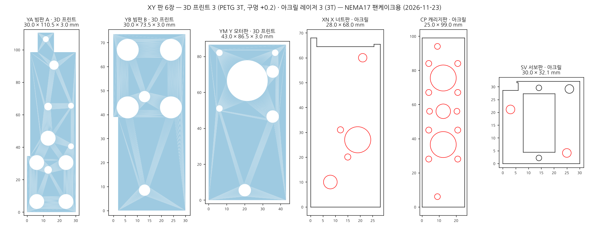

# XY 판 6장 — 최종 (3D 프린트 5 + 아크릴 1) — 승준, 2026-11-23 21시 (11/24 재료 PLA로), CAP-AI-SJ-63

> **11/24 학교 프린터에 PETG 없음 → PLA** (YM만 ABS·ASA, 없으면 PLA 2장). 프린터 담당자용 1쪽 안내 **`출력안내_2026-11-24.pdf`** + PC `XY판_프린트_아크릴_2026-11-23\XY_plates_5parts_print_1124.zip` (STL 5 · README.txt · 안내 PDF · preview.png, 영어 이름 `1_YA_…` ~ `5_SV_…`, 파일 이름에서 PETG 뺌 — 내용은 아래 STL과 같음). 파일 이름의 'PETG'는 11/23 때 이름일 뿐.

**왜**: meviy 담당자 견적 6장 (YA·YB·XN·YM·CP·SV)은 출하 12/02라 시연(12/2)에 못 맞춤 → **11/23 주문 취소**, 플라스틱으로 만듦 (재료 변경 — 서현 확인 필요).
**NEMA17 팬케이크 + T8 너트용 구멍을 처음부터 넣음** → 이 6장은 손으로 뚫을 것 없음. 손 가공은 금속 **217 한 장만** (`design/2026-11-23_XY모터_NEMA17/` 1:1 도안).
두께 3 mm 그대로 → 봉·기둥·나사 길이 안 바뀜. 만든 스크립트: `cad/xy_plates_plastic_1123.py` (meviy STEP에서). 조립 검사: `cad/check_xy_plastic_nema17.py` → `cad/_xy_plastic_nema17_check.json` (정지·움직임 새 겹침 0, 캐리지 Y는 펌웨어 한계 +18까지 0 [확실 — CAD]).

## 1. 3D 프린트 — 학교 (모멘트 M200), PLA (YM은 ABS·ASA 또는 PLA × 2)
| 파일 | 크기 (mm) | 비고 |
|---|---|---|
| `YA_빔판A_PETG_3T.stl` | 30 × 110.5 × 3 | M4 접시 6 (SC8UU 4 · Y 봉 끝 2) |
| `YB_빔판B_PETG_3T_혀깎음.stl` | **28** × 73.5 × 3 | M4 접시 6. **−x 혀 (2 × 34.5) 깎음** — 캐리지 y +17.0에서 SP가 닿던 곳. 접시 2개가 판 끝에서 조금 열림 (정상) |
| `YM_Y모터판_PETG_3T_NEMA17.stl` | 43 × 86.5 × 3 | 모터 구멍 Ø3.4 × 3 (31 간격), 기둥 M3 접시 3, 돌기 Ø22.5 |
| `XN_X너트판_PETG_3T_NEMA17.stl` | 28 × 68 × 3 | 가운데 Ø10.5 (T8 너트 몸 통과). **Ø2.5 × 2 = M3 탭 밑구멍 (보정 안 함)** → M3 × 6을 바로 돌려 넣거나 M3 탭 |
| `SV_서보판_PETG_3T.stl` | 32.1 × 30 × 3 | 원래 모양. 서보 귀 Ø2.2 + M2 나사·너트 |

- 다섯 개 한 판에 들어감 (가장 긴 것 110.5). 이미 눕혀 놓음 (높이 3 mm), 받침 없이.
  - (11/24 확인) YA·YB는 Y 봉 끝 M4 접시 2개가 **바닥 쪽으로 열림** (반대 면에 SC8UU 접시 4개가 있어 뒤집어도 같음). 벽이 45°라 서포트 없이 나옴 [가능성 높음] — 슬라이서 자동 서포트가 그 안에 받침을 넣지 않게 **서포트 끄기**. 거칠면 접시 드릴로 한 번 다듬기. YM·XN·SV는 아래로 뜬 면 0
- **재료 (11/24)**: 학교에 PETG 없음 → **YA · YB · XN · SV = PLA** (PETG보다 단단함, 힘은 작음 [가능성 높음]). **YM은 모터가 40~60 °C** — PLA는 약 55 °C에서 물러짐 [가능성 높음] → **ABS · ASA 있으면 YM만 그걸로, 없으면 PLA로 2장** (1장 예비) + 서현에게 DRV8825 전류 낮추기 · 멈출 때 드라이버 끄기 (EN), 시연 전 모터 손으로 5초 (약 50 °C 밑). **채움 100 %** (또는 벽 5겹 이상), 층 0.2 mm. PLA 약 37 g (YM 2장이면 49 g).
- 관통 구멍은 0.2 mm 크게 넣음 (FDM은 작게 나옴). 빡빡하면 같은 지름 드릴로 한 번 훑기 (Ø3.4 · Ø4.5 · Ø5.5). 탭 밑구멍 Ø2.5는 훑지 말 것.
- XN·SV를 아크릴에서 프린트로 바꾼 이유 [확실 — CAD 벽 두께]: XN 탭 구멍 ↔ 가운데 구멍 벽 1.5 mm, SV 귀 구멍 ↔ 판 끝 1.04 mm — 아크릴은 여기서 금 갈 수 있음, 프린트 (PETG · PLA)는 안 깨짐.

## 2. 아크릴 레이저 3T — 아크릴몰 자유재단 (https://www.acrylmall.com/goods/goods_view.php?goodsNo=25555)
| 파일 | 크기 (mm) | 비고 |
|---|---|---|
| **`CP_캐리지판_묶음_62x105_아크릴3T_x2.dxf`** | 62 × 105 (CP 2장, 1장 예비) | **이걸 주문** — 아크릴몰은 50 × 50 밑 재단 안 됨 (300f2 묶음과 같은 방식) |
| `CP_캐리지판_아크릴3T_NEMA17.dxf` | 25 × 99 | 한 장 모양 (다른 레이저 업체용) |

- 상품 페이지에서 **두께 3 mm** · 색 (지난번처럼 백색 등) → 옵션 '도면전달' → 메일 (페이지 안내 주소)로 DXF.
- CP: 새 Ø3.4 × 2 (가로, T8 너트) + 뒤 M3 너트, 옛 POM 구멍 없음. 세게 조이면 깨짐 → **와셔**, 손으로 적당히, 나사 고정제 쓰지 않기.

## 3. 예비 (안 써도 됨)
`예비_아크릴/XN_X너트판_아크릴3T_NEMA17.dxf`, `예비_아크릴/SV_서보판_아크릴3T.dxf` — 프린트가 안 될 때만. 50 × 50 밑이라 아크릴몰에는 묶어서.

## 영어 이름 (프린터 PC · 업체용 — 한글 이름이 깨질 때)
내용은 같고 이름만 영어. 레포에는 안 올리고 PC `XY판_프린트_아크릴_2026-11-23\english_names\` · `XY_plates_1123.zip` (11/23 22시).
| 영어 이름 | 레포 파일 |
|---|---|
| `YA_beam_plate_A_PETG_3T.stl` | `YA_빔판A_PETG_3T.stl` |
| `YB_beam_plate_B_PETG_3T_trimmed.stl` | `YB_빔판B_PETG_3T_혀깎음.stl` |
| `YM_Y_motor_plate_PETG_3T_NEMA17.stl` | `YM_Y모터판_PETG_3T_NEMA17.stl` |
| `XN_X_nut_plate_PETG_3T_NEMA17.stl` | `XN_X너트판_PETG_3T_NEMA17.stl` |
| `SV_servo_plate_PETG_3T.stl` | `SV_서보판_PETG_3T.stl` |
| `CP_carriage_plate_x2_62x105_acrylic_3T.dxf` | `CP_캐리지판_묶음_62x105_아크릴3T_x2.dxf` (아크릴몰 주문용) |
| `CP_carriage_plate_acrylic_3T_single.dxf` | `CP_캐리지판_아크릴3T_NEMA17.dxf` |

## 4. 조립 때 같이 할 것
- **YB 옆 M4 접시머리 2개 (SC8UU 쪽 위)는 머리 지름 8.4 mm 이하** (키트 SMG NT-KIT-LS008 십자 접시 — 받으면 재 보기). CAD 모델은 Ø8.0으로 검사 → y +18까지 0. 머리가 더 크면 SP에 닿음.
- T8 너트 플랜지 줄질 2곳: X 너트 위 1.5 mm 평평하게 (Y 원점 기판), Y 너트 가장자리 4곳 0.5 mm (LMK8UU 나사 머리). `design/2026-11-23_XY모터_NEMA17/img/플라스틱6장_조립검사_한눈에.png`
- 플라스틱은 시간이 지나면 조금 눌림 → 시연 전 한 번 다시 조이기.

## 미검증
T8 너트 구멍 간격 PCD 16 [추측] (XN 탭 · CP 구멍 자리), 모터 토크 0.15 N·m [추측] (강도 계산), 프린터 실제 출력 크기 (M200 사양 못 찾음).
