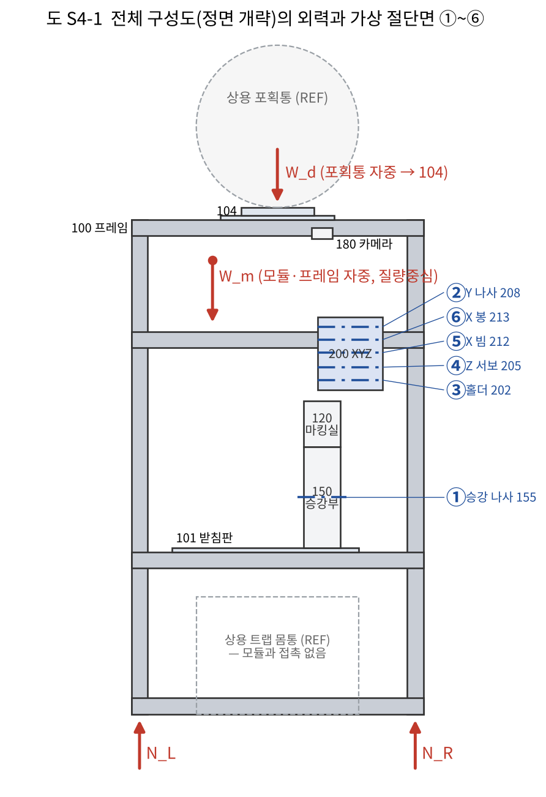
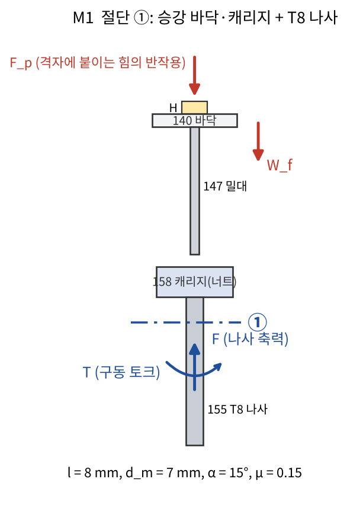
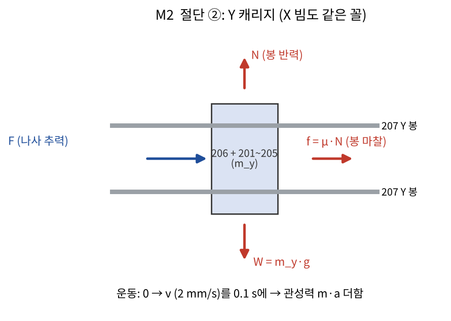
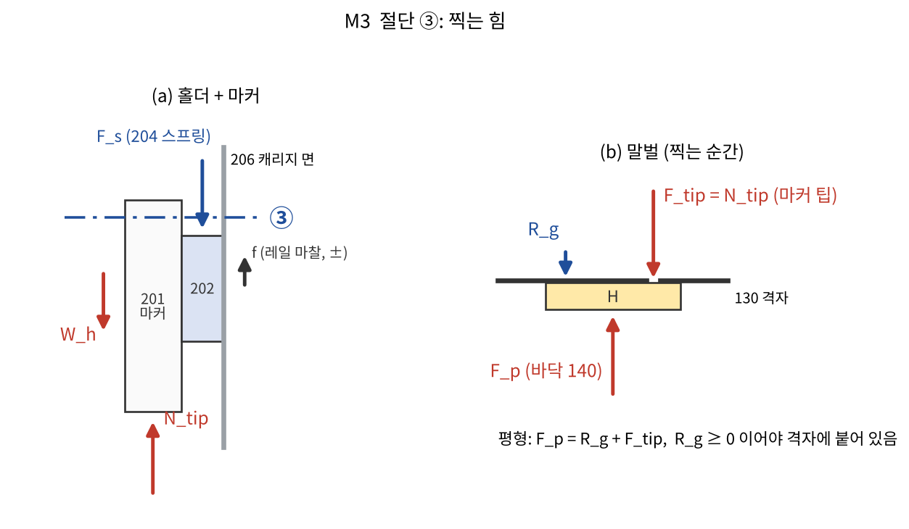
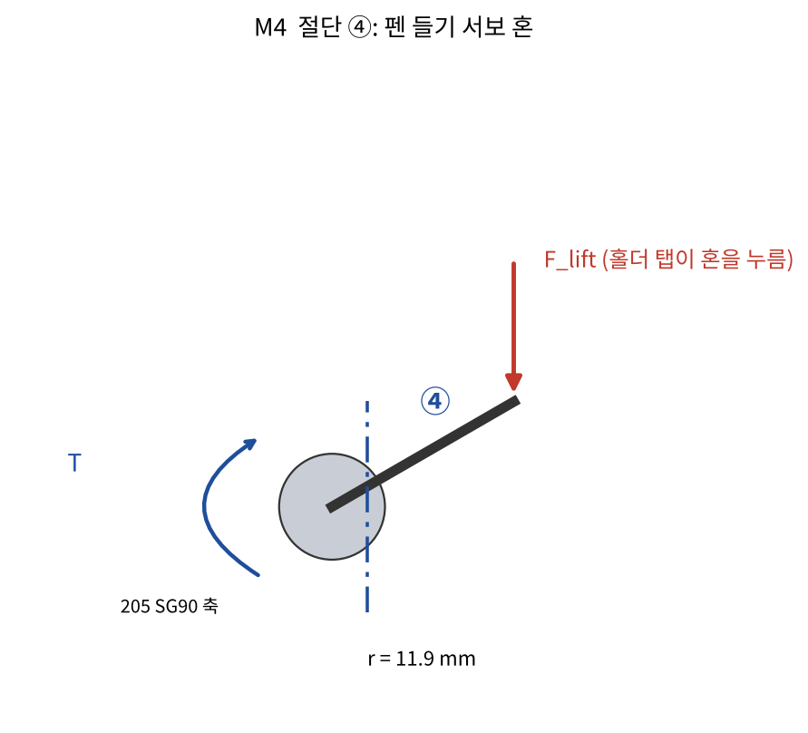
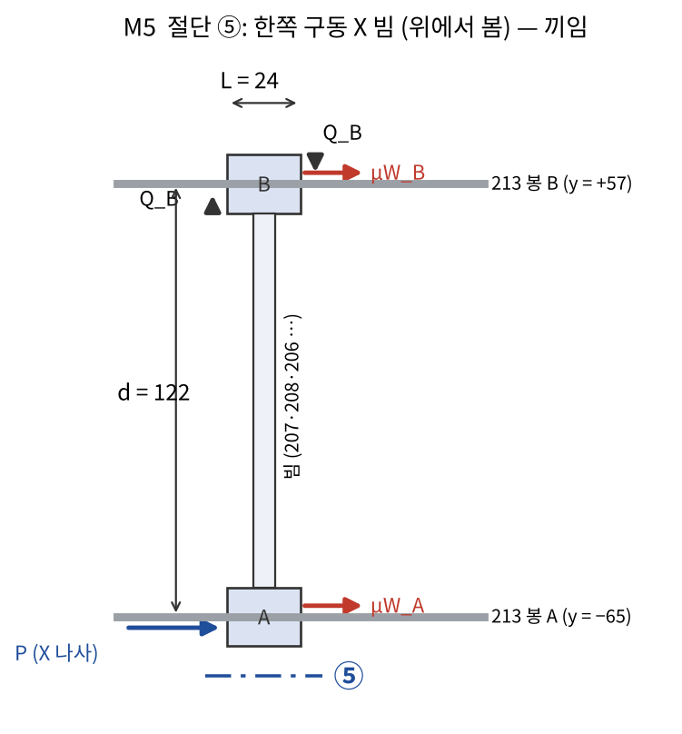
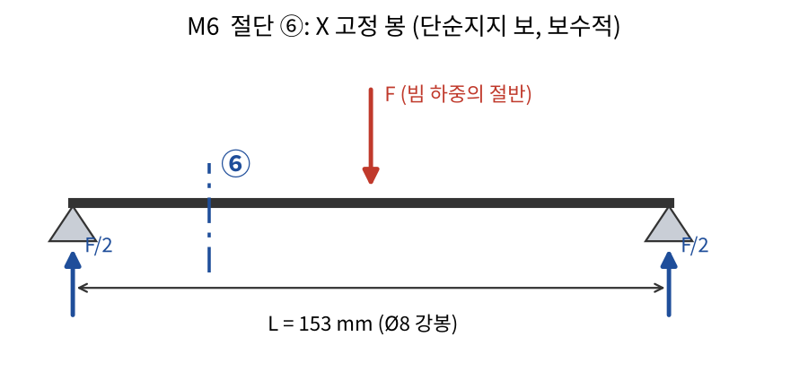

# S4 역학계산 1차 — 말벌 자동 마킹 트랩 (시스템설계및제어 S4 양식)

정리일: 2026-10-28 · 작성: 이서현 (Claude와 정리, CAP-AI-18) · 설계대상: 말벌 자동 마킹 모듈 (D5 4차 + 보완) · 회차 S4 / r1
양식: 「워크시트_역학계산(학생작성용)」 4-1 → 4-2 → 4-3(①~⑤) + 검증 대장
계산: `design/calc/s4_calc.py` → `design/calc/s4_results.json` (AI값) · 그림: `design/calc/s4_figs.py` → `design/img/S4_*.png`

> **수기 풀이에 대해 [확실]:** 양식은 "④ 수기 풀이를 AI 계산보다 먼저" 하도록 되어 있다. 이번에는 D6 설계 결정(모터·부싱)이 급해서 **AI값을 먼저 계산해 설계에 반영했다.** 그래서 아래 ④는 서현이 채울 칸으로 비워 두고(풀이 순서만 적음), ⑤의 판정은 모두 **"잠정 — 수기 대조 후 확정"** 이다.

---

## 4-1. 전체 구성도의 외력 표기와 가상 절단면

| 구분 (외력/내력) | 기호 | 하중 | 크기와 근거 (미지이면 '미지') | 작용점 (도면부호) |
|---|---|---|---|---|
| 외력 (전체도) | W_m | 모듈·프레임 자중 | 약 58 N [추측] = 9.81 × 약 5.9 kg (2020 프로파일 약 9.4 m × 0.5 kg/m + 아크릴판 0.37 kg + 모듈 부품 약 0.8 kg) | 질량중심 |
| 외력 (전체도) | W_d | 상용 포획통(격리함) 자중 | 약 1.5 N [추측] (빈 통 약 150 g, 미측정) | 결합부 104 |
| 외력 (전체도) | N_L, N_R | 바닥 반력 | 미지 (전체 평형: N_L + N_R = W_m + W_d) | 프레임 100 다리 |
| 내력 (절단 ①) | F, T | 승강 나사 축력·구동 토크 | 미지 (M1) | 155 T8 나사, 158 캐리지 너트 |
| 내력 (절단 ②) | F, T | Y 나사 추력·토크 (X도 같은 꼴) | 미지 (M2) | 208 / 214 |
| 내력 (절단 ③) | N_tip, F_s | 마커 팁 접촉력, 스프링 힘 | 미지 (M3) | 201·202·204 |
| 내력 (절단 ④) | T, F_lift | 펜 들기 서보 토크, 혼 힘 | 미지 (M4) | 205 |
| 내력 (절단 ⑤) | P, Q | X 나사 추력, 부싱 측압 | 미지 (M5) | 212, 222 |
| 내력 (절단 ⑥) | V, M | X 봉 전단력·굽힘 모멘트 | 미지 (M6) | 213 |

- 상용 트랩 몸통(REF)은 모듈과 닿지 않는다 (D5 검사) → 외력에 없음. 환경 하중(바람)은 다루지 않는다 (서현 10/28).

## 4-2. 가상 절단과 역학 분야

| 절단 | 떼어 낸 물체 (도면부호) | 절단면 | 절단면에 드러나는 내력 → 외력 | 역학 분야 | 계산번호 |
|---|---|---|---|---|---|
| ① | 승강 바닥·밀대·캐리지 (140·147·158) + 말벌 접촉 | 너트 바로 아래 T8 나사 (155) | 축력 F, 비틀림 T | 기계요소설계 (나사 구동 토크·자립) | M1 |
| ② | Y 캐리지 묶음 (206 + 201~205·221) / X 빔 묶음 | Y 나사 208 (X: 214) | 추력 F, 비틀림 T | 기계요소설계 + 동역학 (이송 시간·가속력) | M2 |
| ③ | 홀더 + 마커 (201·202·203) / 말벌 H | 스프링 204 위 끝, 팁–말벌 접촉면 | 스프링 힘 F_s, 접촉력 N_tip | 정역학 (평형, 마찰 부정정) | M3 |
| ④ | 서보 혼 (205) | 서보 축 | 토크 T, 혼 끝 힘 F_lift | 정역학 (모멘트) | M4 |
| ⑤ | X 빔 전체 (212·207·208·206…) | 두 X 봉의 부싱 접촉면, X 나사 | 추력 P, 측압 Q, 마찰 μN | 정역학 (마찰·끼임) / 기계요소 (안내 요소 선정) | M5 |
| ⑥ | X 고정 봉 (213) | 봉 가운데 단면 | 전단력 V, 굽힘 모멘트 M | 재료역학 (보 처짐·응력) | M6 |

설계 질문과 분야: 정역학(M3·M4·M5) · 재료역학(M6) · 동역학(M2) · 기계요소설계(M1·M2·M5) — 네 분야 모두 포함.

---

## 4-3. 역학 문제 전개

### M1 승강 나사 구동 토크와 자립 — 기계요소설계
| 절단 / 떼어 낸 물체 | ① / 140·147·158 + 155 |
|---|---|
| 역학 분야 | 기계요소설계 |
| 검증 대상 문장·기준값 | D2 F3-1 "바닥이 말벌 등을 격자에 붙임", 인터페이스 정의서 구동기 1 (28BYJ-48 견인 토크 > 34.3 mN·m) |

① 자유물체도: 

② 문제설정
- **주어진 조건**: 승강 바닥·밀대·캐리지·하중 센서·스프링의 무게 W_f = 0.41 N (모델 부피 × 밀도: PLA 1.24, 강 7.85, 알루미늄 2.7 g/cm³ — PLA는 꽉 찬 값이라 상한). 바닥이 말벌을 격자에 붙이는 힘 상한 F_p = 0.5 N (가정, R7 미정). 나사 Tr8×8: 바깥지름 8, 피치 2, 4줄, 리드 l = 8, 유효지름 d_m = 7 mm, 나사산 반각 α = 15°, 마찰계수 μ = 0.15 (황동 너트–스테인리스, 건조). 모터 28BYJ-48 견인 토크 > 34.3 mN·m (사양서).
- **구하는 값**: 너트 아래 단면의 축력 F와 올림 토크 T, 효율 η, 자립 여부, 모터 기준 안전율, 행정 36.5 mm 시간.
- **가정**: 칼라 마찰 없음, 가이드봉 마찰 무시, 정속(가속력 무시 — 0.04 kg × 0.02 m/s² ≈ 0.001 N).

③ 교과서 유제 연계
| 항목 | 내용 |
|---|---|
| 교재명 | Wright, D., *Design and Analysis of Machine Elements* (DANotes), UWA (2005, 웹 강의자료) — Shigley 식 사용 |
| 유제 | Threaded fasteners – Problem 1 (동력나사) |
| 유형 | 사다리꼴(Acme) 나사의 올림·내림 토크, 효율, 자립 |
| 유사점 | 축하중을 들어 올리는 나사, 나사산 각 포함, 자립 판정 |
| 변형 | 하중 100 kN → 0.91 N, Acme 30 mm·1줄 피치 6 → Tr8×8 4줄(리드 8), 칼라 마찰 없음. 목적이 "큰 힘"에서 "작은 모터로 되는지·자립하는지"로 바뀜 |
| 교재 정답 / 본인 풀이 / 대조 | 정답 T_R 501 N·m / **서현 수기 508.0 N·m (10-21, scan_05)** / 1.4 % — 원문은 나사산 각 sec α를 무시 (S4 태양광 추적기 회차에서 이미 풂) |

④ 수기 풀이 — **서현 칸 (대기)**. 풀이 순서: F = W_f + F_p → T = (F d_m / 2)(l + π μ d_m sec α)/(π d_m − μ l sec α) → η = F l / (2π T) → 자립: π μ d_m sec α 와 l 비교 → 내림 토크 T_L = (F d_m / 2)(π μ d_m sec α − l)/(π d_m + μ l sec α) → 속도 v = l × rpm / 60.

⑤ AI 대조와 판정
| 항목 | 내용 |
|---|---|
| AI값 (CAP-AI-18) | F = 0.910 N, **T = 1.75 N·mm**, η = 0.661, π μ d_m sec α = 3.42 mm < l = 8 → **자립 안 함**, T_L = −0.63 N·mm (저절로 내려가려 함), 안전율 34.3 / 1.75 = **19.6**, v = 1.33~2.0 mm/s → 36.5 mm에 27~18 s |
| 수기값 / 상대 차이 | 대기 |
| 최종 채택값 | 잠정 T = 1.75 N·mm (수기 대조 후 확정) |
| 문장 기준 만족 | 만족 — 28BYJ-48로 충분 (토크 여유 큼) |
| 환류 | 자립하지 않지만 28BYJ-48 감속기(1/64)가 역구동을 막는다 [가능성 높음] → 전원이 꺼져도 바닥이 내려가지 않는지 J6에서 확인. 리드 2(1줄) 나사로 바꾸면 자립하지만 속도가 1/4 → 시간(M2)에 불리해서 안 바꿈 |

### M2 X·Y 이송 토크와 한 마리 처리 시간 — 기계요소설계 + 동역학
| 절단 / 떼어 낸 물체 | ② / Y 캐리지 묶음 (206 + 201~205 + 221), X 빔 묶음 |
|---|---|
| 역학 분야 | 기계요소설계 (나사 토크), 동역학 (가속력, 운동 시간) |
| 검증 대상 문장·기준값 | D1 **R6 한 마리 3분 이내** (급이 포함) |

① 자유물체도: 

② 문제설정
- **주어진 조건**: 이동 질량 m_y = 118 g (Y 캐리지 묶음), m_x = 387 g (X 빔 묶음) — 모델 부피 × 밀도 + 사양 질량(마커 13 g, SG90 9 g, 28BYJ-48 37 g, LM8UU 15 g, LM6UU 8 g). 안내: 볼 부싱 μ = 0.005 (비교로 PLA 부싱 0.3). 나사는 M1과 같음. 0.1 s에 2 mm/s까지 가속. 대기 → 흉부 최대 이동 Δx = 28, Δy = 58 mm (X·Y 동시). 모터 10~15 rpm.
- **구하는 값**: 추력 F와 토크 T, 안전율, 한 마리 처리 시간과 R6를 만족하는 급이 시간 상한.
- **가정**: 시간 단계는 D6 5장 표 (판별 2 s, 방생 10 s는 가정), 마커 복귀·급이 높이 이동은 급이와 병렬.

③ 교과서 유제 연계
| 항목 | 내용 |
|---|---|
| 토크 | M1과 같은 UWA Problem 1 (서현 수기 완료) |
| 가속·시간 | Meriam·Kraige, *Engineering Mechanics: Dynamics* 9판 SI, 3장 질점의 운동방정식 F = ma (마찰 있는 직선 운동) — **유제 번호는 교재 확인 후 기입 (미정)** |
| 변형 | 마찰력 μmg + 관성력 ma를 나사 추력으로 보고 M1 식에 넣음. 시간은 거리/속도 합 (등속 근사) |

④ 수기 풀이 — **서현 칸 (대기)**. 순서: W = m g → F = μ W + m a → T (M1 식) → 안전율 → 단계별 시간 합 → 급이 상한 = 180 − (기구·판별 합).

⑤ AI 대조와 판정
| 항목 | 내용 |
|---|---|
| AI값 (CAP-AI-18) | 볼 부싱: Y F = 0.008 N, T = 0.016 N·mm (안전율 2,186) / X F = 0.027 N, T = 0.051 N·mm (667). 참고 PLA 부싱: X T = 2.2 N·mm (16). **시간: 기구·판별 합 63.9 s (15 rpm) / 87.5 s (10 rpm) → 급이 상한 116 s / 92 s, 재시도 1회면 105 s / 77 s** |
| 수기값 / 상대 차이 | 대기 |
| 최종 채택값 | 잠정 — 28BYJ-48 + T8 유지, 급이 상한 약 105 s (15 rpm, 재시도 1회) |
| 문장 기준 만족 | **조건부** — 잉크 건조(= 급이) ≤ 약 105 s일 때만 R6 만족. 샤피 표기 "종이 위 1~3분" → 시험 전에는 판정 불가 |
| 환류 | ② 원인 구분: 요구사항 쪽(건조 시간이 R6를 지배). 건조 > 115 s이면 (가) XY 벨트 (+23 s 여유) (나) R6를 4~5분으로 고침 (다) 빠른 건조 방법 — D6 5장. 재시도 바닥 내림을 전 행정 36.5 → 10 mm로 줄임 (재시도 1회 +11 s) |

### M3 찍는 힘 — 정역학
| 절단 / 떼어 낸 물체 | ③ / (a) 홀더 + 조임 띠 + 마커 (201·202·203), (b) 말벌 H |
|---|---|
| 역학 분야 | 정역학 (평형, 마찰은 부정정 → 범위로 다룸) |
| 검증 대상 문장·기준값 | D1 R3 마킹 성공(잉크가 묻음: F_tip ≥ F_ink), R7 말벌 손상 없음(F ≤ F_harm), 말벌이 격자에 붙어 있음(R_g ≥ 0) |

① 자유물체도: 

② 문제설정
- **주어진 조건**: 홀더 + 조임 띠 + 마커 무게 W_h = 0.32 N (모델 + 마커 13 g). 스프링 204 힘 F_s (구하는 값의 범위). 레일(캐리지 면) 마찰 f (정지 마찰, 방향 미정). 바닥이 말벌을 미는 힘 F_p = 0.5 N (M1과 같은 가정).
- **구하는 값**: 팁 접촉력 N_tip(= F_tip), 말벌이 격자에서 밀려나지 않는 F_s 상한, 바닥 하중 센서가 F_tip을 재는지.
- **가정**: 서보 혼은 탭에서 떨어져 있음(놓은 상태), 말벌은 강체, 팁은 격자 눈을 닿지 않고 통과.

③ 교과서 유제 연계
| 항목 | 내용 |
|---|---|
| 교재명 | Riley·Sturges, *Engineering Mechanics: Statics* 2판 (Wiley) — 6장 강체 평형 |
| 유제 | **번호 미정** (후보: 6장 2차원 평형 + 접촉면이 둘인 물체) — 교재 확인 후 기입 |
| 변형 | 두 물체(홀더, 말벌)를 나눠 각각 평형. 말벌 쪽은 격자 반력 R_g ≥ 0 이라는 부등식 조건을 더함 |

④ 수기 풀이 — **서현 칸 (대기)**. 순서: (a) ΣF_z: N_tip = W_h + F_s ∓ f → (b) ΣF_z: F_p = R_g + F_tip → R_g ≥ 0 ⇒ F_tip ≤ F_p ⇒ F_s ≤ F_p − W_h (f = 0일 때) → 바닥 힘 F_p는 바닥 위치(스프링 146 압축)로 정해지고 F_tip과 무관함을 보임.

⑤ AI 대조와 판정
| 항목 | 내용 |
|---|---|
| AI값 (CAP-AI-18) | W_h = 0.32 N → 스프링 없이도 F_tip ≈ 0.32 N. 말벌이 격자에 붙어 있으려면 **F_s ≤ 0.18 N**. **바닥 하중 센서는 F_tip을 못 잰다** — F_tip만큼 격자 반력 R_g가 줄 뿐 F_p는 그대로 (F_tip > F_p가 되어 말벌이 밀려 내려갈 때만 바뀜) |
| 수기값 / 상대 차이 | 대기 |
| 최종 채택값 | 잠정 — 스프링 204는 "없음 또는 약한 스프링(≤ 0.18 N)", F_ink 시험 후 결정 |
| 문장 기준 만족 | R_g ≥ 0: 만족 (0.32 < 0.5). R3·R7: **판정 불가** (F_ink·F_harm 미측정) |
| 환류 | ① D5 9-3·10장의 "바닥 하중 센서로 찍는 힘도 잼"은 틀림 → 정정 (D5 11장). ② F_p 상한이 0.32 N보다 작아야 한다면(말벌이 약하면) 홀더 자중 때문에 말벌이 밀려남 → 홀더를 위로 받치는 **역스프링(무게 상쇄)** 이 필요해짐 → F_harm 시험이 설계를 가름 |

### M4 펜 들기 서보 토크 — 정역학
| 절단 / 떼어 낸 물체 | ④ / 서보 혼 (205) |
|---|---|
| 역학 분야 | 정역학 (모멘트 평형) |
| 검증 대상 | 인터페이스 정의서 구동기 4 (SG90 정지 토크 1.8 kgf·cm = 176.6 N·mm) |

① 자유물체도: 

② 문제설정
- **주어진 조건**: 혼 길이 r = 11.9 mm, 들어 올릴 힘 F_lift = W_h + F_s + f = 0.32 + 0 + 0.3 × 0.2 = 0.38 N (레일 측압 0.2 N 가정, F_s = 0으로 두고 스프링을 쓰면 더함).
- **구하는 값**: 필요 토크 T, SG90 기준 안전율, 스프링을 최대(0.18 N)로 넣을 때.
- **가정**: 혼이 수평일 때가 최대 모멘트 팔, 가속 무시.

③ 교과서 유제 연계: Riley 2판 4장 힘의 모멘트 / 6장 평형 — **번호 미정 (교재 확인 후)**. 변형: 혼 끝 접촉력의 축에 대한 모멘트.

④ 수기 풀이 — **서현 칸 (대기)**. 순서: ΣM_O: T = F_lift · r → 안전율 = 176.6 / T.

⑤ AI 대조와 판정
| 항목 | 내용 |
|---|---|
| AI값 (CAP-AI-18) | T = 4.54 N·mm, **안전율 38.9** (스프링 0.18 N 넣으면 T = 6.7 N·mm, 26) |
| 최종 채택값 / 기준 | 잠정 / 만족 — SG90으로 충분 |
| 환류 | 없음 |

### M5 한쪽 구동 X 빔의 끼임 — 정역학(마찰) / 기계요소 (안내 요소 선정)
| 절단 / 떼어 낸 물체 | ⑤ / X 빔 전체 (212 끝 블록 2개 + 207·208·206…) |
|---|---|
| 역학 분야 | 정역학 (마찰, 서랍 끼임 모델) → 기계요소설계 (부싱 선정) |
| 검증 대상 | 흉부 좌표로 정확히 가는가 (e_xy ±1 mm), 모터가 멈추지 않는가 |

① 자유물체도 (위에서 봄): 

② 문제설정
- **주어진 조건**: X 나사 추력 P는 −y 쪽 끝 블록 A에만 작용(y = −65). 먼 쪽 봉 B(y = +57)까지 d = 122 mm. 끝 블록이 봉을 감싸는 길이 L = 24 mm. 각 블록의 무게 몫 W_A, W_B. 마찰계수: 3D 프린트 PLA 부싱 0.3, 소결 청동 0.15, 직선 볼 부싱(LM8UU) 0.005 [가능성 높음, 일반값].
- **구하는 값**: 빔이 끼이는(아무리 밀어도 안 움직이는) 조건과, 지금 치수에서 각 부싱의 판정. 같은 방법으로 높이 차(나사 z 425, 봉 z 480, 55 mm)에 의한 끼임.
- **가정**: 먼 쪽 블록 B의 마찰 μW_B가 A 기준 요(yaw) 모멘트를 만들고, 이 모멘트를 B 부싱 양끝의 측압 쌍 Q_B가 받음 (A 쪽 짝힘은 보수적으로 0).

③ 교과서 유제 연계: Riley 2판 9장 마찰 — "서랍(미닫이) 끼임" 유형 — **번호 미정 (교재 확인 후)**. 변형: 손잡이 대신 나사 추력, 서랍 길이 대신 부싱 길이 L, 손잡이 치우침 대신 봉 간격 d.

④ 수기 풀이 — **서현 칸 (대기)**. 순서: ΣM_A: (μW_B + 2μQ_B)·d = Q_B·L → Q_B(L − 2μd) = μW_B·d → **L − 2μd ≤ 0 이면 Q_B가 무한대 = 끼임** → 끼임 조건 2μd/L ≥ 1, 한계 μ_c = L/(2d).

⑤ AI 대조와 판정
| 경우 | μ | 요(yaw) 2μd/L | 높이 차(pitch) 2μ·55/L | 판정 |
|---|---|---|---|---|
| PLA 부싱 | 0.30 | **3.05** | **1.38** | 끼임 |
| 소결 청동 | 0.15 | **1.53** | 0.69 | 끼임 (요) |
| LM8UU 볼 부싱 | 0.005 | 0.05 | 0.02 | 안전 (한계 μ_c = 0.098 / 0.218의 약 1/20) |

| 항목 | 내용 |
|---|---|
| 최종 채택값 | 잠정 — **X: LM8UU ×2, Y: LM6UU ×2** (Y는 나사가 두 봉 가운데라 이 끼임은 없지만, 같은 이유로 볼 부싱 통일) |
| 문장 기준 만족 | 볼 부싱이면 만족 |
| 환류 | ② 원인 구분: 설계안 쪽. 모델을 고침 (끝 블록 두께 12 → 18, x 20 → 24, X 봉 y −64/+54 → −65/+57) → 검사 통과 (D5 11장). 승준 구매 목록 C3에 LM8UU 2·LM6UU 2 추가 요청 |

### M6 X 고정 봉 처짐 — 재료역학
| 절단 / 떼어 낸 물체 | ⑥ / X 고정 봉 213 (Ø8 강봉) |
|---|---|
| 역학 분야 | 재료역학 (보의 처짐·굽힘응력) |
| 검증 대상 | e_xy ±1 mm, 팁 높이 (격자 통과) |

① 자유물체도: 

② 문제설정
- **주어진 조건**: X 빔 묶음 무게 3.79 N을 봉 2개가 나눠 받음 → F = 1.90 N, 봉 길이 L = 153 mm, Ø8 강봉 E = 200 GPa. (Y 봉 Ø6: F = 0.58 N, L = 104 mm)
- **구하는 값**: 최대 처짐 δ, 최대 굽힘응력 σ.
- **가정**: 양끝 단순지지·가운데 집중하중 (실제는 받침에 고정이라 더 작음 → 보수적).

③ 교과서 유제 연계: Gere·Goodno, *Mechanics of Materials* SI판 (Cengage, 2018) — 처짐 공식표(단순지지 가운데 집중하중 δ = PL³/48EI) **예제 번호 미정**, 굽힘응력은 서현이 푼 장말 5.5-19·5.5-29 (σ = M/S)와 같은 꼴.

④ 수기 풀이 — **서현 칸 (대기)**. 순서: I = πd⁴/64 → δ = FL³/(48EI) → M = FL/4 → σ = M/(πd³/32).

⑤ AI 대조와 판정
| 항목 | 내용 |
|---|---|
| AI값 (CAP-AI-18) | X 봉: I = 201.1 mm⁴, **δ = 0.0035 mm**, M = 72.5 N·mm, σ = 1.44 MPa / Y 봉: δ = 0.0011 mm, σ = 0.71 MPa |
| 최종 채택값 / 기준 | 잠정 / 만족 — 처짐이 정확도 ±1 mm의 1/280 이하 → **봉 지름을 줄일 여지는 있으나 LM 부싱 규격(Ø8·Ø6)에 맞춰 유지** |
| 환류 | 없음 (과잉 만족 — 상세설계에서 재검토 대상 아님: 규격 부품) |

---

## 검증 대장

| 번호 | 계산 항목 (도면부호·문장) | 수기값 | AI값 (CAP-AI-18) | 차이 | 판정·원인·주체 | 채택값 | 기준 만족 |
|---|---|---|---|---|---|---|---|
| M1 | 승강 나사 토크·자립 (155, F3-1) | 대기 | T 1.75 N·mm, 안전율 19.6, 자립 안 함 | — | 잠정 | 1.75 N·mm | 만족 |
| M2 | X·Y 토크, 처리 시간 (208·214, R6) | 대기 | 안전율 ≥ 667, 기구 63.9 s, 급이 상한 105~116 s | — | 잠정 | 급이 ≤ 105 s | **조건부** (건조 시험) |
| M3 | 찍는 힘 (201~204, R3·R7) | 대기 | W_h 0.32 N, F_s ≤ 0.18 N, 하중 센서로 못 잼 | — | 잠정 | 스프링 0~0.18 N | 판정 불가 (F_ink·F_harm) |
| M4 | 펜 들기 서보 (205) | 대기 | T 4.54 N·mm, 안전율 38.9 | — | 잠정 | SG90 | 만족 |
| M5 | X 빔 끼임 (212·222) | 대기 | PLA 3.05 끼임 / LM8UU 0.05 | — | 잠정 → 설계 변경 | LM8UU·LM6UU | 만족 (변경 후) |
| M6 | X·Y 봉 처짐 (213·207) | 대기 | δ 0.0035 / 0.0011 mm | — | 잠정 | Ø8·Ø6 유지 | 만족 |

## 환류 정리 (S4 → 설계)
1. **안내 요소: 볼 부싱으로 변경** (M5) — 모델 반영·검사 통과
2. **찍는 힘은 수동값, 하중 센서로 못 잼** (M3) — D5 정정, 스프링은 시험 뒤
3. **R6는 건조 시간이 지배** (M2) — 샤피 노랑 건조 시험이 1순위, 재시도 바닥 내림 10 mm
4. **모터는 28BYJ-48 유지** (M1·M2·M4) — 토크 여유 19.6 이상, 속도만 J6로 확인

## 남은 일
- 서현: ④ 수기 풀이 6개 (M1은 UWA Problem 1을 이미 풀어서 변형만), ③ 유제 번호 확정(Riley 6·9장, Meriam 3장, Gere 처짐 — 교재 PDF 위치 필요)
- 시험: 건조 시간·F_ink, 28BYJ-48 rpm(J6), 표본 압축(F_harm)
- 데이터 시트(xlsx) 예제변형·검증대장 시트 입력은 수기 대조 뒤
