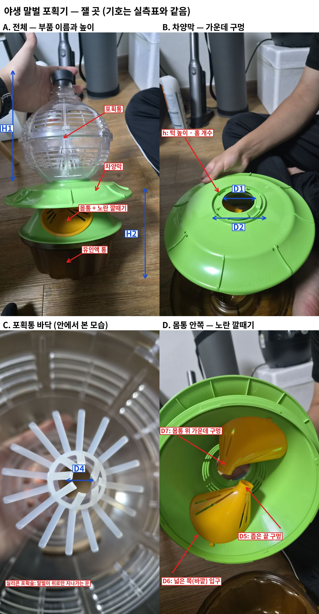

# 상용 트랩(야생 말벌 포획기) 실측표

정리일: 2026-10-28 · 작성: 이서현 (Claude와 정리, CAP-AI-12) · 상태: **값 입력 대기 — 서현이 재서 알려 줌**
잴 곳 그림: 

## 부품 이름 (그림 A)
| 이름 | 무엇 |
|---|---|
| 포획통 | 맨 위 투명한 공 모양 통. 위에 검은 실리콘 뚜껑, 옆에 꿀벌 탈출 슬롯 |
| 차양막 | 포획통 아래 넓은 초록 지붕. 가운데 구멍으로 말벌이 위로 올라감 |
| 몸통 | 차양막 아래 초록 몸체. 옆면에 노란 깔때기(말벌 포획구) 2개 |
| 노란 깔때기 | 말벌이 바깥에서 몸통 안으로 들어오는 한 방향 입구. **넓은 쪽은 바깥 벽, 좁은 끝이 몸통 안쪽** |
| 유인액 통 | 맨 아래 갈색 통 (위에 초록 고체 유인제 망) |

## 잴 값 — 우리 모듈은 차양막과 포획통 사이에 끼움

| 기호 | 어디 (그림) | 무엇을 | 어디에 쓰나 (도면부호) | 값 (mm) |
|---|---|---|---|---|
| D1 | 차양막 가운데 구멍 (B) | 구멍 **안지름** | 모듈 아래 결합부 102, 입구 110 위치 | |
| D2 | 구멍 둘레 턱(링) (B) | 턱 **바깥지름** | 모듈 아래 결합부 102 | |
| h | 구멍 둘레 턱 (B) | 턱 **높이**, 돌려 끼우는 홈·돌기 **개수와 폭** | 결합 방식 (돌려 끼움?) | |
| D3 | 포획통 바닥 테두리 (그림 없음 — 포획통을 뒤집어서) | 차양막 턱에 끼워지는 부분의 **안지름·바깥지름** | 모듈 위 결합부 104 | |
| D4 | 포획통 바닥 실리콘 포획술 (C) | 가운데 구멍 **지름** (손대지 않은 상태) | 격리 통로 172 크기 | |
| D5 | 노란 깔때기 좁은 끝 (D) | 구멍 **안지름** — 말벌이 실제로 지나가는 크기 | 우리 입구 110 크기 기준 | |
| D6 | 노란 깔때기 넓은 쪽 (D) | 지름 (참고) | — | |
| D7 | 몸통 위 가운데 구멍 (D) | 구멍 **지름** — 몸통에서 위로 올라오는 통로 | 입구 110 | |
| H1 | 전체 (A) | 차양막 윗면 → 포획통 꼭대기(뚜껑 포함) 높이 | 모듈을 끼우면 늘어나는 높이 기준 | |
| H2 | 전체 (A) | 바닥 → 차양막 윗면 높이 | 전체 높이·전도 계산 | |
| — | 차양막 | 바깥지름 (참고, 제품 표기 26 cm) | 전도 계산 | |

재는 법: 버니어 캘리퍼스가 있으면 0.1 mm까지, 없으면 자로 1 mm까지. 자를 대고 찍은 사진을 `지금가지고 있는 물품` 폴더에 넣어도 된다.
