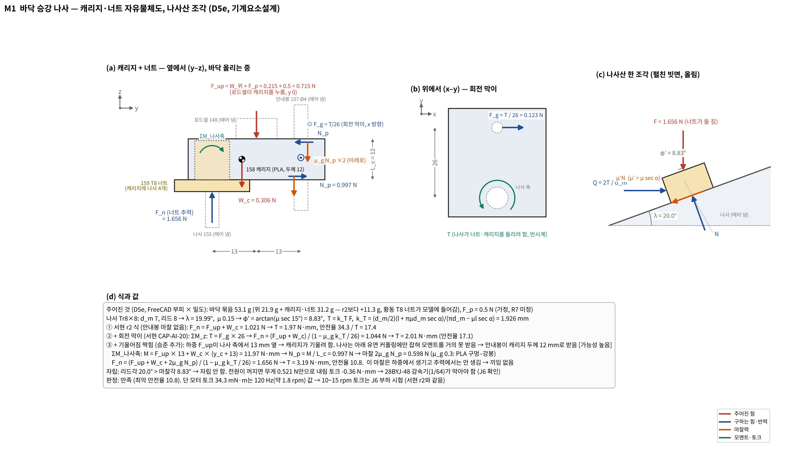
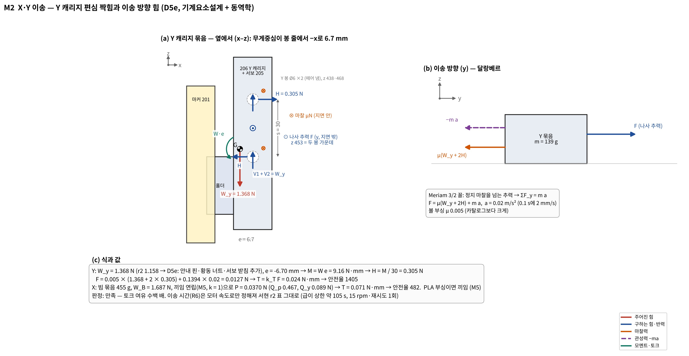
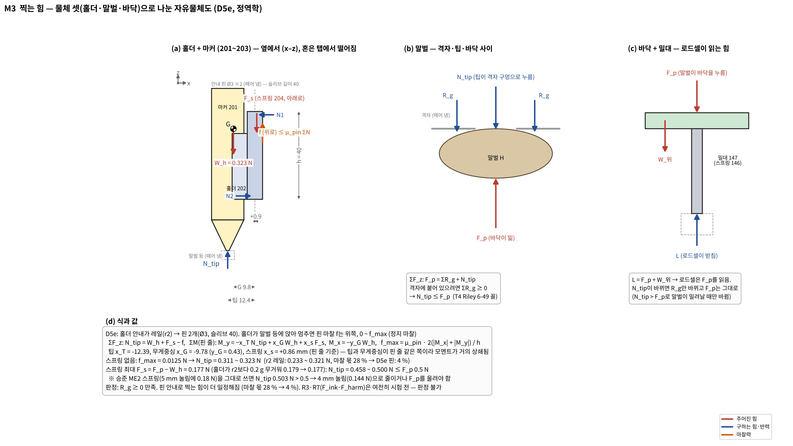
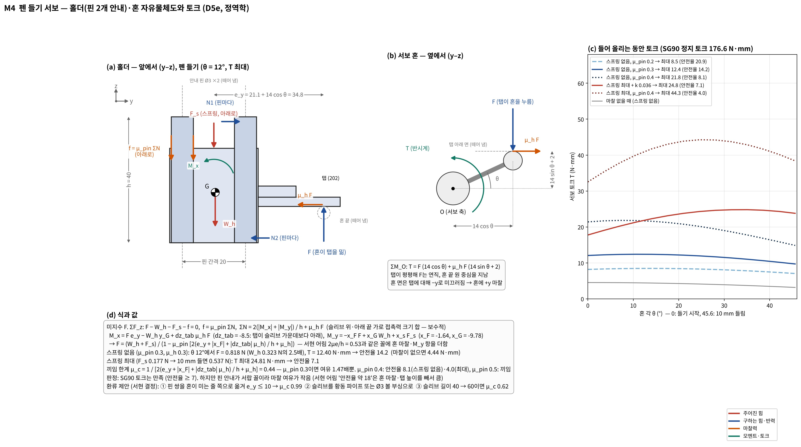
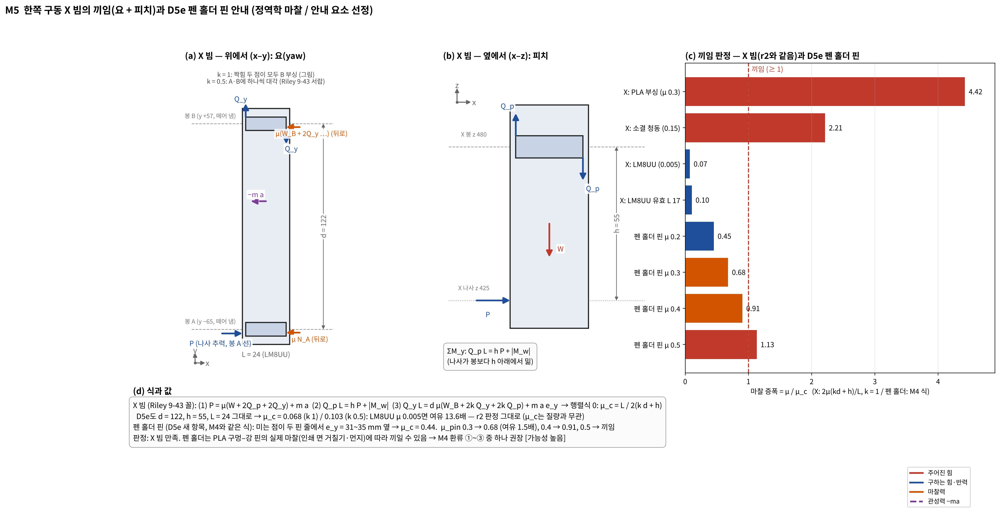
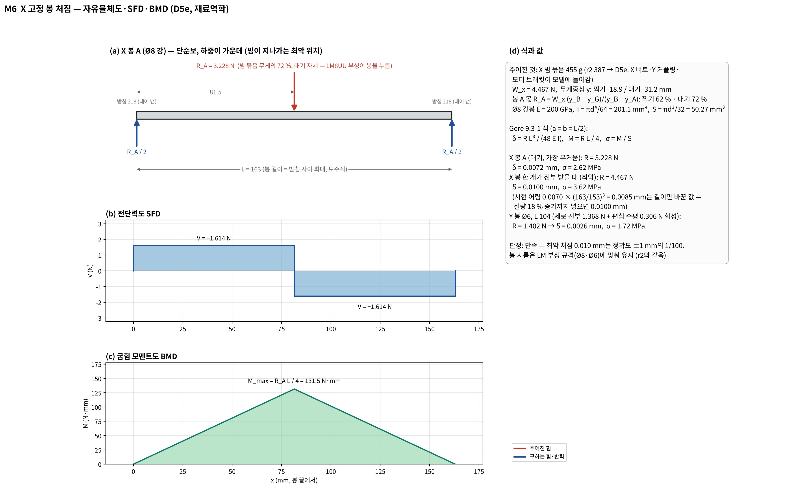

# S4 역학계산 2차 — D5e 기준 M1~M6 다시 계산 + 자유물체도 (승준이 서현 작업을 이어서)

정리: 2026-11-01 · 이승준 (Claude와 정리, **CAP-AI-SJ-29**) · 이어서 한 것: 서현 로그 CAP-AI-20 "남은 일" **2번(s4_calc를 D5e로)·3번(M1~M6 자유물체도 jpg)**
바탕: 서현 `design/2026-10-28_S4_역학계산_1차.md` r2(CAP-AI-19), `design/2026-11-01_S4_유제선정과_적용.md`(CAP-AI-20), `cad/D5e_module_kinematic.py`
계산: `design/calc/s4_calc_d5e_sj.py` → `s4_results_d5e_sj.json` (서현 `s4_calc.py`의 `screw_torque`·`jam_solve`·`beam_point_load`를 그대로 불러 씀 — 교재·해설집 대조를 통과한 함수)
질량: 승준 PC FreeCAD에서 D5e `build()`·`posed()`로 부품별 부피·무게중심을 읽음 → `design/calc/d5e_mass_cad_sj.json` (자세 대기·찍기·들림·x 끝·y 끝)
그림: `design/calc/s4_fbd_module_sj.py` → `design/img/fbd/M1~M6_D5e_*.jpg` (서현 `fbd_lib.py` 색·기호 규칙 그대로)
**서현 파일은 하나도 고치지 않음** (CLAUDE.md 파일 규칙) — S4 본문·유제 md·D6·인터페이스에 옮길지는 서현이 정함 (아래 5장)
표기: [확실] 계산·모델 값 / [가능성 높음] 근거 있는 가정 / [추측]. 모든 값은 **AI값 — 수기 대조 전(잠정)**

---

## 0. 결론 먼저

| # | 결론 | 판정 |
|---|---|---|
| 1 | **새로 생긴 위험 하나: 펜 홀더 안내 핀이 서랍 꼴** — 혼이 두 핀 줄에서 31~35 mm 옆을 밀어 핀 마찰이 커짐. 끼임 한계 μ_c = **0.44**, PLA 구멍–강 핀 μ 0.3이면 **여유 1.5배뿐**, μ 0.5면 **끼임** (아무리 돌려도 안 올라감). 서현 어림 "T ≈ 9.6 N·mm, 안전율 약 18"은 혼–탭 미끄럼 마찰과 탭 높이를 빼서 큼 → **T 12.4 N·mm, 안전율 14.2** (스프링 최대면 24.8 N·mm, 7.1) | [가능성 높음] (마찰계수는 시험 전) |
| 2 | 고치는 법 (서현 결정): ① 핀 쌍을 혼이 미는 줄 쪽으로 옮겨 e_y ≤ 10 mm → μ_c 0.99 ② 슬리브를 황동 파이프·Ø3 볼 부싱으로 ③ 슬리브 40 → 60 mm → μ_c 0.62 | [가능성 높음] |
| 3 | **찍는 힘은 오히려 좋아짐**: 레일(r2) → 핀(D5e)으로 마찰 몫 28 % → 4 %. N_tip 0.311~0.323 N (스프링 없음) | [확실] (모델 기하) |
| 4 | 스프링 204 상한이 0.179 → **0.177 N** (홀더 0.2 g 증가) → 승준 ME2 스프링(5 mm 눌림 0.18 N)은 **4 mm 눌림(0.144 N)으로** 줄여야 F_p 0.5 N 안 | [확실] 계산 / F_p 0.5는 가정 |
| 5 | M1 바닥 나사: 질량 41.8 → 53.1 g(황동 너트), 회전 막이(서현) + **[승준 추가] 캐리지 기울어짐 짝힘**(하중이 나사에서 13 mm 옆, 안내봉이 캐리지 두께 12 mm로 받음) → T 1.75 → **3.19 N·mm, 안전율 10.8** — 만족, 끼임 없음 | [가능성 높음] |
| 6 | M2·M5(X 빔)·M6: 질량 +18 %여도 여유 큼 — X 토크 안전율 482, X 빔 μ_c 그대로(LM8UU 여유 13.6배), 봉 최악 처짐 **0.0100 mm**(서현 어림 0.0085는 길이만 바꾼 값) | [확실] 계산 |

---

## 1. D5e 질량·무게중심 (FreeCAD, 찍기 자세 xm 59.4·ym 0·바닥 36.5)

| 묶음 | r2 (D5d) | **D5e** | 늘어난 까닭 | 무게중심 (x, y, z) mm |
|---|---|---|---|---|
| 바닥 묶음 (140·158·159·148·146·147) | 41.8 g | **53.1 g** | 황동 T8 너트 11.7 g | (55.0, −2.5, 323.9) |
| 홀더 + 조임 띠 + 마커 (201~203) | 32.8 g | **33.0 g** | 안내 슬리브 2개 | (62.0, 0.4, 440.6) — 핀 줄(x 71.8)에서 −x로 9.8 |
| Y 캐리지 묶음 (+204·205·205h·206·221·223·224) | 118.0 g | **139.4 g** | 안내 핀 7.7, Y 너트 11.7, 서보 받침 | (79.1, 2.9, 442.1) — Y 봉 줄에서 −x로 6.7 |
| X 빔 묶음 (+207~212·222·225) | 386.5 g | **455.2 g** | X 너트, Y 커플링(Al 16.7), 브래킷 | (83.4, −18.9, 449.6) / 대기 y −31.2 |

밀도 PLA 1.24(꽉 찬 값 = 상한)·강 7.85·Al 2.7·황동 8.5 g/cm³, 구매품은 사양 질량 (서현 r2와 같은 규칙). 로드셀 148은 모델이 Ø12×6 자리표시라 실제(막대형 약 30 g)보다 가벼움 → M1에 0.3 N 더해도 안전율 8 이상 [추측].

## 2. 계산별 결과 (그림 → `design/img/fbd/`)

### M1 바닥 승강 나사 — 
- ① r2 식: F = 1.021 N → T = 1.97 N·mm, 안전율 17.4
- ② + 회전 막이 F_g = T/26 (서현): F = 1.044 N → T = 2.01 N·mm (17.1)
- ③ + 기울어짐 짝힘 (승준): M = F_up·13 + W_c·(y_c + 13) = 11.97 N·mm → N_p = M/12 = 1.00 N → 마찰 0.60 N → **F = 1.656 N, T = 3.19 N·mm, 안전율 10.8**. 하중에서 생기는 마찰이라 추력을 키우지 않음 → 끼임 없음
- 자립 안 함 (리드각 20.0° > 마찰각 8.83°), 전원 꺼짐 내림 토크 −0.36 N·mm → 감속기가 막아야 함 (J6, r2와 같음)
- 환류: 없음 (만족). 참고로 안내봉을 캐리지에 더 길게 끼우면(12 → 20 mm) 마찰 0.60 → 0.36 N

### M2 X·Y 이송 — 
- Y: W 1.368 N, 편심 e 6.70 mm → H = 9.16/30 = 0.305 N → F 0.0127 N, T 0.024 N·mm (안전율 1,405)
- X: 끼임 연립(k 1) P 0.037 N → T 0.071 N·mm (482). PLA 부싱이면 끼임
- R6 시간은 모터 속도로만 정해짐 → 서현 r2 표 그대로 (급이 상한 약 105 s)

### M3 찍는 힘 — 
- 물체 셋: 홀더(N_tip·W_h·F_s·핀 짝힘·f) / 말벌(N_tip·R_g·F_p) / 바닥+밀대(F_p·W_위·로드셀 L) — 로드셀은 F_p를 읽음 (r2 결론 그대로)
- 팁(x −12.4)과 무게중심(x −9.8)이 핀 줄 같은 쪽 → 모멘트가 거의 상쇄 → f_max 0.0125 N → **N_tip 0.311~0.323 N** (r2 레일 0.233~0.321)
- 스프링 최대 0.177 N → N_tip 0.458~0.500 N ≤ F_p. ME2 스프링 0.18 N이면 0.503 > 0.5 → 4 mm 눌림으로

### M4 펜 들기 서보 — 
- 혼 팔 14 cos θ (서현 11/01) + 혼 면이 탭에서 미끄러지는 마찰 μ_h F (팔 14 sin θ + 2) + 핀 서랍 효과 + 스프링 늘어남(10 mm 들면 +0.36 N)
- F = (W_h + F_s) / (1 − μ_pin [2(e_y + |x_F| + |dz_tab| μ_h)/h + μ_h])

| 경우 | T 최대 (N·mm) | 안전율 (SG90 176.6) | 비고 |
|---|---|---|---|
| 마찰 없음 (참고) | 4.44 | 40 | 서현 r2 방식에 가까움 |
| 스프링 없음, μ_pin 0.2 | 8.46 | 20.9 | |
| **스프링 없음, μ_pin 0.3** | **12.40** | **14.2** | 기준 |
| 스프링 없음, μ_pin 0.4 | 21.83 | 8.1 | |
| 스프링 최대, μ_pin 0.3 | 24.81 | 7.1 | |
| 스프링 최대, μ_pin 0.4 | 44.29 | 4.0 | |
| 스프링 없음, μ_pin 0.5 | — | **끼임** | μ_c 0.44 넘음 |

### M5 끼임 — 
- X 빔: d 122·h 55·L 24 그대로 → μ_c 0.068(k 1) / 0.103(k 0.5), LM8UU 여유 13.6배 — r2 판정 그대로
- 펜 홀더 핀 (새 항목): μ_c 0.44 — 위 0장 1·2번

### M6 봉 처짐 — 
- X 봉 A (대기, 무게의 72 %): R 3.23 N → δ 0.0072 mm, σ 2.62 MPa / 최악(한 봉이 전부) 4.47 N → **δ 0.0100 mm**, σ 3.62 MPa (L 163)
- Y 봉 최악 1.40 N → δ 0.0026 mm
- 만족 — 정확도 ±1 mm의 1/100

## 3. 서현 유제 md(CAP-AI-20)의 **미검증 세 값** → 계산값

| 자리 (`2026-11-01_S4_유제선정과_적용.md`) | 서현 어림 (미검증) | **D5e 계산 (SJ-29)** |
|---|---|---|
| T5 3절 M4 토크 | F_lift ≈ 2.1 W_h, T ≈ 9.6 N·mm, 안전율 약 18 | F = 2.5 W_h (θ 12°), **T 12.4 N·mm, 안전율 14.2** (스프링 최대 24.8 / 7.1) |
| T6 3절 펜 홀더 안내 | 2μe/h ≈ 0.53 | 같은 식 + 혼 마찰·M_y → μ_c **0.44**, μ_pin 0.3에서 증폭 0.68 |
| T7 3절 M6 처짐 | 0.0070 × (163/153)³ ≈ 0.0085 mm | 질량 증가까지 넣어 **0.0100 mm** (봉 A 대기 0.0072) |

## 4. 검산 [확실]
- 같은 값을 다른 방법(절댓값 부호를 정해 닫힌 식으로 풂)으로 다시 계산: M4 T 최대 12.403 / 12.403, M1 T 3.189 / 3.189, M3 N_tip 하한 0.3109 / 0.3110, M6 δ 0.01002 / 0.01000 — 모두 0.2 % 안
- 그림 6장은 하나씩 열어 힘 방향(누름·당김, 마찰 방향, 짝힘 방향)과 글자 겹침을 확인함. 핀·안내봉 짝힘 방향은 "어느 쪽으로 기울려 하나 → 구멍의 어느 벽이 닿나"로 정함
- 질량: 마커 13 g·서보 등 구매품은 사양값, 나머지는 FreeCAD 부피(유효 솔리드)

## 5. 서현이 정할 것 / 옮길 곳
1. **펜 홀더 안내 핀 바꿀지** (0장 2번 ①~③) — 바꾸면 `cad/D5e`·D6 변수표, 이 계산 다시 돌림
2. 스프링 204: 넣으면 0.144 N(4 mm 눌림) 이하, F_ink 시험 뒤
3. S4 본문 r3로 옮기기: 질량표(1장), M1 ③ 기울어짐 짝힘, M3·M4·M5 핀 안내, 자유물체도 jpg 6장 — **서현 파일이라 승준이 안 고침**
4. 유제 md 미검증 세 값(3장) 바꾸기
5. 서현 CAP-AI-20 남은 일 5번(D6·인터페이스·cad README·인수인계)과 6번(영상 범례)은 이번에 안 함

## 6. 수기 풀이 (④) — 순서만
- M1 ③: F_up, W_c, y_c → M = F_up·13 + W_c(y_c + 13) → N_p = M/12 → F_n = (F_up + W_c + 2μN_p)/(1 − μk_T/26) → T = k_T F_n
- M4: θ 하나(예: 0°)에서 e_y = 35.1 → M_x·M_y를 F의 식으로 → ΣN → F = (W_h + μ·상수)/(1 − μ·계수) → T = F(14 + 0.6)
- M6: R_A = W_x(y_B − y_G)/(y_B − y_A) → δ = R L³/48EI
