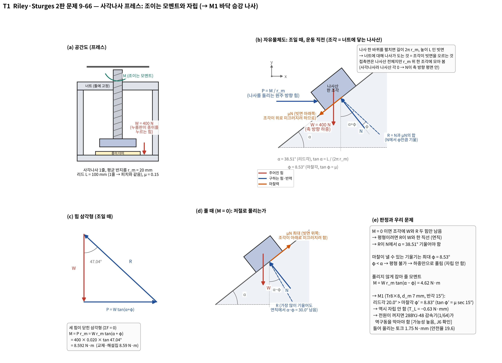
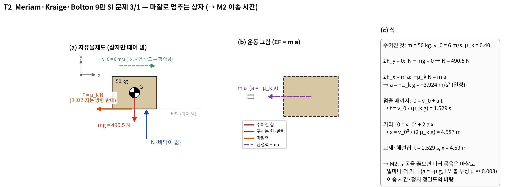
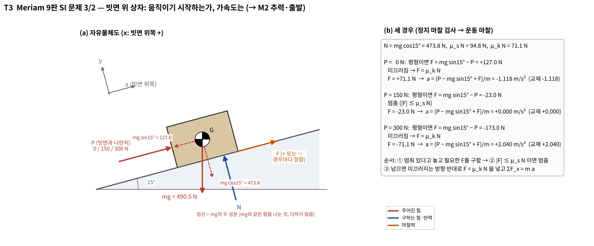
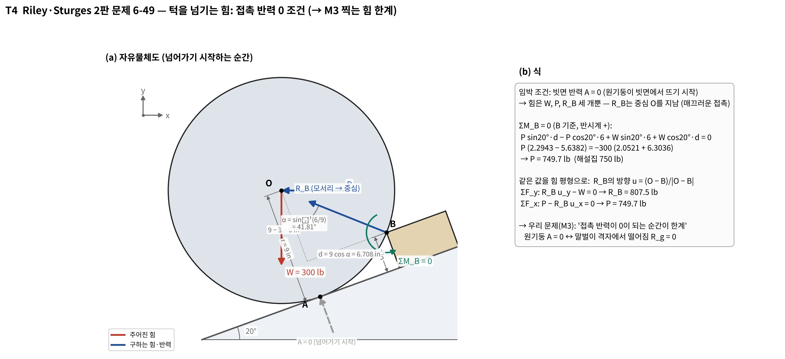
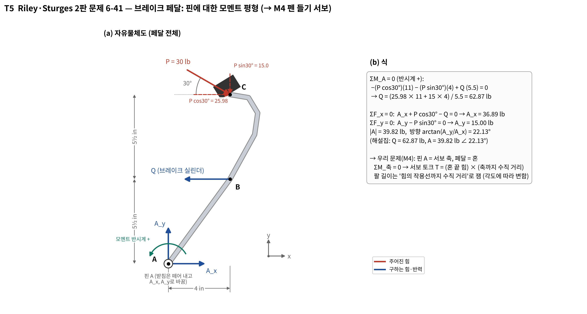
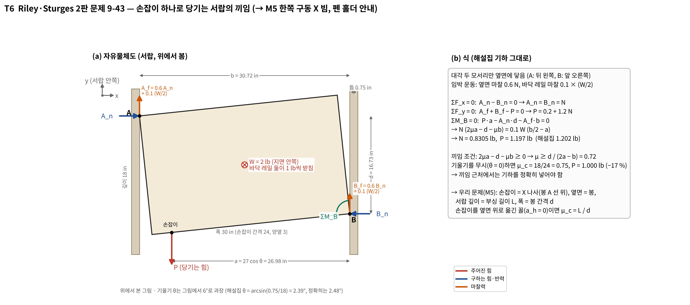
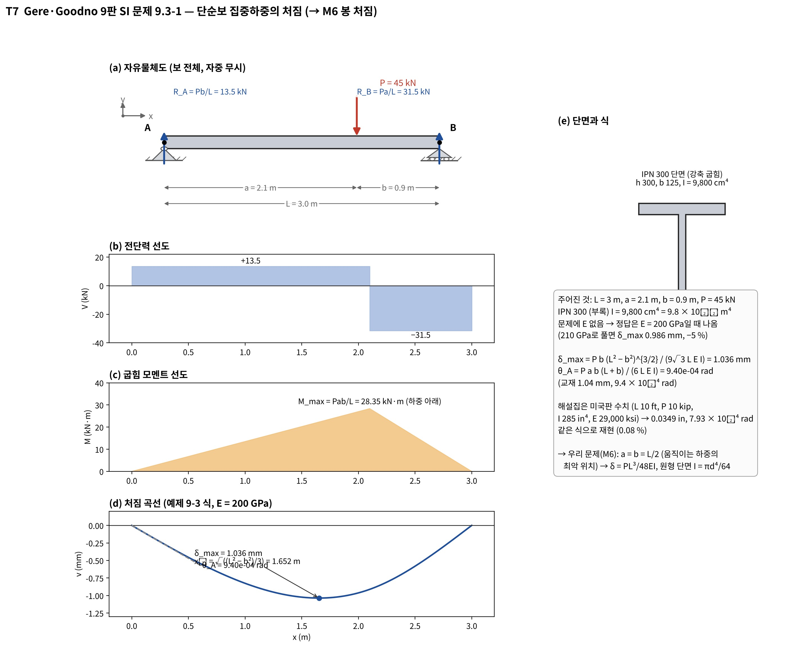

# S4 교과서 유제 7개: 고른 이유, 푼 것, 우리 문제에 적용한 것과 안 한 것

작성: 이서현 (Claude와 정리, **CAP-AI-20**) · 2026-11-01
바탕: `design/2026-10-28_S4_역학계산_1차.md` r2 (CAP-AI-19), 대조 스크립트 `design/calc/s4_textbook_check.py`, 자유물체도 그림 스크립트 `design/calc/s4_fbd_textbook.py`
교재: Riley·Sturges *Statics* 2판, Meriam·Kraige·Bolton *Dynamics* 9판 SI, Gere·Goodno *Mechanics of Materials* 9판 SI. 해설집 PDF와 문제 원문은 서현 PC `Documents\공주대\`에만 있다. 이 문서에는 문제 번호와 주어진 수치만 적는다 (공개 레포).

> **그림 읽는 법 (T1~T7 공통)**
> - 색: 빨강 = 주어진 힘, 파랑 = 구하는 힘·반력, 주황 = 마찰력, 보라 점선 = 관성력(운동 그림), 초록 = 모멘트, 회색 = 치수·각도.
> - 받침(핀·롤러·바닥·벽)은 **떼어 내고**, 그 자리에 반력 화살표를 그렸다. 받침 모양이 남아 있으면 자유물체도가 아니다.
> - 화살표 머리가 작용점에 닿으면 미는 힘, 꼬리가 작용점에 있으면 당기는 힘이다.
> - 각도를 과장한 그림(T6)은 그림 안에 "과장"이라고 적었다.

---

## 0. 한눈에

| # | 유제 | 유형 | 적용한 계산 | 우리 쪽에서 바뀐 것 | 대조 결과 (책 / 해설집 / AI) |
|---|---|---|---|---|---|
| T1 | Riley 9-66 | 사각나사 조이는 모멘트, 자립 | **M1** 바닥 승강 나사 토크 | 사각 → 사다리꼴(반각 15°), 하중 400 N → 0.91 N | 8.59 / 8.592 / 8.592 N·m |
| T2 | Meriam 3/1 | 마찰로 감속하는 질점 | **M2** 이송 시간·정지 | 감속 대신 가속에 필요한 추력 (역문제) | 1.529 s, 4.59 m / 같음 / 1.529 s, 4.587 m |
| T3 | Meriam 3/2 | 정지 마찰 검사 → 운동 마찰 | **M2** 출발 추력 | 경사 15° → 수평 | −1.118, 0, 2.04 / 같음 / −1.118, 0, 2.040 m/s² |
| T4 | Riley 6-49 | 접촉 반력 0 = 한계 | **M3** 찍는 힘 상한 | 한 물체 → 두 물체(홀더·말벌), P → 스프링 힘 F_s | — / 750 lb / 749.7 lb |
| T5 | Riley 6-41 | 핀에 대한 모멘트 평형 | **M4** 펜 들기 서보 토크 | 힘 Q 대신 토크 T | — / 62.87, 39.82 lb ∠22.13° / 같음 |
| T6 | Riley 9-43 | 한쪽 손잡이 서랍의 끼임 | **M5** 한쪽 구동 X 빔, 펜 홀더 안내 | 손잡이를 옆면 위로(a_h = 0), 피치 추가 | — / 1.202 lb / 1.197 lb (기울기 무시하면 1.000, −17 %) |
| T7 | Gere 9.3-1 | 단순보 집중하중 처짐 | **M6** 봉 처짐 | IPN 300 → Ø8 원형, 하중 가운데 | 1.04 mm / (미국판) 0.0349 in / 1.036 mm, 0.03493 in |

고른 기준 (세 가지를 다 만족하는 것만):
1. **같은 식**: 우리 문제를 푸는 식과 유제를 푸는 식이 같다. 유제를 맞게 풀면 그 함수로 우리 값을 낸다 (`s4_calc.py`가 `s4_textbook_check.py`와 같은 함수를 씀).
2. **같은 판정**: 유제가 묻는 "예/아니오"(자립하나, 끼이나, 떨어지나)가 우리 설계 판정과 같다.
3. **정답이 있다**: 책 정답이나 해설집 답이 있어서 AI 계산을 대조할 수 있다. 별표 없는 Riley 문제는 해설집으로 대조했다.

시스템설계및제어 수업 S4 양식은 유제마다 "유사점·변형"을 적게 되어 있다 → 아래 각 절의 2·3·4번이 그 칸을 풀어 쓴 것이다.

---

## T1. Riley 9-66 — 사각나사 프레스 → M1 바닥 승강 나사

**1. 왜 골랐나**
- 바닥(말벌 받침)을 T8 리드스크루로 올린다. 물어야 할 것은 "28BYJ-48로 들 수 있나"와 "전원이 꺼지면 바닥이 내려가나(자립)" 두 가지다.
- 9-66은 **리드가 큰 나사(리드각 38.5°)라서 자립하지 않는** 경우다. 우리 T8 리드 8 나사도 리드각 20.0°로 마찰각보다 크다. 자립 판정 구조가 같은 유제가 필요했다. 리드가 작은 보통 나사 유제는 "자립한다"로 끝나서 우리 판정을 연습하지 못한다.
- μ = 0.15로 우리 가정(황동 너트–스테인리스)과 같다.

**2. 무엇을 풀었나**
- 나사 한 바퀴를 펼친 빗면 위의 "나사산 한 조각"을 자유물체로 잡았다. 힘은 W(축 하중), P = M/r_m(원주 방향), 빗면 반력 R(= N + μN, N에서 φ만큼 기욺).
- 조일 때: M = W r_m tan(α + φ) = 400 × 0.020 × tan 47.04° = **8.592 N·m**. 책 8.59, 해설집 8.592와 같다.
- 풀 때(M = 0): 힘이 W와 R 둘뿐이라 R이 연직이어야 한다. 그러려면 R이 N에서 α = 38.5° 기울어야 하는데, 마찰은 φ = 8.53°까지만 낸다. → **평형 불가, 저절로 풀린다.** 잡아 두려면 W r_m tan(α − φ) = 4.62 N·m가 든다.

**3. 우리 문제에 어떻게 적용했나 (S4 M1)**
- 같은 함수 `screw_torque`에 나사산 반각 15°(사다리꼴 Tr8×8)를 넣었다. 마찰각이 tan φ′ = μ sec 15° → φ′ = 8.83°로 커진다.
- 하중 F = 바닥 묶음 0.41 N + 말벌을 격자에 붙이는 힘 0.5 N(가정) = 0.91 N, d_m = 7 mm, 리드 8.
- 결과: 올림 토크 **1.75 N·mm**, 효율 0.66, 28BYJ-48 견인 토크 34.3 mN·m 기준 안전율 19.6. 리드각 20.0° > φ′ 8.83° → **자립 안 함**, 내림 토크 −0.63 N·mm (하중이 나사를 돌리려 함).

**4. 적용하지 않은 것과 이유**
- 칼라 마찰: 9-66에도 없고, 우리도 나사 아래 끝은 커플링으로 모터 축에 물려 있어 따로 미끄러지는 칼라가 없다. 축 방향 하중은 모터 축 베어링이 받는다 [가능성 높음].
- 사각나사 식 그대로: 우리 나사산은 사다리꼴이라 sec 15°를 넣었다. 넣지 않으면 마찰각이 8.53°로 작아져 토크를 약 1 % 작게 본다. 값 차이는 작지만 판정 경계를 볼 때는 넣어야 한다.
- 가속력: 0.04 kg × 0.02 m/s² ≈ 0.001 N으로 하중의 0.1 %라 뺐다.

**5. 이 유제로 검산하지 않았다면**
- "모터 토크가 충분하다"만 보고 자립 판정을 빠뜨렸을 가능성이 크다. 리드 8 나사는 자립하지 않는다. 전원이 꺼지거나 모터가 풀리면 바닥이 내려가 말벌이 격자에서 떨어진다.
- 지금 설계는 28BYJ-48 감속기(1/64)가 역구동을 막는다고 본다 [가능성 높음]. 이것은 승준 J6(부하 시험)에서 확인할 항목으로 넘겼다.

---

## T2. Meriam 3/1 — 마찰로 멈추는 상자 → M2 이송 시간

**1. 왜 골랐나**
- R6(한 마리 3분 이내)를 따지려면 마커를 옮기는 데 걸리는 시간을 알아야 한다. 마찰이 있는 직선 운동의 ΣF = m a와 "속도/가속도 = 시간"을 한 번에 다루는 가장 짧은 유제다.
- 자유물체도(힘)와 운동 그림(m a)을 나란히 그리는 Meriam의 형식이 우리 M2 그림의 틀이 된다.

**2. 무엇을 풀었나**
- ΣF_y = 0 → N = mg = 490.5 N. ΣF_x = m a → −μ_k N = m a → a = −3.924 m/s².
- 멈출 때까지 t = v₀/(μ_k g) = **1.529 s**, x = v₀²/(2μ_k g) = **4.587 m** (책·해설집 1.529 s, 4.59 m).

**3. 우리 문제에 어떻게 적용했나 (S4 M2)**
- 같은 식을 거꾸로 썼다. 가속도를 정하고 필요한 추력을 구한다 (0.1 s에 2 mm/s까지, a = 0.02 m/s²).
- F = μ(W + 2H) + m a: H는 Y 캐리지 편심 짝힘 0.26 N이다. 볼 부싱 μ = 0.005를 넣으면 Y 0.011 N, X 0.032 N이다. 이것을 M1의 나사 식으로 토크로 바꾸면 Y 0.021 N·mm(안전율 1,650), X 0.061 N·mm(566)다.
- 시간 = 거리/속도의 합: 기구·판별 63.9 s(15 rpm) → 급이 상한 약 105 s(재시도 1회 포함).

**4. 적용하지 않은 것과 이유**
- 유제의 "마찰로 멈추는 거리"는 직접 쓰지 않았다. 우리 이송은 스테퍼가 나사를 돌려 위치를 정하므로 미끄러져 멈추지 않는다. 볼 부싱 μ ≈ 0.003~0.005라 구동을 끊어도 마찰 감속은 0.03~0.05 m/s²다. 이송 속도 2 mm/s에서 미끄러지는 거리는 0.1 mm 이하라 정지 정밀도(±1 mm)에 영향이 없다 [가능성 높음]. 나사가 자립하지 않으므로 이 판정은 감속기에 달려 있다.
- 가속·감속 구간의 시간: 0.1 s짜리라 전체 63.9 s에 비해 무시했다.

**5. 이 유제로 검산하지 않았다면**
- 시간 계산이 "거리/속도"뿐이라 마찰을 빼먹기 쉽다. 그러면 PLA 부싱(μ 0.3)일 때 Y 토크가 0.98 N·mm까지 오르는 것을 놓친다. 이것이 M5 끼임으로 이어지는 단서였다.

---

## T3. Meriam 3/2 — 빗면 위 상자, 세 가지 P → M2 출발 추력

**1. 왜 골랐나**
- 정지 상태의 축이 움직이기 시작하는가를 판정하는 순서(① 멈춰 있다고 놓고 필요한 마찰을 구함 → ② μ_s N 이하면 멈춤 → ③ 넘으면 μ_k N으로 ΣF = m a)를 연습하기 좋다. 우리 이송축이 출발하는 순간과 같은 순서다.
- 마찰 방향을 "경우마다 정한다"는 점이 핵심이다. 우리 M3의 레일 마찰도 홀더가 내려올 때와 들릴 때 방향이 반대다.

**2. 무엇을 풀었나**
- N = mg cos 15° = 473.8 N, μ_s N = 94.8 N, μ_k N = 71.1 N.
- P = 0: 평형에 필요한 F = +127.0 N > 94.8 → 미끄러짐. F = +71.1 N(위쪽) → a = **−1.118 m/s²**.
- P = 150 N: 필요한 F = −23.0 N, |F| ≤ 94.8 → **멈춤**, a = 0.
- P = 300 N: 필요한 F = −173.0 N > 94.8 → 위로 미끄러짐. F = −71.1 N → a = **+2.040 m/s²**. 책·해설집과 같다.

**3. 우리 문제에 어떻게 적용했나 (S4 M2, M3)**
- M2: X·Y 축은 수평이라 sin 항은 0이다. 출발할 때 "추력 > 정지 마찰"인지 보는 순서를 그대로 썼다. 볼 부싱이라 추력이 0.03 N 수준으로 작다.
- M3: 홀더 레일 마찰 f를 "방향을 모르는 값"(0 ≤ f ≤ f_max)으로 두고, 들 때(M4)와 찍을 때(M3)에 방향을 따로 정했다. 이 순서가 이 유제에서 왔다.

**4. 적용하지 않은 것과 이유**
- 경사 성분 mg sin θ: X·Y는 수평이라 없다. 수직인 Z(바닥 승강)는 무게 전부가 축 방향이라 M1 나사 식에서 다룬다.
- μ_s와 μ_k의 구분: 볼 부싱 카탈로그는 하나의 μ만 준다. 그래서 μ = 0.005로 크게 잡아 둘을 같게 했다 (보수적).

**5. 이 유제로 검산하지 않았다면**
- 마찰 방향을 한쪽으로 고정해 M3에서 N_tip을 0.32 N 하나로만 냈을 것이다. 실제로는 0.23~0.32 N 범위다 (마찰이 위로 걸리면 찍는 힘이 28 % 줄어든다). F_ink 시험을 실제 홀더로 해야 한다는 결론이 여기서 나왔다.

---

## T4. Riley 6-49 — 턱을 넘기는 힘 → M3 찍는 힘의 상한

**1. 왜 골랐나**
- 펜이 말벌을 위에서 누를 때, 말벌은 아래 격자에 기대어 있다. 너무 세게 누르면 말벌이 격자에서 밀려 떨어진다. "접촉 반력이 0이 되는 순간이 한계"인 문제가 필요했다.
- 6-49는 그 조건(빗면 반력 A = 0)을 쓰는 대표 문제다. 매끄러운 접촉이라 반력 방향이 중심을 지나는 점도 같다.

**2. 무엇을 풀었나**
- 넘어가기 시작하는 순간 A = 0 → 힘은 W, P, R_B 셋뿐이다. R_B는 모서리 B에서 중심 O를 향한다.
- 기하: B는 O에서 빗면 법선 방향으로 9 − 3 = 6 in, 빗면 방향으로 d = 9 cos α = 6.708 in (α = arcsin(6/9) = 41.81°).
- ΣM_B = 0 → **P = 749.7 lb** (해설집 750 lb). 힘 평형으로도 같은 값이 나온다 (R_B = 807.5 lb).

**3. 우리 문제에 어떻게 적용했나 (S4 M3)**
- 물체를 둘로 나눴다. (a) 홀더+마커: N_tip = W_h + F_s − f. (b) 말벌: F_p = R_g + N_tip.
- 한계 R_g = 0 (말벌이 격자에서 막 떨어짐) → N_tip ≤ F_p → **F_s ≤ F_p − W_h = 0.18 N**.
- 같은 FBD에서 "바닥 하중 센서는 찍는 힘을 못 잰다"를 보였다. R_g > 0인 동안 F_p는 바닥 위치로 정해지고, N_tip만큼 R_g가 줄 뿐이다. D5의 "하중 센서로 찍는 힘도 잼"은 이 FBD로 틀린 것을 알았다.

**4. 적용하지 않은 것과 이유**
- 모멘트 평형(ΣM_B): 6-49는 원기둥이 모서리를 축으로 구르므로 모멘트가 핵심이다. 말벌은 펜이 거의 수직으로 누르고 격자가 아래에서 받쳐 힘이 한 직선 위에 있다. 그래서 ΣF_z만 쓴다. 말벌이 기울어 구르는 경우는 다루지 않았다 (자세는 비전이 흉부를 찾을 때 고름).
- 빗면 각: 우리 격자는 수평이다.

**5. 이 유제로 검산하지 않았다면**
- 스프링을 세게 넣을수록 잘 찍힌다고만 봤을 것이다. 그러면 말벌이 격자에서 밀려 내려가는 한계(0.18 N)를 몰랐을 것이다. 또 하중 센서로 찍는 힘을 잰다는 틀린 설계가 그대로 남았을 것이다.

---

## T5. Riley 6-41 — 브레이크 페달 → M4 펜 들기 서보

**1. 왜 골랐나**
- 펜은 SG90 서보 혼이 탭을 밀어 들어 올린다. 서보 축 = 핀, 혼 = 레버, 탭이 혼 끝을 누르는 힘 = 페달의 힘이다. 핀에 대한 ΣM = 0으로 필요한 토크를 구한다.
- 6-41은 힘이 비스듬해서 **팔 길이를 "작용선까지의 수직 거리"로 재는 연습**이 된다. 혼이 돌면 접촉점과 힘의 방향이 바뀌는 우리 문제에 꼭 필요하다.

**2. 무엇을 풀었나**
- ΣM_A = 0 (반시계 +): −(P cos 30°)(11) − (P sin 30°)(4) + Q(5.5) = 0 → **Q = 62.87 lb**.
- ΣF_x → A_x = 36.89 lb, ΣF_y → A_y = 15.00 lb, |A| = **39.82 lb ∠ 22.13°** (해설집과 같음).

**3. 우리 문제에 어떻게 적용했나 (S4 M4)**
- r2 (D5d): 들어 올릴 힘 F_lift = W_h + F_s + f = 0.410 N, 팔 r ≤ 11.9 mm → T ≤ 4.88 N·mm, SG90 176.6 N·mm 기준 안전율 36.2.
- **D5e에서 바뀐 것 (11/01)**: 혼이 탭의 모서리를 치던 D5d는 들림이 8.46 mm라 캡 컵에서 빠지지 못했다 (8.56 mm 필요). D5e는 혼 끝(반지름 14 + 끝 둥글기 2)이 평평한 탭 아래면을 민다. 접촉점까지 팔은 최대 16 mm다.
- 팔만 바꾼 어림값은 T ≈ 0.410 × 16 = 6.6 N·mm, 안전율 약 27이다 → **미검증**. 안내가 레일에서 핀 2개로 바뀌어 마찰 f를 다시 계산해야 한다 (CAP-AI-20 남은 일 2번).

**4. 적용하지 않은 것과 이유**
- 핀 반력 A_x, A_y: 페달은 핀 반력을 구했지만 우리는 서보 축 반력을 쓰지 않는다. SG90 출력축 베어링이 받는 힘(0.4 N 수준)은 서보 허용 범위보다 훨씬 작다 [가능성 높음].
- r2의 "r ≤ 11.9가 상한" 주장: **틀렸다.** 혼 모서리가 탭에 닿는 경우에는 힘 방향이 접촉면 법선이라 팔이 혼 길이보다 길어질 수 있다. 그래서 D5e에서 접촉을 "혼 끝 둥근 면 – 평평한 탭"으로 바꿨다. 이 경우 팔은 혼 끝 중심까지의 수평 거리로 정해진다.

**5. 이 유제로 검산하지 않았다면**
- "토크 = 힘 × 혼 길이"로만 계산했을 것이다. 그러면 접촉 모양에 따라 팔이 달라진다는 점을 놓친다. D5d 펜 들기 부족(8.46 < 8.56 mm)은 CAD 검사로 찾았다. 그 원인인 "혼 모서리 접촉에서 팔과 들림이 함께 정해짐"은 이 유제의 수직 거리 개념으로 설명된다.

---

## T6. Riley 9-43 — 손잡이 하나로 당기는 서랍 → M5 한쪽 구동 X 빔, 펜 홀더 안내

**1. 왜 골랐나**
- X 빔은 나사 하나가 한쪽 봉(A) 옆에서 민다. 구동점이 치우쳐 있어 서랍을 한쪽 손잡이로 당길 때처럼 빔이 돌려고 한다. 대각 두 곳에 측압이 생기고, 그 마찰이 회전을 더 키우면 아무리 밀어도 안 움직인다 (끼임).
- 9-43은 이 끼임을 정량으로 푸는 유제다. 부싱 재료(PLA / 청동 / 볼 부싱)를 고르는 근거가 된다.

**2. 무엇을 풀었나**
- 대각 두 모서리 A(뒤 왼쪽), B(앞 오른쪽)만 옆면에 닿는다. 옆면 마찰 0.6 N, 바닥 레일 마찰 0.1 × (W/2)이다.
- ΣF_x: A_n = B_n = N. ΣF_y: P = 0.2 + 1.2 N. ΣM_B: P a − N d − A_f b = 0 → N(2μa − d − μb) = 0.1W(b/2 − a).
- 해설집 기하(θ = arcsin(0.75/18) = 2.39°)로 **P = 1.197 lb** (해설집 1.202 lb). 정확한 θ = 2.48°로는 1.206 lb다.
- 끼임 조건: μ ≥ d/(2a − b) = 0.72. **기울기를 무시(θ = 0)하면 P = 1.000 lb, −17 %**. 한계(μ 0.6 vs 0.72)에 가까워 기하에 민감하다.

**3. 우리 문제에 어떻게 적용했나 (S4 M5)**
- 대응: 손잡이 = X 나사, 옆면 = 봉, 서랍 깊이 = 부싱 길이 L(24 mm), 폭 = 봉 간격 d(122 mm).
- 우리 나사는 봉 A 선 위에 있다 → 손잡이를 옆면 위로 옮긴 꼴(a_h = 0) → 요(위에서 본 회전)만이면 μ_c = L/d.
- 서랍에 없는 것 두 가지를 더했다. ① 두 접점이 B 부싱에 몰리는 경우(k = 1). ② 나사가 봉보다 h = 55 mm 아래라 생기는 피치. 연립하면 **μ_c = L / 2(k d + h)**.
- 판정: PLA 0.3·소결 청동 0.15는 **끼임**, LM8UU(μ 0.005)는 μ_c 0.068~0.103 → 여유 13.6~20.7배 → X는 LM8UU 2개로 정했다.
- **D5e 펜 홀더 안내 (11/01)**: 홀더를 안내 핀 2개(간격 20 mm)가 받친다. 혼이 홀더 한쪽을 미는 것이 같은 서랍 꼴이다. 마찰 증폭은 약 2μ·e_y/h다 → 다시 계산 예정 (**미검증**).

**4. 적용하지 않은 것과 이유**
- 정확한 기울기 θ: 우리 볼 부싱은 한계의 1/14이라 작은 각 근사(θ → 0)로 충분하다. 서랍처럼 한계 근처일 때만 −17 % 차이가 의미 있다.
- 바닥 레일 마찰을 모서리에 모으는 해설집 방식: 우리 빔 무게는 봉 두 개가 부싱으로 받는다. 무게에 의한 마찰(μW)을 따로 ΣF_x에 넣었다.

**5. 이 유제로 검산하지 않았다면**
- r1은 요만 봤고 k = 0.5를 썼다. 그래서 소결 청동 부싱이 "안 낀다"고 판정했다. 피치를 합치면 청동도 낀다 (2μ(kd + h)/L = 1.45 > 1). 값싼 오일리스 부싱을 샀다면 X축이 움직이지 않았을 것이다.
- 해설집과 −0.4 % 차이 나는 이유(θ 근사)를 확인하지 않았다면 "AI가 틀렸다"나 "해설집이 틀렸다" 중 하나로 잘못 결론 냈을 것이다. 둘 다 맞고, 근사 차이였다.

---

## T7. Gere 9.3-1 — 단순보 집중하중 → M6 봉 처짐

**1. 왜 골랐나**
- X 빔 무게가 Ø8 고정 봉 위를 움직인다. 봉 가운데가 얼마나 처지는지가 펜 높이·위치 정확도에 들어간다. 양끝 받침 + 집중하중 + 처짐 식이 정확히 같은 유제다.
- 하중이 가운데가 아닌(a = 2.1, b = 0.9 m) 일반식이라 a = b로 줄이면 우리 식이 된다. 같은 함수가 두 경우를 다 맞는지 확인할 수 있다.

**2. 무엇을 풀었나**
- 반력 R_A = Pb/L = 13.5 kN, R_B = Pa/L = 31.5 kN. 전단력 +13.5 / −31.5 kN. 최대 모멘트 Pab/L = 28.35 kN·m(하중 아래).
- δ_max = P b (L² − b²)^{3/2} / (9√3 L E I) = **1.036 mm** at x₁ = 1.652 m, θ_A = 9.40 × 10^-4 rad (책 1.04 mm, 9.4 × 10^-4).
- **SI판 문제에 E가 없다.** E = 200 GPa여야 책 답이 나오고, 210 GPa면 −5 %다. 해설집은 미국판 수치(10 ft, 10 kip, 285 in⁴)라 같은 식으로 0.03493 in를 재현해 식만 대조했다.

**3. 우리 문제에 어떻게 적용했나 (S4 M6)**
- a = b = L/2 (움직이는 하중의 최악 위치) → δ = PL³/48EI, 원형 단면 I = πd⁴/64. 굽힘응력 σ = M/S를 더했다.
- 하중 나눔: X 빔 묶음 3.79 N을 무게중심 위치대로 두 봉이 나눈다. 봉 A 61~71 %, 최악은 한 봉이 전부 받는다.
- r2 (L = 153): 최악 δ = 0.0070 mm, σ 2.89 MPa → 정확도 ±1 mm의 1/140 이하 → 만족.
- **D5e (11/01)**: 갠트리 받침을 x −18까지 늘려 받침 사이가 163 mm다. δ ∝ L³이라 어림값은 0.0070 × (163/153)³ ≈ 0.0085 mm다 → 여전히 만족 (**미검증**, `s4_calc.py` 다시 돌릴 것).

**4. 적용하지 않은 것과 이유**
- 하중 위치를 일반값으로 두기: 하중이 움직이므로 처짐이 가장 큰 가운데만 보면 된다.
- 자중: Ø8 강봉 163 mm는 약 0.06 N으로 하중의 1.6 %라 뺐다.
- 받침의 고정 효과: 실제는 끝 블록에 끼워 고정이라 처짐이 더 작다 (고정–고정이면 1/4). 단순지지로 계산하면 보수적이다.

**5. 이 유제로 검산하지 않았다면**
- 교재 답과 다르게 나올 때 E 값 때문인 것을 몰라 식을 의심했을 것이다. 같은 함수로 우리 봉을 계산하므로 식이 맞다는 확인이 먼저다.
- 봉 지름을 줄일 여지(과잉 만족)를 보지 못했을 것이다. 다만 LM 부싱 규격(Ø8·Ø6)에 맞추려고 그대로 둔다.

---

## 승준 쪽 연계 (참고)

승준 로그 **CAP-AI-SJ-23**의 기계요소 유제 ME1~ME3은 승준 담당이다. 겹치는 곳만 가리킨다.
- ME1 동력나사 (DANotes 나사 P1) ↔ T1: 승준도 "T8 리드 8은 자기잠금 아님"으로 같은 판정을 냈다. 마찰계수 가정은 서로 다르다 (서현 0.15, 승준 쪽은 로그 참고) → 판정은 같다.
- ME2 압축 스프링 ↔ T4: 홀더 스프링 204의 강성·응력. M3의 상한 F_s ≤ 0.18 N과 함께 봐야 한다.
- ME3 스테핑 모터 선정 ↔ T2: 28BYJ-48은 토크 여유가 크지만 펄스 한계로 속도가 약 2 mm/s다. M2 시간 계산과 같은 결론이다.

## 남은 일 (이 문서 기준)

1. M1~M6 우리 문제 자유물체도 jpg (`design/calc/s4_fbd_module.py` 예정) — D5e 구조(안내 핀, 혼 끝, 스프링, 받침 −18)로 그린다.
2. `s4_calc.py`를 D5e 치수로 다시 돌려 위의 **미검증** 세 값(M4 토크, M5 홀더 안내, M6 처짐)을 확정하고 이 문서와 S4 문서에 반영한다.
3. ④ 수기 풀이 칸은 서현 몫이다 (각 유제 2번의 순서대로 풀면 된다).
