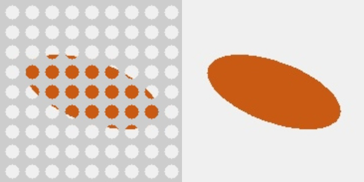

# VespAI가 잘 못 잡는 원인 점검 (서현, 2026-11-02, CAP-AI-21)

바탕: 승준 `vision/2026-10-29_VespAI_프린트_웹캠시험.md`(CAP-AI-SJ-26), `vision/2026-10-28_J1_VespAI_실행결과.md`, 스크립트 `vision/scripts/vespai_live_webcam.py`. 승준 파일은 고치지 않고 읽기만 했다. 점검 키트는 `design/vespai_check/`에 있고, 사용법은 그 폴더 `읽어보기.md`에 있다.

## 결론 먼저
1. [확실] **스크립트 문제는 아니다.** 승준 웹캠 스크립트는 OpenCV 프레임을 RGB로 바꿔 넣는다(`cvtColor BGR2RGB`). 가중치 해시도 확인한다. 예시 사진 시험(J1)도 원 결과와 16/21장이 같았다.
2. [가능성 높음] 원인은 **장면 차이**다. VespAI는 미끼판을 내려다보는 1080p 현장 영상(말벌이 작게 보임, 단순한 미끼판 배경)으로 학습했다. 승준 시험은 손에 든 인터넷 사진이었고 손·얼굴·옷이 화면에 들어왔다. 오검출 60 %가 피부·옷이었고, 가까이 대면 못 잡았고, 자갈 배경에서는 6 %만 잡았다. 모두 학습 장면과 다른 조건이다.
3. [확실, 계산] **우리 카메라 배율은 VespAI가 잘 잡는 범위 안이다.** 격자 위 200 mm에서 화면 폭이 약 260 mm라, 말벌(25~30 mm)이 화면 폭의 약 10~12 %가 된다. 승준 시험에서 잘 잡힌 범위는 4~18 %였다. 반대로 **마킹실(40 mm)만 잘라 넣으면 60~75 %가 되어 범위를 벗어난다** → 종 판별에는 넓은 화면을 넣는다.
4. [확실, 계산] **새로 찾은 큰 위험은 격자판 가림이다.** 카메라는 격자판(두께 1.5, 구멍 Ø3, 피치 4.4) 너머로 말벌 등을 본다. 열린 면적은 π·1.5² / 4.4² = **36.5 %**뿐이라, 말벌이 점박이 조각으로 보인다 (아래 그림). [가능성 높음] VespAI는 가리지 않은 말벌로 학습했으므로 이 상태에서는 거의 못 잡을 것이다. 다만 아직 시험하지 않았다 → 키트의 g(격자 겹침)로 확인한다.

*왼쪽: 마킹실만 잘라 격자를 겹친 모습(모의 말벌 = 주황 타원). 오른쪽: 격자 없이 마킹실만 자른 모습. 실제 말벌 사진이 아닌 도형이다.*

## 설계에 주는 것 (서현 결정 필요)
| 안 | 내용 | 장단점 |
|---|---|---|
| ① 투명 격자 | 격자판을 투명 아크릴·PETG로 만들고 구멍은 그대로 둠 | 카메라는 말벌 전체를 봄. 레이저 가공·구멍 테두리 반사 확인 필요 [가능성 높음 — 가장 효과 큼] |
| ② 구멍 키우기 | Ø3 → Ø4 (피치 4.4면 열린 면적 65 %) | 벽이 0.4 mm로 얇아져 약함. 말벌 다리가 빠질 수 있음 |
| ③ 다시 학습 | 격자 너머 표본 사진으로 파인튜닝 (승준 계획) | 표본·사진 수가 필요, 시간이 걸림 |
| ④ 판별 위치 | 바닥을 올리기 전(격자에서 떨어져 있을 때) 판별 | 그래도 격자 너머라 가림은 같음 → 단독으로는 해결 안 됨 |

권장 [가능성 높음]: **①을 D5f에 넣고, 키트로 격자 영향을 먼저 수치로 확인한다.** ③은 ①과 상관없이 유지한다(한국에는 유럽말벌이 흔해 종 혼동이 실제 문제다).

## 서현이 지금 할 시험 (10~15분)
`design/vespai_check/읽어보기.md` 순서대로 한다. 실물 크기 말벌 사진을 웹캠 약 20 cm에 두고, 그대로·격자·마킹실만·둘 다를 각 30초씩 본다. 결과(`check_summary.txt`)는 레포 `design/vespai_check/results/`에 올린다. 인터넷 사진·영상은 올리지 않는다.

## 검증
- 키트 스크립트는 가짜 모델과 합성 그림으로 흐름을 확인했다 (조건 5개 표, 격자 열린 면적 0.365 = 계산값 36.5 %) [확실]. 실제 가중치·웹캠 실행은 `미검증`(서현 PC에서 실행).
- VespAI 학습 장면에 대한 설명은 승준 저장소 확인 문서(논문 O'Shea-Wheller 외 2024, *Communications Biology*, 640 입력·현장 Pi 4)와 J1 문서를 근거로 했다.
