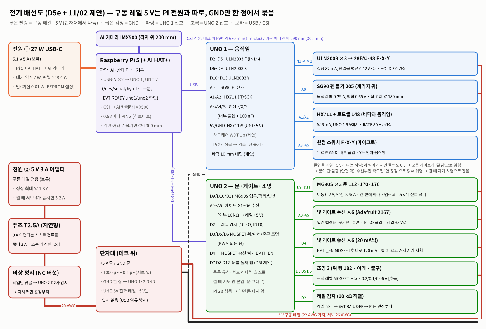
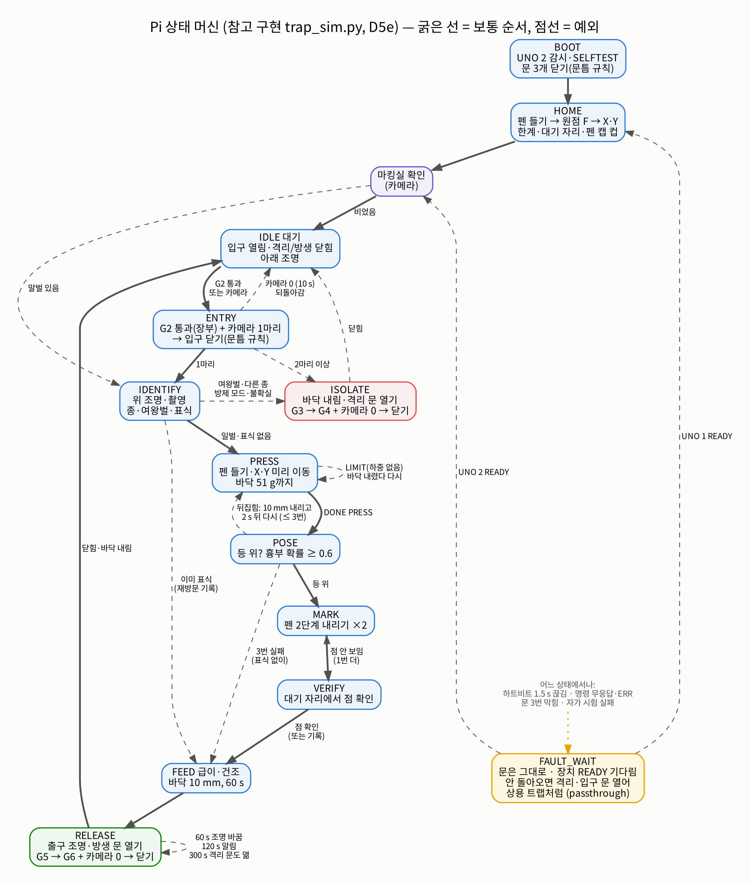
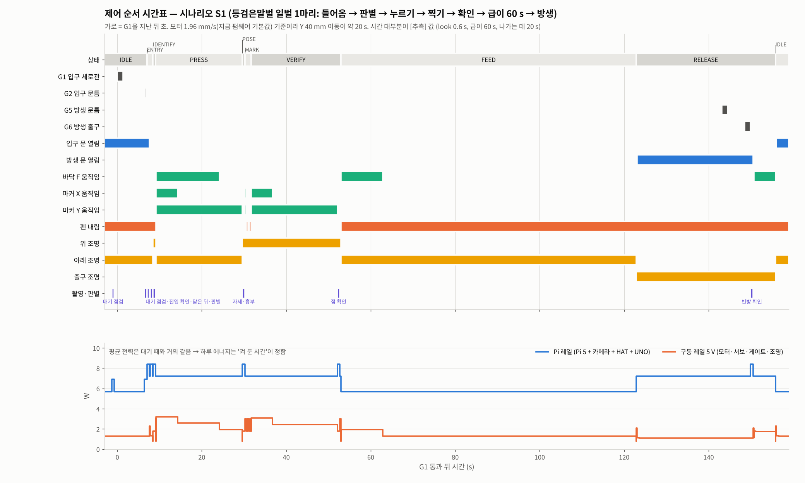

# 전기 계통과 제어 순서 (D5e 기준) — 전류·퓨즈·핀·배선 길이·전원(콘센트 + 배터리) + 상태 머신 시뮬레이션

정리: 2026-11-02 · 이서현 (Claude와, **CAP-AI-22**, 서현 위임으로 혼자 진행 → 09:25 서현 결정 반영) · 서현 PC 사본 `capstone design_이서현\제어\05_전기계통_제어순서_서현.md` (코드 `06_전기계산_시뮬레이션_코드\`)
바탕: `design/2026-11-02_제어_통합정리_D5e.md`(CAP-AI-21), 승준 펌웨어 `control/firmware/trap_controller/trap_controller.ino`(SJ-19, 읽기만), D5e 모델 좌표(`cad/D5e_module_kinematic.py`), S4 역학계산
계산·시험 코드: `design/control_sim/` (`elec_budget.py` 전기 계산, `trap_sim.py` 상태 머신 + 가짜 UNO·카메라·말벌, `make_figs.py` 그림)
표기: [확실] 사양·계산 / [가능성 높음] 근거 있음, 실측 전 / [추측] 실측 필요. **승준 파일은 고치지 않았다** — 펌웨어 제안은 GitHub Issue #5.

> **11/02 09:25 서현 결정**
> 1. Pi 자리 → **위판 아래** (AI 판단, 서현 위임): CSI 리본 약 290 mm, 300 mm 케이블
> 2. 문틈 → **문마다 빔 2개 + 문판 앞 끝 실리콘 립** (AI 추천, 서현 위임). 빛 게이트 6 → **9쌍**
> 3. 분류 → **등검은말벌·유럽말벌 2종만** (VespAI와 같은 2종). 두 종이 아니면 '불확실' → 격리. 유럽말벌을 격리할지 놓아줄지는 **서현 확인 대기** (지금은 문서 규칙대로 격리)
> 4. 전원 → **콘센트 기본, 배터리도 가능** → 본체 입력 2개는 그대로 두고 같은 플러그로 꽂는 **배터리 상자**(8장)

---

## 0. 결론 먼저

| # | 찾은 것 | 그래서 | 판정 |
|---|---|---|---|
| 1 | 규칙(서보는 한 번에 하나)을 지키면 구동 레일 최대 **약 1.9 A**. 그런데 지금 펌웨어 `setup()`은 **서보 4개를 한꺼번에** 움직임 → 켤 때 위치가 다르면 **약 3.3 A**로 5 V 3 A 어댑터를 넘음 | UNO는 켤 때 서보를 붙이지 않고, Pi가 문을 하나씩 닫음. UNO 2가 문 서보를 스스로 한 번에 하나만 움직임 | 계산 [확실] / 서보 전류 [가능성 높음] |
| 2 | 3 A 어댑터에 **3 A 퓨즈**는 거의 안 끊어짐 (어댑터가 먼저 전압을 떨어뜨림) | **T2.5A 지연형** 퓨즈 (정상 최대 1.9 A × 1.3) | [가능성 높음] |
| 3 | 바닥 모터를 멈춘 뒤 코일 전류(`HOLD F 1`, 지금 기본값)는 필요 없음: 바닥을 내리려는 토크 **0.64 N·mm** vs 28BYJ-48 기어 마찰 **59~118 N·mm** (92~185배) | **`HOLD F 0`** → 0.4~0.8 W 절약, 모터 발열 0.34~0.67 W 없앰 (모터 위 PLA 판 보호) | 사양값 [확실] / 실제 [가능성 높음] → 10분 처짐 시험 |
| 4 | D5e에서 Pi가 데크 위라 카메라까지 CSI 리본이 **약 680 mm** → 공식 케이블(200/300/500 mm)로 모자람 | **Pi를 같은 x·y에서 위판 아래(z ≈ 540~575)로** (결정) → 약 290 mm, 300 mm 케이블 | 좌표 계산 [확실] (경로 1.15배 [추측]) |
| 5 | 빛 게이트 수신부는 **열린 컬렉터** (끊기면 LOW). 수신부가 죽거나 선이 빠지면 풀업 때문에 **늘 '안 끊김'** → 문틈에 말벌이 있어도 닫힘 | 송신부 전원을 MOSFET(EMIT_EN)으로 켜고 끄는 **켤 때 자가 시험**. 풀업은 레일 +5 V에 → 레일이 꺼지면 모두 '끊김'(안전 쪽) | 극성 [확실 — Adafruit 안내] / 대책 [가능성 높음] |
| 6 | 문틈 빔 하나(통로 쪽)는 마킹실 쪽에서 머리만 문틈에 넣은 말벌을 못 봄. **시뮬레이션에서 빔 하나면 S8a·S8b 모두 끼임 1번**, 빔 2개면 0번 | **문마다 빔 2개(문판 앞·뒤 각 2 mm) + 실리콘 립** (결정). 순서로 방향도 앎 → 장부 어긋남도 줄어듦 | 시뮬레이션 [확실] / 실물 [가능성 높음] |
| 7 | 하루 에너지는 **켜 둔 시간**이 정함: 대기 7.4 W, 한 마리 처리는 대기보다 **0.03 Wh**만 더 씀. 9시간 운용이면 하루 **약 72 Wh**(콘센트 기준 84 Wh) | 콘센트 기본. **배터리 상자는 2일 → LiFePO4 12.8 V 20 Ah (2.84일)로 정함 (11/06)**. 12 Ah면 1.7일 (8장) | [가능성 높음] (Pi·카메라 전력은 측정 기사값) |
| 8 | 상태 머신 참고 구현으로 **시나리오 19개 모두 통과** — 안전 규칙 5개 검사 (서보 동시 1개, 펜 든 채로만 X·Y, 누르기·찍기 중 입구 닫힘, 끼임 0, 레일 최대 < 퓨즈) | Pi 코드는 이 순서(`trap_sim.py` PiFSM)를 그대로 옮겨 쓰면 됨 | 시뮬레이션 [확실] / 실물 [미검증] |
| 9 | 시뮬레이션에서 고장 5개를 찾음: ① 멈출 때 문 2개를 동시에 엶 ② 켤 때 문 상태를 몰라 원점 찾는 35 s 동안 말벌이 들어옴 ③ Pi가 멈추면 말벌이 바닥에 눌린 채 남음 ④ UNO 1이 꺼지거나 재부팅되면 **펜이 무게로 떨어짐** ⑤ 빔 하나 문틈 → 끼임 | ① UNO 2 서보 순서 + Pi가 OPEN 확인 ② BOOT에서 문 3개 먼저 닫음 ③ UNO 1 감시가 펜 들고 **바닥 10 mm 내림** ④ Pi가 시리얼을 열 때 UNO가 재부팅되지 않게 (`-hupcl` 또는 RESET–GND 10 µF) ⑤ 빔 2개 | [가능성 높음] |
| 10 | 한 마리 처리 **약 157 s** (급이 60 s 포함). 시간은 모터 1.96 mm/s가 정함 (Y 40 mm = 20 s, 두 번) | 점 확인을 대기 자리까지 가지 않고 15 mm만 비켜서 하면 약 13 s 단축. `SPEED 800`이면 25 % 빠름 | 시간값 대부분 [추측] |
| 11 | 2종 분류기는 꿀벌·장수말벌 같은 다른 곤충도 두 종 중 하나로 우기거나 낮은 신뢰도를 냄 | 신뢰도 기준 아래 = '불확실' → 격리 (S5b). **꿀벌이 들어오면 갇혀 죽는다**는 점은 남음 → 입구 크기 거름·행동 시험에서 확인 | [가능성 높음] |

---

## 1. 상태별 전류·전력

`HOLD F 0`, 빛 게이트 9쌍 기준. 구동 레일 = 5 V 3 A 어댑터(모터·서보·게이트·조명), Pi 레일 = 27 W 어댑터(Pi 5 + AI 카메라 + AI HAT+ + UNO 2개 + HX711).

| 상태 | 구동 레일 보통 (A) | 순간 최대 (A) | 구동 레일 (W) | Pi 레일 (W) | `HOLD F 1`이면 |
|---|---|---|---|---|---|
| 0 켤 때 원점 찾기 (F → X·Y) | 0.50 | 0.58 | 2.5 | 5.6 | +0.13 A |
| 대기 (아래 조명 켬) | 0.34 | 0.34 | 1.7 | 5.7 | +0.13 A |
| 1 진입 → 입구 문 닫기 (0.2 s) | 0.54 | 1.08 | 2.7 | 7.2 | +0.13 A |
| 2 판별 (위 조명) | 0.44 | 0.44 | 2.2 | 8.4 | +0.13 A |
| 3 누르기 + X·Y 미리 이동 | 0.73 | 0.85 | 3.6 | 7.2 | — |
| 4 자세·흉부 촬영 | 0.44 | 0.44 | 2.2 | 8.4 | +0.13 A |
| 5 찍기 (펜 서보) | 0.68 | 1.08 | 3.4 | 7.2 | +0.13 A |
| 6 급이·건조 | 0.34 | 0.34 | 1.7 | 5.7 | +0.13 A |
| 7 방생 문 열고 기다림 | 0.49 | 1.04 | 2.5 | 7.2 | +0.13 A |
| 8 격리 문 열고 기다림 | 0.43 | 0.98 | 2.2 | 7.2 | +0.13 A |
| 밤 (Pi 꺼짐 → UNO도 꺼짐) | 0.03 | 0.03 | 0.2 | 0.01 | — |

부품 값의 근거 (`elec_budget.py`의 `LOADS`):

| 부품 | 값 | 근거 |
|---|---|---|
| 28BYJ-48 + ULN2003 | 상당 (5 − 0.9) V / 50 Ω = **82 mA**, 반걸음은 1상·2상이 번갈아 → 평균 0.12 A, 최대 0.16 A | 50 Ω [확실 — 제조사], ULN2003 0.9 V [가능성 높음 — TI 대표값] |
| SG90 (펜) | 움직일 때 0.25 A, 막힘 0.65 A | [가능성 높음 — 흔한 측정값] |
| MG90S (문 3) | 무부하 90 mA, 막힘 750 mA @4.8 V, 미닫이 이동 평균 0.2 A | 사양 [확실 — 판매처] / 0.2 A [추측] |
| 빛 게이트 송신 | 20 mA @5 V ×9 = 0.18 A | [확실 — Adafruit 2167] |
| 조명 위·아래·출구 | 0.20 / 0.10 / 0.06 A | [추측 — 보유 조명 실측 필요] |
| Pi 5 | 대기 3.0 W, CPU 최대 8.8 W, 꺼짐 0.01 W (EEPROM `POWER_OFF_ON_HALT=1`) | [가능성 높음 — raspberry.tips 측정, Jeff Geerling] |
| AI 카메라 (IMX500) | 모델 실행 중 약 1.87 W | [가능성 높음 — Hackster 측정] |
| AI HAT+ (Hailo-8L) | 보통 1.5 W | [가능성 높음 — CNX] |
| UNO R3 | 약 50 mA (0.25 W) ×2 | [가능성 높음] |

## 2. 최대 전류와 퓨즈

| 경우 | 구동 레일 | 판정 |
|---|---|---|
| 규칙을 지킬 때 최악: 스테핑 3개 2상 + 문 서보 1개 막힘 + 게이트 9 + 조명 3개 다 켬 | **1.86 A** | 3 A 어댑터 안 [가능성 높음] |
| 켤 때 서보를 하나씩 | 1.15 A | 안 |
| **켤 때 서보 4개가 동시에** (지금 펌웨어 `setup()`: attach + write ×4) | **3.27 A** | **넘음** — 전압이 떨어져 UNO·서보가 재부팅을 되풀이할 수 있음 [가능성 높음] |

- **퓨즈 T2.5A (지연형, 5×20 유리관 또는 2.5 A 폴리퓨즈)**. 3 A 어댑터는 3 A 근처에서 스스로 전압을 떨어뜨리므로, 3 A 퓨즈는 단락에서도 늦게 끊어진다. 2.5 A는 정상 최대(1.86 A)의 1.3배다 [가능성 높음]. 11/02 아침 문서(제어 통합 정리 6장)의 '퓨즈 3 A'를 이것으로 바꾼다.
- **비상 정지**: 버섯 스위치(NC)를 퓨즈 뒤 레일에 직렬로 넣는다. 레일만 끊기므로 Pi·UNO는 살아 있고, UNO 2가 D2(10 kΩ 직렬)로 레일 끊김을 알린다 → 다시 켜면 **원점부터** (스테핑은 개루프라 레일이 끊기면 위치를 잃음) [가능성 높음].

## 3. 전원과 접지 규칙

1. **두 전원은 따로, GND만 한 점**(단자대)에서 묶는다. UNO 1·2의 GND도 그 점으로 간다.
2. **UNO 5V 핀과 레일 +5 V는 잇지 않는다.** UNO는 Pi USB에서 전원을 받는다. 이으면 두 5 V가 맞물려 USB 쪽으로 전류가 거꾸로 흐를 수 있다 [가능성 높음].
3. **HX711은 UNO 1의 5 V에서** 받는다 (약 6 mA). 서보가 흔드는 레일보다 조용하다 [가능성 높음].
4. 서보 옆 단자대에 **1000 µF 전해 + 0.1 µF**. ULN2003 보드마다 0.1 µF를 더해도 좋다.
5. 굵기: 어댑터 → 단자대 **20 AWG** (1.9 A에서 0.03 V 강하), 단자대 → ULN2003 22 AWG, 서보·조명 24~26 AWG, 신호 26~28 AWG. 움직이는 선(펜 서보, Y 모터, 로드셀, Y 원점)은 **실리콘 피복 연선**.
6. 밤: Pi를 `shutdown`하면(EEPROM `POWER_OFF_ON_HALT=1`) USB 전원이 끊겨 UNO도 꺼진다 → 게이트 송신(EMIT_EN)·조명이 저절로 꺼진다. 구동 레일 어댑터는 남아도 약 0.25 W [추측]. Pi 5 RTC 깨우기 알람으로 아침에 켤 수 있다 (꺼진 상태에서 깨우기는 아직 시험 안 함 [가능성 높음]).

## 4. 핀 배정 (최종안)

UNO 1 — 움직임 (11/02 아침 문서와 같음):

| 핀 | 연결 |
|---|---|
| D2~D5 / D6~D9 / D10~D13 | ULN2003 IN1~4 → 28BYJ-48 바닥 F / 마커 X / 마커 Y |
| A0 | SG90 펜 들기 205 신호 (전원은 레일) |
| A1 / A2 | HX711 DT / SCK (HX711 전원은 UNO 5 V) |
| A3 / A4 / A5 | 원점 스위치 F / X / Y (내부 풀업 + 100 nF, 눌리면 GND) |

UNO 2 — 문·게이트·조명 (**11/02 아침 문서에서 바꿈**, 빛 게이트 9쌍):

| 핀 | 연결 | 바꾼 까닭 |
|---|---|---|
| D9 / D10 / D11 | MG90S 입구 112 / 격리 170 / 방생 176 | (같음) Servo 라이브러리는 Timer1을 쓰고 어느 핀이든 된다 |
| A0~A5 | G1, **G2·G2b**(입구 문 바깥·안), **G3·G3b**(격리 문 안·바깥), G4 | 문마다 빔 2개. 외부 10 kΩ → 레일 +5 V (내부 풀업 20~50 kΩ는 서보 선 옆에서 잡음에 약함 [가능성 높음]) |
| D7 / D8 / D12 | **G5·G5b**(방생 문 안·바깥), G6 | 같음 |
| **D2** | 레일 감지 (10 kΩ 직렬, INT0) | 비상 정지·어댑터 빠짐을 알기 위해 (새로) |
| **D3 / D5 / (D6 예비)** | MOSFET → 위 링 / 아래 조명 (출구 조명은 11/06 SJ-45로 없앰) | 아침안 D2~D4 → PWM 되는 핀으로 (조명 밝기 조절 여지) |
| **D4** | MOSFET → 게이트 송신 9개 (EMIT_EN, 180 mA) | 켤 때 자가 시험 (새로) |
| D13 | 예비 (상태 LED·버저) | — |

Pi 5 GPIO2/3 (I2C): 배터리 상자의 **INA226** (배터리로 돌 때만 꽂음, 8장).

## 5. 신호

- **빛 게이트** (Adafruit 2167): 송신 빨강 5 V·검정 GND, 수신 빨강 5 V·검정 GND·흰 신호. **끊기면 LOW** (예제 코드: "if it is [broken], the sensorState is LOW") [확실]. 응답 2 ms 이하 [확실 — 사양].
  - UNO 2는 1 ms마다 읽고 **3번 연속 같으면** 바뀐 것으로 본다 (빛 반사·서보 잡음 거름) [가능성 높음].
  - **켤 때 자가 시험** `SELFTEST`: EMIT_EN을 끄면 9개 모두 LOW여야 하고, 켜면 모두 HIGH여야 한다. 어긋나면 그 게이트 이름을 보내고 Pi는 모듈을 멈춘 뒤 **격리·입구 문을 열어 상용 트랩처럼** 지나가게 한다 (시나리오 S11b). 대기 중 30분마다 다시 해도 된다 (50 ms).
  - 햇빛: 불투명 관 안이라 영향이 작다 [가능성 높음]. 야외에서 오작동하면 38 kHz 변조 수신기로 바꾼다.
- **원점 스위치**: 내부 풀업 + 100 nF, 소프트웨어로 5 ms 거름. 원점 찾기는 스위치까지 → 2 mm 물러남 → 반 속도로 다시 (같은 자리 반복성) [가능성 높음].
- **HX711**: 모듈 대부분이 RATE를 GND에 묶어 **10 Hz** → 누르기 정지가 최대 100 ms 늦음 = 1.96 mm/s에서 **0.2 mm** 더 올라감. RATE를 5 V로 바꾸면 80 Hz → 0.025 mm [가능성 높음]. 바닥과 말벌 사이 강성을 모르므로 힘으로 얼마인지는 J6 시험에서 본다.
- **시리얼 두 개 구분**: Pi에서 `/dev/ttyACM0·1` 순서는 바뀔 수 있다 → `/dev/serial/by-id/…`를 쓰거나 `EVT READY uno1/uno2` 문자열로 구분한다.

## 6. 문틈 — 빔 2개 (결정)

- 빔 하나(문판 앞 통로 쪽 3 mm 안)는 **마킹실 쪽에서 머리만 문판 평면을 넘은 말벌**을 못 본다. MG90S 닫는 힘은 22~44 N이라 (S4 M7) 이때 끼면 다친다.
- **시뮬레이션 비교** [확실 — `trap_sim.py` 마지막 비교]: 같은 행동표(S8a 머리만 2 s, S8b 닫힐 때마다 3번)를 빔 하나로 돌리면 **둘 다 끼임 1번**, 빔 2개면 **0번** (문이 바로 다시 열림).
- 빔 2개는 **방향**도 준다 (앞 → 뒤 = 지나감, 같은 빔으로 빠짐 = 되돌아감). 빔 하나일 때 S8a에서 생기던 장부 어긋남이 없어졌다. 바짝 붙은 두 마리(S3)는 빔 2개로도 한 번으로 보일 수 있어 **카메라 마릿수가 최종 판단**이다.
- 배치: 문판 평면 앞·뒤 **각 2 mm 안** (입구·격리 문 x ≈ 23·29, 방생 문 x ≈ 81·87). 두 빔이 모두 0.2 s 비어야 닫기 시작하고, 닫는 중 둘 중 하나라도 막히면 바로 다시 연다. 문판 앞 끝에 **실리콘 립 1 mm**(끼어도 힘을 나눔). D5f 모델에 넣는다.
- 그래도 남는 위험: 다리 끝 같은 아주 작은 부분 [가능성 높음]. 닫는 동안 서보 속도를 반으로 줄이면(0.4 s) 빔이 잡을 시간이 늘어난다.

## 7. 배선 길이 (D5e 좌표, 직각 경로 × 1.2 + 끝 여유 60 mm, 움직이는 끝은 1.5 × 움직임 + 40 mm)

UNO는 데크 위(191 자리), UNO 2는 그 위에 15 mm 기둥으로 겹친다고 봤다. 단자대는 데크 위 빈 자리(x −30, y −65). Pi는 위판 아래로 옮기므로 Pi → UNO는 USB 케이블(0.5 m)로 충분하다.

| 배선 | 선 수 · 굵기 | 길이 (mm) | 기본 선 | 더 필요한 길이 | 강하 (V) |
|---|---|---|---|---|---|
| 구동 전원 입력 → 단자대 (+5 V, GND) | 2 · AWG 20 | 198 | — | 전부 새로 | 0.033 |
| 단자대 → ULN2003 F (+5 V, GND) | 2 · AWG 22 | 180 | — | 전부 새로 | 0.003 |
| 단자대 → ULN2003 X·Y (+5 V, GND, 둘이 함께) | 2 · AWG 22 | 594 | — | 전부 새로 | 0.021 |
| UNO 1 → ULN2003 F (IN1~4) | 4 · AWG 26 | 203 | — | 전부 새로 | — |
| UNO 1 → ULN2003 X (IN1~4) | 4 · AWG 26 | 607 | — | 전부 새로 | — |
| UNO 1 → ULN2003 Y (IN1~4) | 4 · AWG 26 | 643 | — | 전부 새로 | — |
| ULN2003 F → 바닥 모터 153 | 5 · AWG 26 | 110 | 240 | 0 | 0.005 |
| ULN2003 X → X 모터 215 | 5 · AWG 26 | 126 | 240 | 0 | 0.006 |
| ULN2003 Y → Y 모터 209 (X로 움직임) | 5 · AWG 26 | 333 | 240 | 93 | 0.015 |
| UNO 1 → 펜 서보 205 (신호 + 레일 전원, X·Y로 움직임) | 3 · AWG 26 | 711 | 250 | 461 | 0.124 |
| HX711 → 로드셀 148 (바닥과 함께 움직임) | 4 · AWG 28 | 271 | — | 전부 새로 | — |
| UNO 1 → HX711 (5V, GND, DT, SCK) | 4 · AWG 26 | 289 | — | 전부 새로 | — |
| UNO 1 → 원점 F | 2 · AWG 28 | 292 | — | 전부 새로 | — |
| UNO 1 → 원점 X | 2 · AWG 28 | 492 | — | 전부 새로 | — |
| UNO 1 → 원점 Y (빔과 함께 움직임) | 2 · AWG 28 | 654 | — | 전부 새로 | — |
| UNO 2 → 입구 문 서보 112 | 3 · AWG 26 | 340 | 250 | 90 | 0.068 |
| UNO 2 → 격리 문 서보 170 | 3 · AWG 26 | 373 | 250 | 123 | 0.075 |
| UNO 2 → 방생 문 서보 176 | 3 · AWG 26 | 443 | 250 | 193 | 0.089 |
| UNO 2 → 빛 게이트 G1 (송신 2선 + 수신 3선) | 5 · AWG 28 | 244 | 230 | 14 | — |
| UNO 2 → 빛 게이트 G2 / G2b | 5 · AWG 28 | 361 / 366 | 230 | 131 / 136 | — |
| UNO 2 → 빛 게이트 G3 / G3b | 5 · AWG 28 | 400 / 395 | 230 | 170 / 165 | — |
| UNO 2 → 빛 게이트 G4 | 5 · AWG 28 | 598 | 230 | 368 | — |
| UNO 2 → 빛 게이트 G5 / G5b | 5 · AWG 28 | 464 / 469 | 230 | 234 / 239 | — |
| UNO 2 → 빛 게이트 G6 | 5 · AWG 28 | 504 | 230 | 274 | — |
| UNO 2 → MOSFET → 위 조명 182 | 2 · AWG 24 | 685 | — | 전부 새로 | 0.023 |
| UNO 2 → MOSFET → 아래 조명 | 2 · AWG 24 | 397 | — | 전부 새로 | 0.007 |
| UNO 2 → MOSFET → 출구 조명 | 2 · AWG 24 | 526 | — | 전부 새로 | 0.005 |

- 전선을 가닥으로 모두 더하면 **약 44 m** → 26 AWG·28 AWG 실리콘 연선 각 10~15 m 묶음, 22·20 AWG 각 2 m, 점퍼 연장 커넥터(듀폰 또는 JST-XH)로 충분하다 [가능성 높음].
- **CSI 카메라 리본**: Pi를 위판 아래로 옮겨 약 **290 mm** → **300 mm 케이블**(공식 Pi 5용 22핀 ↔ 15핀). 보유 AI 카메라에 든 케이블 길이를 확인할 것.
- 강하는 모두 0.13 V 이하 → 서보 5 V 기준 2.5 % 이내라 문제없다 [확실 — 계산].

## 8. 전원 — 콘센트 기본, 배터리도 가능 (결정)

### 8-1. 구성

| 쓰는 곳 | 본체 입력 (바꾸지 않음) | 콘센트 | 배터리 |
|---|---|---|---|
| Pi 레일 | **USB-C** | 27 W 공식 어댑터 (보유) | 배터리 상자의 강압 5.1 V 5 A → USB-C |
| 구동 레일 | **DC 5.5×2.1 배럴 5 V** → 퓨즈 T2.5A → 비상 정지 → 단자대 | 5 V 3 A 어댑터 (구매 목록 G2) | 배터리 상자의 강압 5 V 3 A → 배럴 |

- **배터리 상자** (따로 만든 상자, 본체는 그대로): LiFePO4 12.8 V 팩(BMS 들어 있음) → 퓨즈 5 A → **INA226**(전압·전류·적산) → 강압 2개. INA226은 4선(3.3 V·GND·SDA·SCL)으로 Pi GPIO2/3에 꽂는다.
- 바꾸는 법: 전원을 끄고 플러그 2개를 바꿔 꽂는다. **자동 전환(정전 때 끊김 없이)은 이번에는 안 한다** — 필요하면 나중에 DC-UPS 모듈을 앞에 단다.
- 왜 이렇게 [가능성 높음]: ① 본체 회로·보유 어댑터를 그대로 씀 ② 배터리 크기를 바꿔도 본체가 안 바뀜 ③ 12.8 V LiFePO4는 태양광 충전기·자동차 배터리와 같은 12 V 계열이라 나중에 늘리기 쉬움. 보조배터리 2개도 같은 플러그로 꽂히지만 **밤에 전류가 작으면 저절로 꺼지는** 제품이 많아 아침에 구동 레일이 죽을 수 있다 → 짧은 시험용으로만.

### 8-2. 얼마나 가나

| 조건 | 대기 전력 | 하루 (부하) | 하루 (콘센트, 효율 85 %) |
|---|---|---|---|
| 9시간 운용, 하루 20마리, 카메라 늘 켬, 아래 조명 켬, `HOLD F 0` | 7.4 W | **71.6 Wh** | 84.3 Wh |
| 같은 조건, 하루 100마리 | 7.4 W | 74.2 Wh | 87.3 Wh |
| 24시간 운용, `HOLD F 1` (지금 펌웨어 기본) | 8.1 W | 194.0 Wh | 228.3 Wh |
| 9시간, 카메라는 G1이 울릴 때만, 대기 조명 끔 (절약) | 5.3 W | 52.9 Wh | 62.2 Wh |

배터리 상자 (강압 효율 90 %, 무부하 0.05 W, LiFePO4 90 %까지 씀, 하루 20마리·9시간):

| 팩 | 에너지 | 보통 모드 (하루 81 Wh) | 절약 모드 (하루 60 Wh) |
|---|---|---|---|
| 12.8 V 6 Ah | 77 Wh | 0.85일 | 1.15일 |
| 12.8 V 12 Ah | 154 Wh | 1.7일 | 2.3일 |
| 12.8 V 15 Ah | 192 Wh | 2.13일 | 2.87일 |
| 12.8 V 20 Ah | 256 Wh | 2.8일 | 3.8일 |

- 한 마리 처리(S1, 157 s)는 대기보다 **0.03 Wh**만 더 쓴다 [확실 — 시뮬레이션 적분]. 마릿수가 아니라 **켜 둔 시간**이 배터리를 정한다.
- **11/06 결정: 배터리 2일 (서현) → 20 Ah** (15 Ah는 여유 6 %라 추위·노화에 모자람, AI 판단). 시험은 콘센트. 밤에는 Pi를 끄고(0.01 W) 아침 RTC 알람으로 켠다.
- 대략 값 [추측 — 승준이 가격 확인]: LiFePO4 12.8 V 20 Ah 13~18만 원 [추측], 전용 충전기(14.6 V) 2~3만 원, 강압 2개 1~2만 원, INA226 0.5만 원, 퓨즈·커넥터·상자 1만 원 → **약 18~25만 원** [추측 — 20 Ah 기준]. 남은 재료비를 보고 현장 시험 날짜가 정해지면 산다.

### 8-3. 배터리가 떨어질 때 (시나리오 S14)

- Pi가 0.5 s마다 INA226을 읽는다. **남은 에너지 15 %(적산) 또는 부하 중 12.0 V 아래**면 '부족' [가능성 높음 — LiFePO4는 전압이 평평해서 적산을 먼저 봄].
- 순서: 처리 중인 말벌은 **끝까지 처리**(찍고 급이·방생) → 조명 끔 → **격리 문·입구 문 열기**(상용 트랩처럼 지나가게) → Pi 끔 → UNO도 꺼짐. 뒤에 온 말벌은 마킹실에 갇히지 않고 포획통으로 간다 (S14에서 확인).
- BMS 차단(약 10 V)보다 먼저 Pi가 꺼지므로 SD 카드가 깨지지 않는다 [가능성 높음].

## 9. 바닥 모터 유지 전류 (`HOLD F`)

| 항목 | 값 | 근거 |
|---|---|---|
| 바닥을 내리려는 토크 (누르는 힘 0.5 N, 리드 8 mm, 역구동 효율 1로 최악) | **0.64 N·mm** | F·L/2π [확실 — 계산] (S4 M1과 같은 크기) |
| 28BYJ-48 기어 마찰 토크 (전원 없을 때) | **59~118 N·mm** (600~1200 gf·cm) | [확실 — 제조사 사양] |
| 자기 위치 유지 토크 | 34.3 N·mm 이상 | [확실 — 제조사 사양] |
| 여유 | 마찰 92~185배, 유지 토크 54배 | [확실 — 계산] |
| `HOLD F 1`이 쓰는 것 | 레일 0.41~0.82 W, 코일 발열 0.34~0.67 W, 9시간이면 3.7~7.4 Wh | [확실 — 계산] |

→ **`HOLD F 0` 권장** [가능성 높음]. 끄는 순간 회전자가 가까운 자리로 반걸음 이내(0.002 mm) 움직일 뿐이다. 모터 바로 위가 PLA 모터판(152)이라 여름 한낮 발열은 피하는 것이 좋다. **시험**: 전원을 끈 채 바닥에 1 N(100 g 추)을 올리고 10분 뒤 처짐을 다이얼 게이지나 캘리퍼로 잰다 (0.05 mm 이하면 통과).

## 10. 제어 순서 — Pi 상태 머신

| 상태 | 들어가며 하는 일 | 넘어가는 조건 | 시간 제한·안 되면 |
|---|---|---|---|
| BOOT | UNO 2 `WATCHDOG 2`, `SELFTEST`(9쌍), **문 3개 닫기**(문틈 규칙) | 모두 OK | SELFTEST 실패 → 멈춤 + 격리·입구 문 열기 (passthrough) |
| HOME | UNO 1 `WATCHDOG 2`, `HOLD F 0`, `PEN UP`, `HOME ALL`(F 먼저 → X·Y), `LIMIT X 37 73`, `LIMIT Y -40 18`, 대기 자리 (65, −40), `PEN DOWN`(캡 컵) | `DONE HOME ALL` | 120 s → 고장 |
| 마킹실 확인 | 촬영 | 비었으면 IDLE, 말벌 있으면 IDENTIFY (켜는 중·고장 중에 들어온 말벌) | — |
| IDLE | 위 조명 끔, 아래 조명 켬, 격리·방생 닫힘 확인, `DOOR IN OPEN` | 장부 마킹실 ≥ 1 (G2 → G2b) 또는 5 s마다 촬영에서 말벌 | 배터리 부족이면 SHUTDOWN |
| ENTRY | 촬영으로 1마리 확인 → `DOOR IN CLOSE` (UNO 2가 문틈 규칙) → 닫은 뒤 다시 촬영 | 카메라 1마리 → IDENTIFY, 2마리 이상 → ISOLATE | 카메라 0이 10 s → 장부 0으로, 문 열어 둠. 문 3번 막힘(BLOCKED) → 5 s 뒤 다시, 3번이면 고장 |
| IDENTIFY | 아래 조명 끔, 위 조명 켬, 촬영 → **2종 분류**(등검은말벌/유럽말벌) + 여왕벌(크기)·표식 | 등검은말벌 일벌·표식 없음 → PRESS / 이미 표식 → FEED (재방문 기록) / 유럽말벌 → ISOLATE(서현 확인 대기) / 여왕벌·방제 모드 → ISOLATE / **2종 아님·불확실 → ISOLATE** | — |
| PRESS | `PEN UP` → 위 조명 끔·아래 켬 → `MOVE X`, `MOVE Y`(판별 사진의 흉부 추정), `PRESS 51` 동시에 | 세 `DONE` 모두 | `DONE PRESS LIMIT`(하중 없음) → 바닥 내리고 다시 (최대 3번) |
| POSE | 아래 끔·위 켬, 촬영 → 등 위? 흉부 확률 ≥ 0.6 | 등 위 → MARK | 뒤집힘·확률 낮음 → 바닥 10 mm 내리고 2 s → PRESS (최대 3번) → 실패면 표식 없이 FEED |
| MARK | `MOVE X/Y` 흉부로 → `PEN DOWN`(2단계) → 0.3 s → `PEN UP`, **두 번** | — | — |
| VERIFY | 대기 자리로 비켜서 촬영 → 점 있나 | 있으면 `PEN DOWN`(캡) → FEED | 없으면 MARK 한 번 더 → 그래도 없으면 기록하고 FEED |
| FEED | 위 끔·아래 켬, `MOVE F 10`(심지 높이), 60 s | 시간 끝 | — |
| RELEASE | (밤이면 NIGHT_HOLD, 11/06) 위·아래 끔, `DOOR REL OPEN` (출구 조명 없음) | 장부(G5 → G5b → G6) 0 **그리고** 카메라 0 → `DOOR REL CLOSE` → `MOVE F 0` → IDLE | 60 s 출구 조명 깜빡, 120 s 알림, 300 s 격리 문도 엶 |
| ISOLATE | `MOVE F 0`, 위·아래 끔, `DOOR CAP OPEN` (포획통 쪽이 밝음) | 장부(G3 → G3b → G4) 0 그리고 카메라 0 → `DOOR CAP CLOSE` → IDLE | 같음 |
| SHUTDOWN | (배터리 부족, 처리 끝난 뒤) 조명 끔, 격리 문 → 입구 문 열기, Pi 끔 | — | — |
| FAULT_WAIT | 문은 그대로. 고장 난 장치의 `EVT READY`를 120 s 기다림 | 돌아오면 그 장치만 다시 초기화 → 마킹실 확인으로 | 안 돌아오면 passthrough |

고장으로 가는 것: 하트비트 1.5 s 끊김 (Pi가 0.5 s마다 `PING`), 명령에 `ERR`·무응답, 문 3번 막힘, 자가 시험 실패.

### 10-1. 한 마리 처리 시간표 (시나리오 S1)

- G1 통과 → 입구 문이 다시 열릴 때까지 **157 s**. 판별까지 약 10 s, 누르기·미리 이동 20 s, 찍기 2 s, 대기 자리로 비키기 21 s, 급이 70 s, 방생 33 s (말벌이 나가는 데 20 s로 가정).
- 메시지 전체 순서: `img/control/제어_메시지순서_S1.png` (Pi ↔ UNO 1 ↔ UNO 2).

### 10-2. UNO 2 명령 (제안 — 승준 펌웨어 나누기 때)

| 명령 | 응답·사건 | 하는 일 |
|---|---|---|
| `PING` | `OK PONG` | 하트비트 |
| `WATCHDOG <s>` | `OK WATCHDOG` | s초 동안 명령 없으면: 닫던 문은 다시 열고, 문은 그 자리, `EVT WATCHDOG_HOLD` |
| `SELFTEST` | `OK SELFTEST` / `ERR SELFTEST G3 STUCK_CLEAR` | EMIT_EN 끔 → 9개 모두 LOW? → 켬 → 모두 HIGH? |
| `STATUS` | `OK STATUS IN=OPEN CAP=CLOSED REL=CLOSED GATES=000000000 RAIL=1` | 문은 서보를 아직 안 붙였으면 `UNKNOWN` |
| `DOOR <IN·CAP·REL> OPEN` | `OK DOOR` → `EVT DOOR IN OPEN <ms>` | 다른 문 서보가 움직이면 끝날 때까지 기다렸다 움직임 |
| `DOOR <…> CLOSE` | `OK DOOR` → `EVT DOOR IN CLOSED <ms>` / `EVT DOOR IN RETRY <k>` / `EVT DOOR IN BLOCKED` | 그 문의 **빔 2개가 모두** 0.2 s 비어야 시작, 닫는 중 하나라도 막히면 바로 다시 열고 1 s 뒤 재시도, 3번이면 BLOCKED |
| `LIGHT <TOP·BOT> <0~255>` | `OK LIGHT` | MOSFET (D3·D5 PWM) — EXIT 없앰 (11/06) |
| (사건) | `EVT GATE <1·2·2b·3·3b·4·5·5b·6> BLOCK·CLEAR <ms>`, `EVT RAIL OFF·ON`, `EVT READY uno2 …` | 3번 연속 같은 값일 때만 보냄 |

켤 때: **서보를 붙이지 않는다** (문은 기어 마찰로 그 자리에 있음). 문 서보는 멈춘 뒤 0.5 s에 신호를 끊는다 (떨림·전류).

### 10-3. UNO 1에 더할 것 (제안 — 지금 펌웨어 기준)

| 지금 | 제안 | 까닭 |
|---|---|---|
| `HOLD` 기본 F=1 | **F=0** | 9장 |
| 원점 스위치 없음 → 켤 때 0으로 가정 | `HOME ALL` (F 먼저, 그다음 X·Y), `DONE HOME ALL`. 원점 전에는 `MOVE`에 `ERR NOT_HOMED` | 고장·재부팅 뒤 위치를 다시 앎 |
| `LIMIT` 기본 X −18~18, Y −40~18 (D5d) | D5e: **X 37~73, Y −40~18** (절대 좌표, 대기 자리 65, −40). 원점 스위치 자리가 X 37·Y −40 | D5e 검사 범위 (`cad/D5e_check.py`) |
| `PEN DOWN` 한 번에 | **2단계** (팁 위 2 mm까지 빠르게, 마지막 2 mm는 1°씩 약 17 ms) + `DONE PEN UP·DOWN` | S4 M8 충격, Pi가 끝을 알아야 함 |
| 펜 내린 채 `MOVE X·Y` 가능 | **`ERR PEN_DOWN`** (펜 든 채로만 X·Y) | 캡 컵·말벌 위에서 끌림 방지 |
| `setup()`에서 서보 4개 attach·write | 붙이지 않음 → 첫 `PEN` 명령 때 붙임 | 켤 때 3.3 A |
| `WATCHDOG` 기본 0 (끔), 걸리면 멈춤·펜 들기 | Pi가 켤 때 `WATCHDOG 2`. 걸리면 멈춤 → 펜 들기 → **바닥 10 mm 내림** | Pi가 멈추면 말벌이 0.5 N으로 계속 눌림 (S12b) |
| (없음) | 하드웨어 WDT 1 s (`avr/wdt.h`) | 루프가 멎으면 감시도 멎음 |
| HX711 10 Hz 그대로 | 모듈 RATE 핀을 5 V로 (80 Hz) | 누르기 넘침 0.2 → 0.025 mm |
| `SPEED` 기본 1000 µs | J6에서 800 µs가 탈조 없으면 800 | 처리 시간 −25 % |

## 11. 시나리오 시험 (`python design/control_sim/trap_sim.py`)

안전 규칙 5개를 모든 시나리오에서 검사한다: ① 서보(문 3 + 펜) 동시에 1개 이하 ② X·Y는 펜을 든 채로만 ③ PRESS·POSE·MARK·VERIFY 동안 입구 문 닫힘 ④ 문이 닫히는 순간 문판 평면에 말벌 없음(끼임 0) ⑤ 구동 레일 순간 최대 < 퓨즈 2.5 A. **19개 모두 통과** (최대 1.08 A).

| 시나리오 | 무엇 | 결과 | 처리 (s) | 기록 |
|---|---|---|---|---|
| S0 | 입구 통로에 들어왔다 되돌아감 | 통과 — 트랩으로 돌아감, 문 안 움직임 | — | — |
| S1 | 등검은말벌 일벌 1마리 → 찍고 급이 후 방생 | 통과 — 밖, 표식 | 157 | — |
| S2 | 두 번째가 처리 중에 도착 | 통과 — 입구 문 앞에서 기다렸다 차례로, 둘 다 표식 | 157 | — |
| S3 | 두 마리가 문 닫기 전에 바짝 붙어 들어옴 | 통과 — 카메라 2마리 → 둘 다 격리 | 41 | 장부 1 vs 카메라 2 (빔이 두 마리를 한 번으로 봄) |
| S4 | 여왕벌 | 통과 — 격리 | 40 | — |
| S5 | 유럽말벌 (지금 규칙: 격리, 서현 확인 대기) | 통과 — 격리 | 40 | — |
| S5b | 2종이 아닌 곤충 (장수말벌·꿀벌 등) | 통과 — 불확실 → 격리 | 40 | — |
| S6 | 이미 표식 있음 | 통과 — 재방문 기록, 급이 후 방생 | 109 | — |
| S7 | 방생 문을 열어도 150 s 안 나감 | 통과 — 60 s 조명 바꿈, 120 s 알림, 나감 | 287 | — |
| S8a | 입구 문이 닫히기 시작할 때 마킹실 쪽에서 머리만 문틈에 넣음 (2 s) | 통과 — 안쪽 빔 G2b가 잡아 바로 다시 열고, 비자 닫음 | 160 | 문 되열림 1번. **빔 하나면 끼임** |
| S8b | 닫힐 때마다 문틈으로 3번 | 통과 — BLOCKED → Pi가 5 s 뒤 다시 | 165 | 문 되열림 3번. **빔 하나면 끼임** |
| S9 | 처음 누르니 뒤집힘 | 통과 — 10 mm 내렸다 다시 → 표식 | 170 | 자세 재시도 |
| S10 | 찍은 점이 두 번 다 안 보임 | 통과 — 표식 없이 방생, 기록 | 200 | 점 확인 실패 ×2 |
| S11a | 카메라가 4 s 동안 못 봄 | 통과 — 기다렸다 확인 후 닫음 | 162 | — |
| S11b | 격리 문 G3 수신부 고장 (늘 '안 끊김') | 통과 — 켤 때 자가 시험에서 잡음 → 격리·입구 문 열어 상용 트랩처럼 → 말벌은 포획통 | — | 고장, 멈춤, passthrough |
| S12a | 누르는 중 UNO 1 전원 8 s 끊김 | 통과 — 하트비트로 잡고, 돌아오면 원점부터, 이어서 표식 | 203 | **펜 떨어짐** |
| S12b | 찍는 중 Pi 20 s 멈춤 | 통과 — UNO 감시가 멈춤·펜 들기, Pi 재시작 후 마킹실 확인 → 이어서 | 197 | **펜 떨어짐** (재부팅) |
| S13 | 켜는 중(원점 찾기 35 s)에 도착 | 통과 — 닫힌 입구 문 앞에서 기다렸다 처리 | 183 | — |
| S14 | 배터리로 운용 중 누르는 동안 배터리 부족 | 통과 — 이 말벌은 끝까지(표식·방생) → 격리·입구 문 열고 Pi 끔 → 뒤에 온 말벌은 포획통 | — | 배터리 부족, 끔 |

## 12. 시뮬레이션이 바꾼 것

1. **멈출 때 문 2개를 동시에 열었다** (처음 짠 passthrough) → 규칙 ① 검사에서 걸림. 고침: Pi가 `EVT DOOR … OPEN`을 기다리고, UNO 2도 문 서보를 스스로 하나씩만 움직인다 (이중 보호).
2. **켤 때 입구 문 상태를 모른다** → 원점 찾는 35 s 동안 말벌이 마킹실로 들어올 수 있었다. 고침: BOOT에서 문 3개를 먼저 닫는다 (S13).
3. **빔 하나 문틈은 끼임을 못 막는다** (S8a·S8b 비교) → 문마다 빔 2개 (결정).
4. **Pi가 멈추면 말벌이 눌린 채 남는다** (S12b) → UNO 1 감시가 바닥을 10 mm 내리도록 제안.
5. **UNO 1이 꺼지거나 재부팅되면 펜이 떨어진다** (S12a·b): 펜은 무게로 내려가고 서보가 들고 있는 구조라서다. 말벌 위면 엉뚱한 곳에 점이 찍힐 수 있다 [가능성 높음]. 대책: Pi가 시리얼을 열 때 UNO가 재부팅되지 않게 `stty -F /dev/ttyACM0 -hupcl`(또는 UNO RESET–GND에 10 µF, 업로드 때는 뺌) [가능성 높음]. 전원 끊김은 막을 수 없으므로 기록만 남기고, 재개 때 카메라로 점을 확인한다.
6. **처리 시간의 절반이 마커 이동**이다 → 점 확인을 15 mm만 비켜서 하면 약 13 s 단축 (카메라 시야에서 마커가 빠지는지 J6에서 확인).

## 13. 결정과 남은 것

| # | 항목 | 상태 |
|---|---|---|
| 1 | Pi 자리 → 위판 아래, CSI 300 mm | **결정** (AI 판단, 서현 위임) → D5f 모델 |
| 2 | 문마다 빔 2개 + 실리콘 립, 빛 게이트 9쌍 | **결정** (AI 추천, 서현 위임) → D5f 모델, 승준 구매 +3쌍 |
| 3 | 분류 2종 (등검은말벌·유럽말벌), 2종 아님 → 격리 | **결정** (서현) |
| 3-1 | 유럽말벌로 판별되면 격리할지 놓아줄지 | **서현 확인 대기** — 지금은 문서 규칙(격리). `PRM["crabro_action"]` 한 줄로 바뀜 |
| 4 | 콘센트 기본 + 배터리 상자 | **결정** (서현) — 배터리 상자 구매는 현장 시험 날짜와 남은 재료비를 보고 (서현 + 승준). 몇 일 버텨야 하는지 정하면 팩 크기 확정 |
| 5 | 펌웨어 나누기와 10-2·10-3 반영 | 승준 (Issue #5) |
| 6 | 인터페이스 정의서 전원 줄(1.9 A, 퓨즈 T2.5A, 배터리 상자)·센서 9쌍·UNO 2 핀 | 승준 확인 뒤 변경 이력과 함께 |
| 7 | 조명 전류 실측 → `LOADS`의 [추측] 값 바꿈 | 승준 또는 서현 |

## 14. 검증과 한계

- 전류·전력·강하·토크·배터리 일수는 스크립트로 계산했다 (`out/elec_results.json`). 사양값은 표의 근거를 따랐다 [확실/가능성 높음]. 조명·수신부 전류, 경로 1.2배, 강압 효율·무부하, 배터리 가격은 [추측].
- 시뮬레이션은 **가짜 장치**다: 모터는 일정 속도, 서보는 정해진 시간, 말벌은 정해진 행동표, 카메라는 '보이면 맞게 판별'한다 (판별 오류는 S11a의 '못 봄'과 S5b의 '2종 아님'만 넣음). 실제 하드웨어·행동은 `미검증`. 문판 평면은 두 빔 사이에 있다고 봤다 — 다리 끝처럼 빔에 안 걸리는 작은 부분은 이 가정 밖이다.
- 같은 입력이면 결과가 같다 (난수 없음). `python design/control_sim/trap_sim.py S1_nominal`로 메시지 기록을 줄마다 볼 수 있다.

## 출처
- [Adafruit IR Break Beam Sensors — Arduino](https://learn.adafruit.com/ir-breakbeam-sensors/arduino) (열린 컬렉터, 끊기면 LOW, 10 kΩ 풀업, 송신 20 mA @5 V)
- [Jeff Geerling — Reducing Raspberry Pi 5's power consumption by 140x](https://www.jeffgeerling.com/blog/2023/reducing-raspberry-pi-5s-power-consumption-140x/) (꺼짐 1.2~1.6 W → 0.01 W)
- [raspberry.tips — Raspberry Pi power consumption (2026)](https://raspberry.tips/en/faq/raspberry-pi-power-consumption-update-2026-all-models-compared) (Pi 5 대기 약 3.0 W, CPU 최대 약 8.8 W)
- [Hackster — Raspberry Pi AI Camera hands-on](https://hackster.io/news/raspberry-pi-s-ai-eye-hands-on-with-the-raspberry-pi-ai-camera-module-383fb34afcf7) (AI 카메라 약 1.87 W)
- [CNX Software — Raspberry Pi AI Kit (Hailo-8L)](https://www.cnx-software.com/2024/06/04/70-raspberry-pi-ai-kit-combines-official-m-2-hat-with-hailo-8l-ai-accelerator/) (보통 1.5 W)
- [Adafruit 5818](https://www.adafruit.com/product/5818) · [5820](https://www.adafruit.com/product/5820) (Pi 5 카메라 케이블 200·500 mm), 공식 300 mm 판매처 목록
- 28BYJ-48 사양(50 Ω, 마찰 토크 600~1200 gf·cm, 자기 위치 유지 34.3 mN·m), MG90S 사양(막힘 750 mA) — 11/02 확인, 제어 통합 정리와 같음
