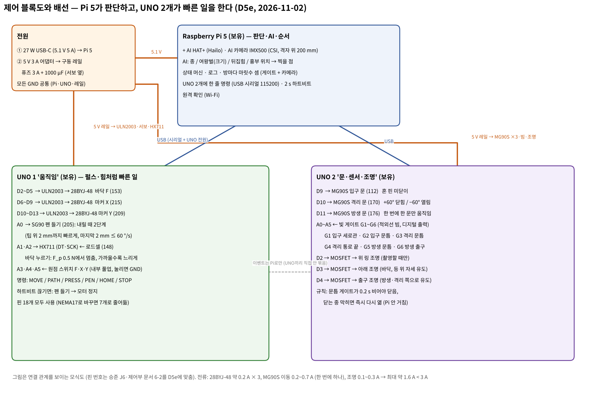
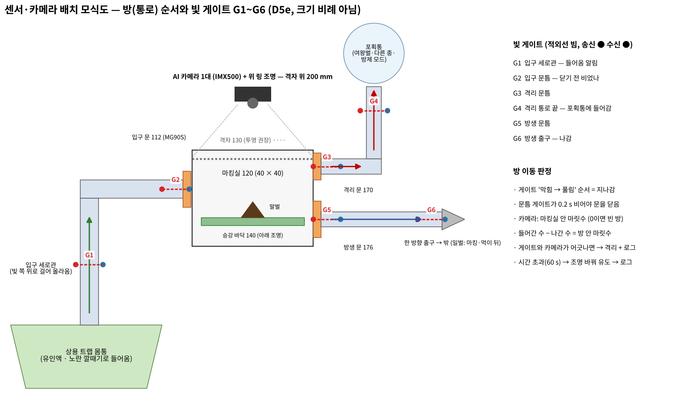

# 제어 통합 정리 (D5e 기준) — 센서·회로·문·방 이동 확인·카메라·제어기

정리: 2026-11-02 · 이서현 (Claude와, **CAP-AI-21**) · 서현 PC 사본 `capstone design_이서현\제어\`
바탕: 승준 `control/2026-10-28_제어부_구성_신뢰성_AI마킹.md`(SJ-24)·`control/2026-10-28_J6_구동부_펌웨어와_시험절차.md`(SJ-19), 인터페이스 정의서 4차, D5e 모델, S4 M7·M8, VespAI 점검(`design/2026-11-02_VespAI_점검_서현.md`)
승준 문서는 D5d(10/28) 기준이다. 이 문서는 그 위에 D5e 변경을 반영했다. 바뀐 것은 문 서보(MG90S 미닫이), 문틈 확인 규칙, 펜 2단계 내리기, 스프링 204 없음, 빛 게이트 6개, 격자 가림이다. **승준 파일은 고치지 않았고**, 펌웨어 나누기와 인터페이스 정의서 반영은 승준 확인 뒤에 한다.
표기: [확실] 계산·사양·문서 / [가능성 높음] 근거 있음, 시험 전 / [추측]

> **11/02 08:50 바뀐 것 (CAP-AI-22, `design/2026-11-02_전기계통_제어순서_서현.md`)** — 아래 6장보다 그 문서가 최신이다.
> ① 퓨즈 3 A → **T2.5A 지연형** ② 최대 전류 1.6 A → **1.8 A** (켤 때 서보 4개 동시면 3.2 A → 서보는 하나씩) ③ UNO 2 조명 핀 D2~D4 → **D3·D5·D6**, D2 = 레일 감지, D4 = 게이트 송신 켜기(자가 시험) ④ 게이트 풀업은 **외부 10 kΩ → 레일 +5 V** ⑤ 문틈은 **문마다 빔 2개** 제안(D5f) ⑥ `HOLD F 0` ⑦ Pi를 위판 아래로 (CSI 300 mm) ⑧ BOOT에서 문 3개를 먼저 닫음

---

## 0. 결론 먼저

| 질문 | 답 | 판정 |
|---|---|---|
| 무엇으로 제어하나 | **Raspberry Pi 5(판단·AI·순서) + Arduino UNO 2개(빠른 일)**. UNO 1은 움직임(스테핑 3, 펜 서보, 하중 센서, 원점 스위치 3), UNO 2는 문·센서·조명(문 서보 3, 빛 게이트 6, 조명 3). 전부 보유 부품이다 | [가능성 높음] (승준 SJ-24 6장과 같은 구조) |
| 센서 | 통로마다 **적외선 빛 게이트(빔 차단) 6개**: 입구 세로관 G1, 입구 문틈 G2, 격리 문틈 G3, 격리 통로 끝 G4, 방생 문틈 G5, 방생 출구 G6. 바닥 힘은 **로드셀 + HX711**, 원점은 **마이크로 스위치 3개** | [가능성 높음] |
| 문 열고 닫기 | **MG90S 혼 핀 미닫이**, 혼 +60° 닫힘 / −60° 열림, 0.2 s. **문틈 게이트가 0.2 s 비어 있어야 닫고, 닫는 중 막히면 UNO 2가 바로 다시 연다**(Pi 안 거침). 한 번에 한 문만 움직인다 | [확실] 기구·운동 (S4 M7) / 규칙 [가능성 높음] |
| 다른 방으로 갔나 | 게이트 '막힘 → 풀림' 순서로 지나감을 잡는다. **방 안 마릿수 = 들어간 수 − 나간 수**를 세고, 마킹실은 **카메라 마릿수**로 맞춰 본다. 어긋나면 격리하고 로그를 남긴다. 60 s 안에 안 나가면 조명을 바꿔 유도한다 | [가능성 높음] |
| 카메라 | **1대면 된다**: AI 카메라(IMX500)를 마킹실 격자 위 200 mm에 둔다. 통로는 빛 게이트로 본다(불투명 관 속은 카메라로 못 봄). **격자판은 투명으로 바꾸기를 권한다** — 지금 격자는 열린 면적 36.5 %라 말벌이 점박이로 보인다 | [확실] 기하 / 투명 격자 효과 [가능성 높음] |
| 회로 | 전원 2개: 27 W USB-C는 Pi 5, **5 V 3 A는 구동 레일**(퓨즈 3 A, 서보 옆 1000 µF). GND는 모두 공통이고, UNO는 Pi USB로 전원과 통신을 받는다. 최대 전류 약 1.6 A | [가능성 높음] |

## 1. 무엇을 무엇으로 제어하나

| 대상 (도면부호) | 구동기 | 제어기 | 무엇을 보고 (피드백) | 방법 |
|---|---|---|---|---|
| 바닥 승강 F (153) | 28BYJ-48 + T8 | UNO 1 | 로드셀 148 (HX711), 원점 스위치 F | `PRESS`: 하중이 F_p 0.5 N에 가까워질수록 느리게 올리고, 넘으면 멈춤. 행정 한계 36.5 mm |
| 마커 X·Y (215·209) | 28BYJ-48 + T8 ×2 | UNO 1 | 원점 스위치 X·Y, 카메라(찍은 점 확인) | 개루프 스텝 + 사다리꼴 가감속, 켤 때 `HOME`. PID 없음(스텝 수 = 위치). 바닥이 오르는 동안 미리 이동 |
| 펜 들기 (205) | SG90 | UNO 1 | 카메라(점 생겼나) | `PEN UP` 10 mm 들림. `PEN DOWN`은 2단계(팁 위 2 mm까지 빠르게, 마지막 2 mm ≤ 60 °/s — 1°씩 약 17 ms 간격) |
| 문 112·170·176 | MG90S ×3 | UNO 2 | 문틈 게이트 G2·G3·G5 | 위치 서보 2자리(+60° 닫힘 / −60° 열림), 문틈 확인 뒤 닫기, 막히면 다시 열기 |
| 조명 182 (위), 아래, 출구 | LED | UNO 2 (MOSFET) | 카메라 밝기 | 켜고 끄기. 위는 촬영할 때만, 아래는 진입·누르기 동안, 출구는 방생 때 |
| 판단 (종·여왕벌·뒤집힘·흉부) | — | Pi 5 + AI HAT+ | AI 카메라 | 검출 + 키포인트 → 찍을 점 1곳(흉부 안 확률 최고, 0.5 미만이면 자세 다시) |
| 순서 전체 | — | Pi 5 | 게이트 이벤트, 카메라, UNO 응답 | 상태 머신(5장), 2 s 하트비트 |

강화학습·PID가 필요 없는 까닭은 승준 SJ-24 5장과 같다. 스테핑은 펄스 수가 곧 위치이고, 힘 조절만 비례식으로 느리게 하면 된다.

## 2. 센서 — 종류와 자리

| 기호 | 자리 | 하는 일 | 부품 |
|---|---|---|---|
| G1 | 입구 세로관 (D5e 114 자리, 데크 위 70 mm) | 들어오는 중 알림 (Pi가 카메라·조명 준비) | 적외선 빔 송수신 쌍 (3 mm, 디지털 출력) |
| G2 | 입구 문 112 바로 앞 (관 안, 문판에서 3 mm 이내) | 문틈이 비었나 → 닫아도 되나, 들어감 확인 | 같음 |
| G3 | 격리 문 170 바로 뒤 | 문틈, 마킹실에서 나감 | 같음 |
| G4 | 격리 통로 끝 (포획통 들어가기 직전) | 포획통에 들어감 | 같음 |
| G5 | 방생 문 176 바로 뒤 | 문틈, 마킹실에서 나감 | 같음 |
| G6 | 방생 한 방향 출구 앞 | 밖으로 나감 | 같음 |
| 148 | 승강 바닥 밀대 아래 | 바닥이 말벌을 미는 힘 F_p (찍는 힘은 못 잼 — S4 M3) | 로드셀 1 kg 이하 + HX711 |
| 원점 F·X·Y | 각 축 한쪽 끝 | 켤 때·탈조 뒤 위치 0 | 마이크로 스위치 ×3 |

- 통로 안지름 12 mm, 벽 2 mm다. 빔 부품(Ø3)을 관 벽에 마주 보게 꽂는다. 말벌 흉부 폭은 약 5 mm이고 몸길이는 20~30 mm라 관 가운데 빔은 반드시 끊긴다 [가능성 높음].
- 관이 불투명하면 햇빛이 빔을 방해하기 어렵다. 그래도 야외 시험에서 오작동하면 38 kHz 변조 수신기로 바꾼다 [가능성 높음].
- **D5e 모델에는 G1만 그려져 있다.** G2~G6 자리는 D5f에서 모델에 넣는다.
- 하중 센서는 말벌이 있는지 알아내는 데는 못 쓴다. 일벌 무게가 로드셀 잡음과 비슷하기 때문이다 (승준 SJ-24 2장).

## 3. 카메라 — 몇 대, 어디, 무엇을

| 항목 | 정한 값 | 근거 |
|---|---|---|
| 대수 | **1대** (AI 카메라 IMX500, 보유) | 화면이 필요한 곳은 마킹실뿐이다. 통로는 예/아니오와 방향만 알면 되므로 빔이 더 빠르고 싸다. 불투명 관 속은 카메라로 볼 수 없다 [확실] |
| 자리 | 마킹실 격자 **위 200 mm**, 아래를 봄 (부품 180, 위 받침판 105에 매달림) | 최소 초점 20 cm (인터페이스 정의서) |
| 화면 | 약 260 × 196 mm, 말벌은 화면 폭의 약 10 % | VespAI가 잘 잡는 범위(4~18 %) 안. **종 판별은 넓은 화면으로, 흉부 위치는 마킹실을 잘라서** (VespAI 점검) |
| 보는 것 | 종 / 여왕벌(몸길이·흉부 폭·배 폭) / 뒤집힘 / 흉부 위치 / 찍은 점 확인 / 마킹실 마릿수 | 승준 SJ-24 4장 |
| 조명 | 위 링 조명(182)은 **촬영 때만** 켬. 진입·누르기 동안은 **아래 조명**을 켬(말벌이 빛 쪽 = 바닥에 머물러 등이 위로) | 승준 SJ-24 1장 (행동은 시험 전) |
| 격자 | **투명 판(아크릴·PETG)으로 바꾸기 권장** — 지금 격자는 열린 면적 36.5 %라 말벌이 조각으로 보인다 | VespAI 점검 [가능성 높음, 키트로 확인] |
| 두 번째 카메라 | 최종 장치에는 필요 없다. 행동 시험 때 휴대폰이나 USB 카메라로 녹화만 한다 | — |

## 4. 문 열고 닫기

- **기구**: MG90S 혼 핀(r 9)이 문판의 세로 홈을 민다(스카치 요크). 문판은 y = 9 sin φ로 움직이고, 행정은 15.6 mm다 (D5e, S4 M7).
- **위치**: 서보 지령 +60°(닫힘) / −60°(열림)이다. 실제 서보 각은 조립 뒤 `SETDOOR`로 보정한다 (승준 펌웨어 명령).
- **속도**: 0.1 s/60°라 한 번 닫는 데 0.2 s 걸린다. 필요 토크는 0.022 N·mm로 여유가 약 9,000배다.
- **안전 규칙** (UNO 2가 스스로 함):
  1. 닫기 명령을 받으면 해당 문틈 게이트(G2·G3·G5)가 **0.2 s 연속 비어 있을 때만** 움직인다.
  2. 닫는 0.2 s 동안 게이트가 막히면 **바로 열림으로 되돌리고**, 1 s 뒤 1번부터 다시 한다. 3번 실패하면 `EVT DOOR BLOCKED`를 Pi에 보낸다.
  3. 왜 필요한가: 말벌이 끼어도 서보는 22~44 N으로 계속 민다 (S4 M7).
- **전류**: MG90S가 막히면 0.7 A 안팎이다 [가능성 높음]. 문은 **한 번에 하나만** 움직이고, 펜 서보와도 겹치지 않게 한다.
- **멈춘 뒤**: 위치에 닿고 0.5 s 뒤 신호를 끊는다(서보 떨림·발열 방지). [가능성 높음] 말벌이 미는 힘은 아주 작아서, 신호를 끊어도 서보 기어가 위치를 잡는다.

## 5. 방 이동 확인과 전체 순서 (상태 머신, D5e)

방 순서는 이렇다. 트랩 몸통 → 입구 통로(G1·G2) → 마킹실(카메라) → 격리 통로(G3·G4) → 포획통. 또는 마킹실 → 방생 통로(G5·G6) → 밖.

| 단계 | 하는 일 (명령) | 다음으로 넘어가는 조건 | 안 되면 |
|---|---|---|---|
| 0 켤 때 | `HOME` F·X·Y → (선택) 시험 점 찍고 카메라로 어긋남 보정 → 대기 상태: 112 열림, 170·176 닫힘, 펜은 캡 컵, 바닥 내림, 아래 조명 켬 | — | 원점 못 찾음 → 정지·로그 |
| 1 진입 | G1 이벤트 → Pi 준비 | **G2 막힘 → 풀림** + 카메라 1마리 → `DOOR IN CLOSE` (4장 규칙) | 카메라 2마리 이상 → 8 격리 |
| 2 판별 | 위 조명 잠깐 켜고 촬영 → 종·여왕벌·표식 | 일벌 + 표식 없음 → 3 / 표식 있음 → 6(로그) | 방제 모드·여왕벌·다른 종·불확실 → 8 |
| 3 누르기 | `PRESS 0.5 N` (가까울수록 느리게), 그동안 X·Y 미리 이동 | 하중 도달 | 행정 끝까지 하중 없음 → 바닥 내리고 촬영 다시 |
| 4 자세·흉부 | 촬영 → 등 위? 흉부 좌표·확률 | 확률 ≥ 기준(0.5~0.8, 더미 시험으로 정함) | 바닥 10 mm 내렸다 다시 (최대 N회) → 실패면 표식 없이 7 + 로그 |
| 5 찍기 | 펜 들기 → X·Y → **펜 내리기 2단계** → 들기 (같은 점 2번) → 대기 자리 → 촬영 | 점 확인 | 한 번 더 → 실패면 로그 |
| 6 급이·건조 | 바닥을 심지 높이에 둠, 정해진 시간 (≥ 잉크 건조) | 시간 끝 | — |
| 7 방생 | 위·아래 조명 끔, 출구 조명 켬 → `DOOR REL OPEN` | **G5 → G6 순서로 지나감** + 카메라 0마리 → `DOOR REL CLOSE` | 60 s → 조명 바꿈, 120 s → 로그·알림 |
| 8 격리 | 바닥 내림 → `DOOR CAP OPEN` (포획통 쪽이 밝음) | **G3 → G4** + 카메라 0마리 → `DOOR CAP CLOSE` | 같음 |

- **마릿수 장부**(Pi): 입구 통로, 마킹실, 격리 통로, 방생 통로마다 '들어감 − 나감'을 센다. 게이트 하나가 '막힘 → 풀림'이면 한 번 지나간 것이다.
- **방향**: 통로의 두 게이트가 어떤 순서로 막혔는지로 정한다. G1 → G2면 들어옴, 반대면 되돌아감이다. 방생 출구와 포획통 실리콘 포획술은 한쪽으로만 열려 되돌아오기 어렵다 [확실 — 구조].
- **어긋날 때**: 카메라 마릿수와 장부가 다르면 안전한 쪽(격리)으로 보내고 로그를 남긴다.
- **하트비트**: Pi가 2 s 동안 말이 없으면 UNO 1은 펜을 들고 모터를 멈춘다. UNO 2는 문을 그 자리에 둔다(움직이다 끼우지 않게).

## 6. 회로

| 연결 | 내용 |
|---|---|
| 전원 ① | 27 W USB-C(5.1 V 5 A, 보유) → Pi 5. AI HAT+·AI 카메라는 Pi에서 받는다 |
| 전원 ② | **5 V 3 A 어댑터 → 퓨즈 3 A → 구동 레일**: ULN2003 ×3, SG90, MG90S ×3, HX711, 빔 송수신 6쌍, 조명 MOSFET. 서보 옆에 1000 µF 전해 콘덴서를 둔다 |
| GND | Pi, UNO 2개, 5 V 레일을 **모두 공통**으로 묶는다. 안 묶으면 서보·빔 신호가 떠서 오동작한다 |
| UNO 전원·통신 | Pi USB → UNO 1·2 (시리얼 115200, 한 줄 명령) |
| 전류 | 28BYJ-48 약 0.2 A × 3 + MG90S 0.2~0.7 A(한 번에 하나) + 조명 0.1~0.3 A → **최대 약 1.6 A < 3 A** [가능성 높음] |

UNO 1 핀 (승준 J6·SJ-24 6-2를 D5e에 맞춤):

| 핀 | 연결 |
|---|---|
| D2~D5 / D6~D9 / D10~D13 | ULN2003 IN1~4 → 28BYJ-48 바닥 F / 마커 X / 마커 Y |
| A0 | SG90 펜 들기 205 (신호) |
| A1·A2 | HX711 DT·SCK |
| A3·A4·A5 | 원점 스위치 F·X·Y (내부 풀업, 눌리면 GND) |

UNO 2 핀:

| 핀 | 연결 |
|---|---|
| D9·D10·D11 | MG90S 입구 문 112 / 격리 문 170 / 방생 문 176 (신호) |
| A0~A5 | 빛 게이트 G1~G6 수신 출력 (내부 풀업, 1 ms마다 읽음) |
| D2·D3·D4 | 로직 레벨 MOSFET 모듈 → 위 링 조명 182 / 아래 조명 / 출구 조명 |
| D5~D8, D12, D13 | 예비 (비상 정지 버튼 등) |

- UNO 1은 18핀을 모두 쓴다. X·Y(·바닥)를 NEMA17 + 드라이버로 바꾸면 축당 STEP·DIR 2핀이라 핀이 남는다 (승준 SJ-24 6-4).
- 원점 스위치는 인터페이스 정의서 3차 1안(Pi GPIO) 대신 **UNO 1에 직접** 연결한다. 그래야 스위치가 눌린 그 펄스에서 바로 멈춘다(승준 제안, 이 문서에서 채택).

## 7. 사야 할 것 (승준 SJ-24 7장에 더할 것)

| 품목 | 수량 | 용도 | 비고 |
|---|---|---|---|
| 적외선 빔 차단 센서 쌍 (3 mm, 디지털 출력) | 6 | G1~G6 | 승준 목록은 3~6 → **6으로** |
| MG90S | 3 | 문 3 | 보유 수량은 `inventory/` 확인 |
| 로직 레벨 MOSFET 모듈 | 3 | 조명 3 | 보유 릴레이를 써도 되지만 MOSFET이 조용하고 빠름 |
| 아래 조명 LED + 반투명 바닥판 | 1 | 등 위 자세 유도 | 행동 시험 뒤 |
| 투명 아크릴(또는 PETG) 격자판 | 1~2 | 카메라 가림 줄이기 | 레이저 가공, 구멍 Ø3·피치 4.4 (또는 승준 제안 3.5) |
| 퓨즈 홀더 + 3 A 퓨즈, 1000 µF 콘덴서 | 1씩 | 구동 레일 보호 | — |
| 5 V 3 A 어댑터, 마이크로 스위치 3, 로드셀 + HX711 | — | — | 승준 목록에 이미 있음 |

## 8. 남은 결정 (누가)
1. **28BYJ-48 유지 vs NEMA17** (서현 + 승준): 승준 SJ-24는 재시도 비용 때문에 NEMA17을 권한다. 시제품 1차는 28BYJ-48로 가고, 샤피 건조 시간이 90 s를 넘거나 재시도가 잦으면 X·Y부터 NEMA17로 바꾸기를 제안한다 [가능성 높음].
2. **펌웨어를 UNO 1·2로 나누기** (승준): 이 문서 1·4·5장 규칙을 반영한다 — `HOME`, `PATH`, `PEN DOWN` 2단계, 문틈 규칙, 게이트 이벤트 `EVT GATE <n> BLOCK/CLEAR <ms>`.
3. **인터페이스 정의서에 센서 6개·핀 배정 반영** (승준 확인 뒤, 변경 이력 줄).
4. **투명 격자** (서현): VespAI 키트에서 격자 겹침 결과를 보고 정한다.
5. **D5f 모델에 G2~G6 자리, 아래 조명, 투명 격자 반영** (서현).
