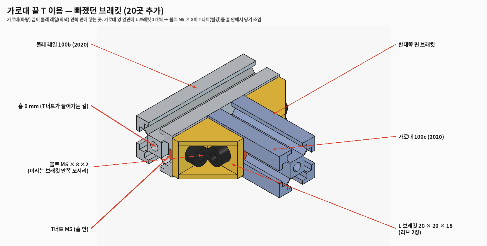
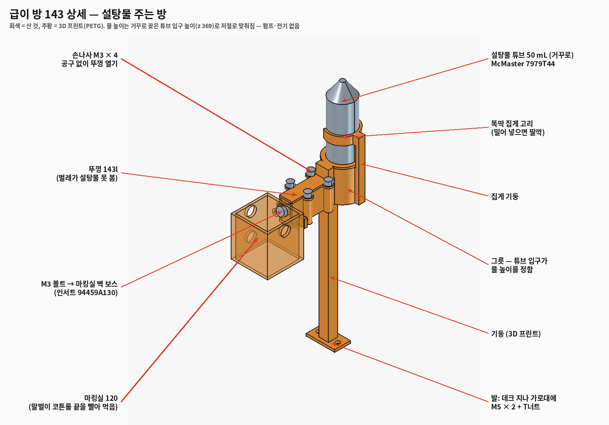
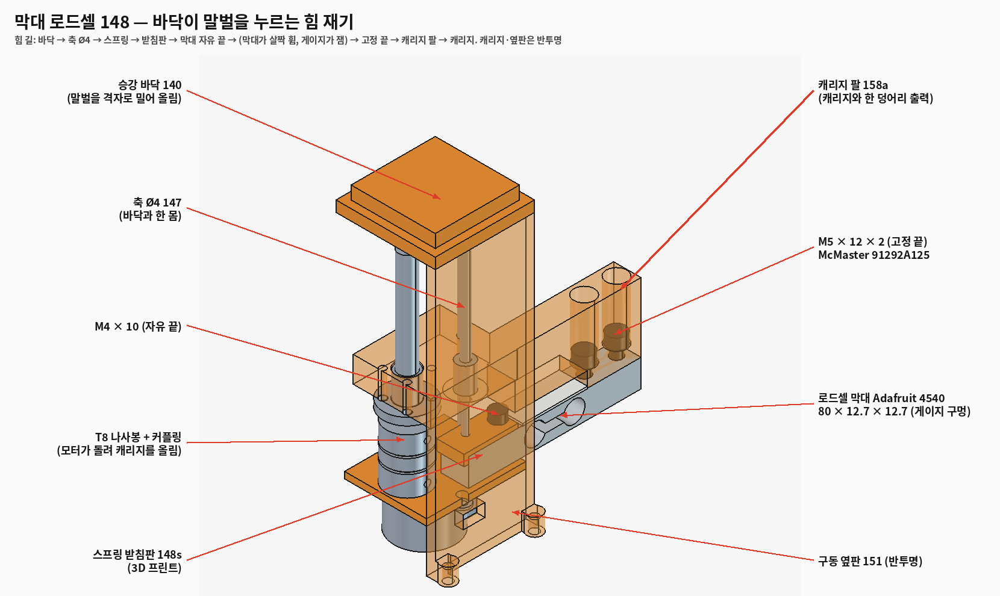
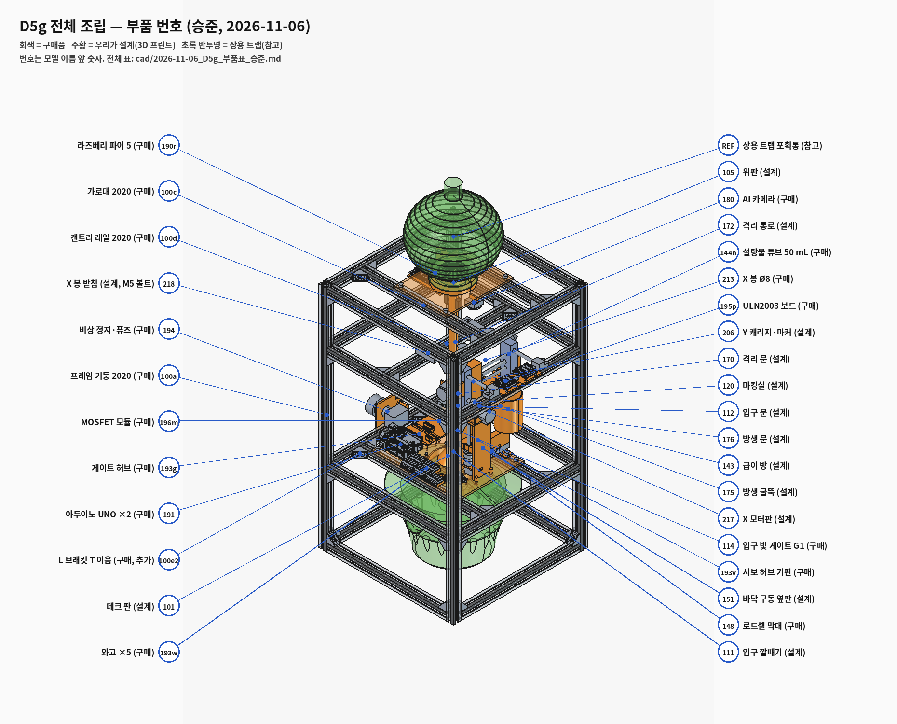

# D5g 상세설계 — 프레임 이음, 부품 고정, 급이 방, 막대 로드셀 (승준, 2026-11-06 밤, CAP-AI-SJ-49)

승준 지적 세 가지를 고쳤다: ① 알루미늄 프로파일 연결이 제대로 안 됨 ② 부품 지지(고정)가 안 됨 ③ 부품 이름이 안 적힘.
같이 한 것: 급이 방 상세(McMaster 부품), 서현 회로 요청(Issue #7) 반영.
스크립트: `cad/D5g_frame_detail.py` → `D5g_feeder_uln.py`, `D5g_real_parts.py`, `D5g_fasten.py`, `D5g_parts_table.py` (`G.make()` 한 번이면 전부)

---

## 1. 보내준 사진 5장 — 무엇이고 왜 있나

| 사진 | 이름 (번호) | 하는 일 (쉬운 말) | 고친 것 |
|---|---|---|---|
| 주황 상자 + 쇠막대 | X 봉 받침 (218), 3D 프린트 | X 방향 쇠막대(Ø8) 양 끝을 붙잡는 손잡이 | 레일에 얹기만 → **볼트로 조임** (아래 3장) |
| 주황 원기둥 + 회색 블록 | 문 서보 기둥 (112·170·176 하우징의 _gate_post) | 문 여닫는 작은 모터(MG90S)의 귀를 나사로 붙이는 기둥 | 그대로 |
| 회색 홈 파인 원기둥 | 커플링 5 → 8 mm (154·210·216), 구매품 | 모터 축(Ø5)과 나사봉(Ø8)을 잇는 이음새. 살짝 비뚤어져도 휘면서 돌림 | 그대로 |
| 주황 세로 관 + 검은 상자 | 격리 통로 (172) + 빛 게이트 G4 (Adafruit 2167) | 여왕벌 등 가둘 말벌이 위 포획통으로 가는 관, 검은 상자는 지나간 말벌을 세는 눈 | 그대로 |
| 2020 이음부 | 가로대 100c·갠트리 레일 100d 끝 | 가로대 끝이 옆 레일에 **그냥 맞닿아만** 있었음 | **브래킷 20개 추가** (아래 2장) |

## 2. 알루미늄 프로파일 이음 — 빠졌던 20곳

- 전에는 기둥 ↔ 둘레 레일 32곳만 브래킷이 있었다. 가로대 4개(데크 2, 위 2)와 갠트리 레일 1개는 **양 끝이 옆 레일 안쪽 면에 닿기만** 했다. [확실 — 모델]
- 고침: 끝마다 **부재 양 옆면에 L 브래킷 1개씩** (끝 10곳 × 2 = 20개), 볼트 M5 × 8 40개, T너트 40개.
  - 아래 면이 아니라 옆면에 단 이유: 받는 레일 높이가 20 mm라 아래 면에 달면 브래킷 다리가 레일 밖(아래)으로 나가 볼트 걸 홈이 없다.
  - 브래킷 한 다리는 가로대 옆 홈, 다른 다리는 받는 레일 안쪽 면 홈에 T너트로. 겹침 0. [확실 — 겹침 검사]
- 합계: 브래킷 52, 프레임 이음 볼트·T너트 각 104.

## 3. 부품 고정 — '닿기만' 한 곳을 볼트로

검사 방법 (겹침 검사: 새·고친 부품 55개 ↔ 전체 184개 → 0건 [확실]): 모든 부품 쌍의 거리(≤ 0.3 mm면 닿음)로 그래프를 만들어 기둥에서부터 따라감. 상용 트랩(참고)만 프레임과 안 이어짐 — 트랩은 땅에 놓이므로 정상.
하지만 '닿음'은 '고정'이 아니다. 프레임에 닿는데 볼트가 없던 것과 고친 방법:

| 부품 | 전 | 지금 |
|---|---|---|
| 218 X 봉 받침 ×4 | 레일 위에 얹기만 | 100d 쪽: 레일 폭까지 늘리고 M5 × 10 세로. 둘레 레일 쪽: X 봉이 받침 가운데를 x 172까지 지나 세로 볼트 자리가 없음 → 바깥 귀(두께 8) + M5 × 12, 바닥 키로 돌지 않게 |
| 217 X 모터판 | 레일 아랫면에 닿기만 | 위 날개(4 mm) + M5 × 8 두 개 위로 |
| 105 위판 / 101 데크 | 가로대 위에 얹기만 (데크는 급이 발 볼트만 지나감) | 가로대 홈에 M5 × 10 네 개씩 |
| 199a Pi 선반 | 구멍만 있고 볼트 없음 | M5 × 8 두 개 (볼트 머리 자리만큼 Pi를 6 mm 띄움) |
| 194b 비상 정지 판 | 구멍만 | M5 × 8 두 개 |
| 151 구동 옆판 ×2, 102 칼라 | 데크에 닿기만 | 데크 아래에서 M3 × 10 → 부품 속 **열 압입 인서트 M3** (옆판은 바깥 보스 Ø7, 칼라는 고리 바깥 보스 4) |

## 4. 급이 방 상세 (143)

| 부분 | 어떻게 | 부품 (McMaster에서 직접 확인) |
|---|---|---|
| 물길 → 마킹실 벽 고정 | 마킹실 벽 바깥에 보스 2개(Ø8, 길이 6, 인서트) — 물길 양옆 귀를 M3 × 8로 조임. 물길 앞이 벽에 꽉 붙어 코튼롤 구멍 둘레가 막힘 | 인서트 **94459A130** (M3, 길이 4.3, 구멍 Ø4.0, 최소 살 5.1), 볼트 **91292A112** |
| 뚜껑 (벌레 막기) | 물길 양옆 기둥 4개(Ø8, 위에 인서트) + **손나사 4개** — 공구 없이 돌려 열고 코튼롤 갈기 | 손나사 **92545A111** (M3 × 8, 머리 Ø8) |
| 설탕물 통 잡기 | 그릇 옆 기둥 → **똑딱 집게 고리** (z 424~434, 열린 쪽 120°: 열린 폭 26.3 < 튜브 29.7이라 밀어 넣으면 '딸깍') | 튜브 **7979T44** (Ø30 × 114.3, 25개 $23.79) = 코닝 352070과 같은 규격 |
| 코튼롤 잡기 | 물길 벽 안쪽 리브 2개(틈 10 = 롤 지름), 바닥에서 4 mm 띄워 물은 리브 아래로 흐름 | 코튼롤 2호 Ø10 × 38 — **McMaster에 없음**, 치과 재료상 (국내 여러 곳) |
| 재료 | PETG (설탕물·물 세척), 벽 2.0, 그릇 2.5 | |

물 높이 원리(거꾸로 병)는 그대로: 물 높이 z 369, 벽 구멍 아래 끝 372.6 → 3.6 mm 여유. 기둥은 x로 3 mm 옮김(로드셀 자리).

## 5. 막대 로드셀 (148) — 서현 결정(버튼형 145,200원 → 막대형 6,710원) 반영

- Adafruit 4540: 80 × 12.7 × 12.7 [확실 — 상품 페이지], 한쪽 끝 M4 탭 2개, 다른 끝 M5 탭 2개, 끝에서 5·20 [가능성 높음 — 데이터시트 그림이 작음, 실물 확인]
- 자리 문제: 바닥 구동 상자 안 폭이 38 mm라 80 mm 막대가 x로 안 들어가고, −y 쪽은 커플링이 막음 → **+y로 뻗음** (x 60.15~72.85, y −2.5~77.5)
- 힘 길: 바닥 → 축 Ø4 → 스프링 146 → **받침판 148s → 막대 자유 끝(M4 × 10)** → 막대가 살짝 휨(게이지가 잼) → **고정 끝(M5 × 12 × 2) → 캐리지 팔 158a** → 캐리지 → T8 너트
- 스프링 아래 끝 높이 244는 D5f와 같음 → 스프링·축 그대로.

## 6. 서현 회로 요청 (Issue #7) — CAD 반영

와고 5개(GND 3 / +5 V 2), 서보 허브 4 × 6 cm, 게이트 허브 3 × 7 cm(+ J_I2C JST XH 4핀), MOSFET 모듈 66.8 각(구멍 자리 미검증), 패널 퓨즈(비상 정지 판 옆 Ø12), 문 빔 LED 다리 꺾기. 좌표는 Issue #7 댓글.
문 빔 LED: 입구·격리 하우징 사이 틈이 5 mm이고 위·아래 소자가 같은 x에서 다리끼리 마주봐서, 다리를 **하우징 살을 벗어난 곳에서 바로 90° 꺾어 옆으로 6 mm** — 납땜은 꺾인 부분에. (곧게 2~3 mm 더 빼면 서로 닿음 [확실 — 겹침 검사])

## 7. 부품 이름표

- 모든 부품에 한글 이름·구분(구매/설계/참고)·규격·품번: `cad/2026-11-06_D5g_부품표_승준.md` (스크립트 `D5g_parts_table.py`가 모델에서 바로 뽑음)
- 그림에 번호 풍선: `cad/img/D5g_parts_balloon.png`

## 8. 남은 것

- MOSFET 모듈 구멍, 로드셀 구멍 간격, 패널 퓨즈 몸통 길이 — 실물 오면 캘리퍼스로 재서 고침
- 펌웨어(`control/`): LIGHT EXIT 빼기, 문 빔 A0~A5·통로 D7·D8·D12 핀 표
- .FCStd 저장은 서현 몫(규칙) — 스크립트로 언제든 다시 만듦
