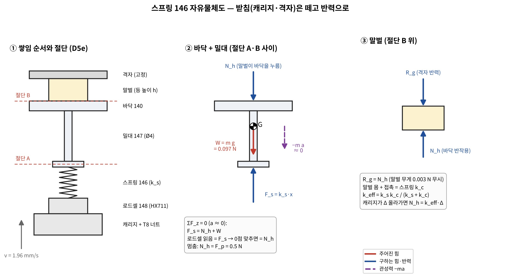
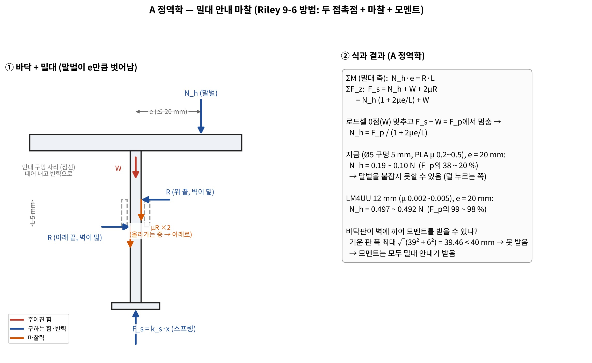
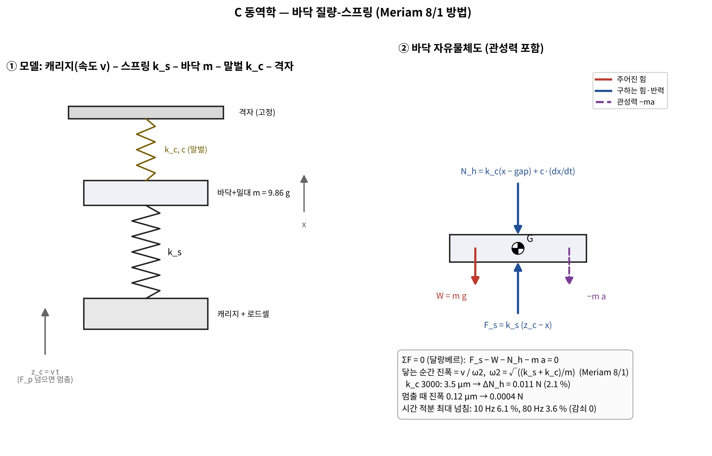
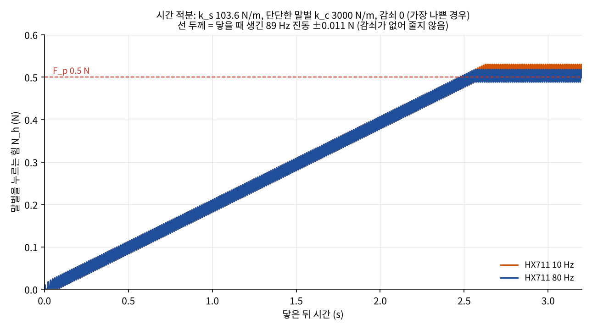

# S4 역학계산 2차 — 스프링 146과 바닥 누르기 (교재 유제 5개 + 정역학·고체·동역학·기계요소)

정리: 2026-11-06 · 이서현 (Claude, **CAP-AI-25**, 서현 지시 "고체·동역학·정역학·기계요소 PDF로 관련 문제 5개 풀고 역학 계산, 확실 98 % 이상")
코드:
- `design/calc/spring146_textbook_check.py` → 유제 대조 `spring146_textbook_check.json`
- `design/calc/spring146_calc2.py` → `spring146_calc2_results.json`
- 그림: `design/calc/spring146_fbd2.py`

1차: `design/2026-11-06_S4_스프링146_역학계산_서현.md` (이 문서가 1차의 k 범위를 쓰고, 스프링 사양은 이 문서가 대신한다)

## 0. 결론 먼저

1. **[확실 — 계산] 1차에서 고른 스프링은 Shigley 권장 범위를 벗어났다.**
   - 1차 사양은 d 0.4, D 7.5로 스프링 지수 C = 18.75다. 권장 범위는 4 ≤ C ≤ 12(식 10-18)다.
   - 1차는 전단탄성계수 G를 79.3 GPa로 썼다. 0.8 mm보다 가는 음악선은 82.7 GPa(Table 10-5)라서 실제 k는 100이 아니라 **104.5 N/m**다. 범위 94~118 안이라 결론은 유지된다.
2. **새 사양 (Shigley 그림 10-3 순서, AI 판단·서현 위임):**
   - 음악선 **d 0.229 mm (0.009")**, 평균 지름 **D 2.63 mm** (바깥 2.86 / 안 2.40)
   - 유효 감김 **15**, 양끝 squared & ground, **자유 길이 14.7 mm**, **Ø2 강철 핀 위에 끼움**
   - → **k = 103.6 N/m (0.59 lbf/in)**
   - C 11.5 · Na 15 · ξ 0.15 · 밀착 안전율 ns 1.75 · 피로 안전율 nf 1.28 (Goodman, Zimmerli)로 권장 조건을 모두 만족한다 [확실 — 계산].
3. **[확실 — 계산] 더 큰 문제는 스프링이 아니라 밀대 안내다.**
   - 지금 D5e는 바닥판 121의 **Ø5 구멍(길이 5 mm)** 하나가 Ø4 밀대를 안내한다.
   - 말벌이 가운데에서 20 mm 벗어나면 안내 마찰 때문에 로드셀이 먼저 F_p에 닿아 멈춘다. 그때 말벌이 실제로 받는 힘은 **F_p의 20~38 %**뿐이다 (PLA μ 0.2~0.5).
   - 덜 누르는 쪽이라 다치게 하지는 않지만, **말벌을 못 붙잡아 자세 재시도가 늘 수 있다.**
   - **LM4UU 볼 부싱(길이 12 mm)** 으로 바꾸면 98~99 %가 된다.
   - → **서현 판단 필요** (부품 추가·CAD 변경)
4. **[확실 — 계산] 넘침:** 시간 적분(감쇠 0, 가장 나쁜 경우)에서 최대 넘침은 HX711 10 Hz에서 6.1 %, 80 Hz에서 3.6 %다. 1차 닫힌식(4.5 %)에 닿는 순간 진동(2.1 %)을 더한 값과 맞는다. 기준 20 % 안이다.
5. **[확실 — 계산] 교재 대조 52항목이 모두 2 % 안이다.**
   - 교재 쪽 산술 오류 2개를 찾았다 (Shigley 10-1 F, 10-2 Ls — 2장).
6. **"확실 98 %"에 대해 [확실]:**
   - **계산** 쪽은 98 % 이상으로 만들었다: 교재 대조, 두 방법 교차, 단위 확인.
   - **입력값** 셋은 시험 전이라 98 %로 만들 수 없다: 말벌이 다치는 힘 F_harm(→ F_safe), 말벌 강성 k_c, PLA 마찰계수. 이 값들이 범위 안에 있으면 결론은 같다. 범위 밖이면 다시 계산한다(5장).

## 1. 왜 이 다섯 문제인가

| | 교재 | 배우는 방법 | 우리 문제 |
|---|---|---|---|
| T8 | Riley Statics 예제 9-6 (냉장고 미끄러짐·넘어짐) | 두 접촉점의 수직력·마찰 + 모멘트 평형 | A: 밀대가 안내 구멍 두 끝에 닿을 때 마찰 → 로드셀 오차 |
| T9 | Gere 예제 2-1 (강체 막대 2개 + 스프링 3개) | 스프링을 반력으로 바꿔 평형 + 변위 적합 | B: 로드셀·스프링·밀대·바닥판·말벌 직렬 → k_eff, 로드셀 읽음 = 스프링 힘 |
| T10 | Meriam Dynamics 샘플 8/1 (스프링에 매단 10 kg) | 정적 처짐, ωn, 초기 속도 → 진폭 = v/ωn | C: 바닥이 v로 말벌에 닿을 때·멈출 때 진동과 힘 |
| T11 | Shigley 예제 10-1 (음악선 압축 스프링 해석) | Sut = A/d^m, Ssy, K_B, k, 밀착 길이, 좌굴, 피치 | D: 1차 스프링 다시 확인 + 새 스프링 검사 |
| T12 | Shigley 예제 10-2 (정적 스프링 설계 표) | 그림 10-3 순서, 선 지름별 표 → 권장 범위로 거르기 | D: 우리 스프링을 선 지름 13개 × 봉 3개 × 틈 4개로 표를 만들어 고름 |

교재 원문·그림은 레포에 넣지 않았다 (공개 레포). PDF는 서현이 이 채팅에 올린 것을 읽었다.

## 2. 유제 대조 (내 풀이 vs 교재 답)

`spring146_textbook_check.json` — **52 / 52 항목 일치 (상대 차이 ≤ 2 %)** [확실]

| 유제 | 대표 값 (내 풀이 / 교재) | 차이 |
|---|---|---|
| T8 Riley 9-6 | P 360 / 360 N, h 0.6667 / 0.667 m (두 방법) | 0.05 % |
| T9 Gere 2-1 | δC = 28P/15k, δD = 4P/3k, F_B = 14P/15, F_CD = 8P/15, M_E = 8PL/15 — 기호식이 같음 (sympy) | 0 |
| T10 Meriam 8/1 | δst 39.2 mm, ωn 15.81 rad/s, 진폭 31.6 mm (식 + 수치 적분) | ≤ 0.14 % |
| T11 Shigley 10-1 | Sut 2231 MPa, k 0.7213 / 0.7207 N/mm, L0 52.39 mm, (L0)cr 53.51 mm | ≤ 0.2 % (F만 1.3 %) |
| T12 Shigley 10-2 | C 10.48 / 10.5, D 21.28 / 21.3, τs 748 MPa, 표 d 1.600·1.905·2.413 | ≤ 1.1 % (Ls만 1.8 %) |

**교재 쪽 오류 (직접 계산으로 찾음):**
- **Shigley 10-1 (b):** F = π(0.94³)(1004)/(8·1.124·10.1727) = **28.63 N**인데 교재는 28.26 N이다. 교재 (d)의 y = 39.70 mm는 28.6 N으로 계산한 값이라 뒤 풀이는 맞다.
- **Shigley 10-2:** Ls = 2.03 × 12.16 = **24.68 mm**인데 교재는 24.3 mm다. 그래서 교재 L0 82.7 mm도 0.4 mm 작다(맞는 값 83.1 mm). 표 아래 문장의 "0.203 mm"는 2.03 mm의 SI 변환 오타다.
- **Shigley 10-4 (d)** (참고, 이번 유제 아님): SI판 식에 인치 단위 G·중력이 섞여 있다. 서지 주파수는 식 10-25를 SI로 직접 계산했다.

## 3. 4-1 외력 · 4-2 절단 · 자유물체도

| 힘 | 크기 | 근거 |
|---|---|---|
| 바닥+밀대 무게 W | 9.86 g → 0.097 N | CAD 질량 [가능성 높음] |
| 말벌 반력 N_h | 0 → F_p 0.5 N | D6 [확실 — 설계값] |
| 스프링 F_s = k_s x | 구함 | |
| 안내 반력 R ×2, 마찰 μR ×2 | 구함 | 말벌이 e만큼 벗어날 때 |
| 관성력 −m a | 닿을 때 진동으로 최대 ±0.011 N | C |

## 4. 계산

### A 정역학 — 밀대 안내 마찰 (T8 방법) [계산 확실, μ는 가능성 높음]

**식 (안내 구멍 두 끝에 R이 짝힘으로 걸림):**
- ΣM: N_h·e = R·L
- ΣF_z: F_s = N_h(1 + 2μe/L) + W
- 로드셀 0점을 맞추고 F_s − W = F_p에서 멈추므로 → **N_h = F_p / (1 + 2μe/L)**

**바닥판이 벽에 끼어 모멘트를 나눠 받을 수 있나:** 기운 판의 최대 폭은 √(39² + 6²) = 39.46 mm로 벽 사이 40 mm보다 작다. 그래서 끼지 못하고, 모멘트는 전부 밀대 안내가 받는다. 밀대는 구멍 안에서 11.3°까지 기울 수 있다 [확실 — 기하].

| 안내 | μ | e = 0 | e = 10 mm | e = 20 mm |
|---|---|---|---|---|
| 지금 Ø5 × 5 mm (PLA) | 0.2 | 100 % | 56 % | **38 %** |
| 지금 | 0.5 | 100 % | 33 % | **20 %** |
| LM4UU 12 mm | 0.002 | 100 % | 99.7 % | **99.3 %** |
| LM4UU 12 mm | 0.005 | 100 % | 99.2 % | **98.4 %** |

(표 값 = 말벌이 실제로 받는 힘 / F_p)

### B 고체역학 — 힘 경로 직렬 강성 (T9 방법) [계산 확실, 부품 강성은 추측~가능성 높음]

| 요소 | k (N/m) |
|---|---|
| 로드셀 (1 kg 버튼, 정격 처짐 0.15 mm [추측]) | 65 400 |
| 스프링 146 | 103.6 |
| 밀대 PLA Ø4 × 46.5 | 946 000 |
| 바닥판 (외팔보, 유효 폭 2e [추측]) | 945 000 |

- 스프링 하나만 넣어 계산한 k_eff와 다섯 요소 직렬 k_eff는 **0.13~0.17 %** 차이다 [확실 — 계산]. 그래서 1차 계산처럼 "스프링 + 말벌"만 써도 된다.
- 직렬이면 모든 요소에 같은 힘이 걸린다. 그래서 **로드셀 읽음 = 스프링 힘**이다 (Gere 2-1의 F_CD처럼).

### C 동역학 — 닿을 때·멈출 때 (T10 방법) [계산 확실, k_c는 추측]

| 경우 | 진폭 (k_c 300 / 3000) | 힘 변화 |
|---|---|---|
| 바닥이 v = 1.96 mm/s로 닿는 순간 (진폭 = v/ω₂, ω₂ = √((k_s+k_c)/m)) | 9.7 / 3.5 µm | 0.003 / **0.011 N (2.1 %)** |
| 누르던 중 캐리지가 갑자기 멈춤 | 2.5 / 0.12 µm | ≤ 0.0008 N |
| 닿기 전 바닥 혼자 출렁임 | f = 16.3 Hz | — |
| 반걸음 하나 (1.96 µm) | — | 0.0002 N |

**시간 적분** (`press_sim`: 바닥 질량 + 스프링 + 말벌, 로드셀 표본, 멈춤 지연 5 ms):

| k_c | HX711 | 감쇠 0 | 감쇠비 0.1 |
|---|---|---|---|
| 300 | 10 / 80 Hz | +1.0 % / +1.0 % | +0.6 % / +0.6 % |
| 3000 | 10 Hz | **+6.1 %** | +3.2 % |
| 3000 | 80 Hz | **+3.6 %** | +0.7 % |

- 두 방법으로 교차 확인했다: 닫힌식(1차 C1) 4.5 % + 닿는 순간 진동 2.1 % = 6.6 %이고, 적분 결과는 6.1 %다 [확실].

### D 기계요소 — 스프링 다시 고르기 (T11·T12 방법) [확실 — 교재 식]

**조건:**
- k 94~118 N/m (1차 C2·C3)
- 4 ≤ C ≤ 12
- 3 ≤ Na ≤ 15
- ξ ≥ 0.15 (작동 범위 = 바닥 무게 + 고장 때 h_max 8.5 mm)
- 밀착 ns ≥ 1.2
- 피로 nf ≥ 1.2: Zimmerli 무한 수명 기준. 한 철 약 2.4만 번이라 보수적이다.
- 바깥지름 ≤ 9 mm
- 봉 위에 끼움: D = d_rod + d + 틈

**결과:** 선 13개 × 봉 3개(Ø1.5·2·3) × 틈 4개(0.4~1.0 mm) = 156줄 중 **조건을 모두 만족하는 것은 3개**다.

| 봉 | d | D | C | Na | k | L0 | ns | nf | 서지 |
|---|---|---|---|---|---|---|---|---|---|
| Ø1.5 | 0.229 | 2.53 | 11.1 | 15 | 116.4 | 14.6 | 1.63 | 1.32 | 874 Hz |
| Ø1.5 | 0.229 | 2.73 | 11.9 | 14 | 99.3 | 14.6 | 1.76 | 1.24 | 804 Hz |
| **Ø2** | **0.229** | **2.63** | **11.5** | **15** | **103.6** | **14.7** | **1.75** | **1.28** | **808 Hz** |

**고른 것: Ø2 봉.**
- k가 100에 가깝다 (1차 C3 고장 힘 0.88 N < F_safe 1.0 N).
- 봉이 굵어 안내가 단단하다.

**확인한 것과 남은 점:**
- **좌굴:** L0 14.7 > (L0)cr 13.8 mm라 안내가 필요하다 → Ø2 핀이 안에서 잡는다 (Shigley 10-1 (g)와 같은 판단).
- **서지 808 Hz vs 반걸음 1000 Hz:** Shigley 기준(15~20배)을 **못 지킨다.**
  - 반걸음 하나가 주는 힘은 0.0002 N이다.
  - 1000/808 = 1.24배 떨어져 있어 증폭은 약 1.9배, 결과는 0.0004 N(0.08 %)이다 [확실 — 계산].
  - → **반걸음 간격을 1100~1400 µs(700~900 Hz)로 바꾸지 않는다**는 조건만 펌웨어에 둔다.
- **1차 스프링(d 0.4, D 7.5):** C 18.75만 걸린다. 나머지(ns 3.14, nf 2.51, 좌굴 없음)는 좋다.
  - 새 사양을 기성품으로 못 구하면 **차선**으로 쓴다: 기성품은 이미 감겨 있으니 감기 어려움은 제조사 문제다 [가능성 높음].

**새 k로 1차 조건을 다시 본 결과:**
- C1 넘침 4.5 %
- C2: F_p까지 5.0 mm < 한계 5.5 mm
- C2b: 0.50 N
- C3: 고장 때 0.88 N
- 닿은 뒤 F_p까지 2.55 s

## 5. 확실도 정리

| 항목 | 확실도 | 이유 |
|---|---|---|
| 식·풀이 방법 | **[확실]** | 교재 유제 52 / 52 일치, 교재 오류 2개 찾음 |
| 넘침 6.1 % 이하 | **[확실]** (입력 범위 안에서) | 닫힌식과 시간 적분 일치 |
| 스프링 사양 (k 103.6, ns, nf) | **[확실]** | Shigley 식, 재료 값은 Table 10-4·10-5 |
| 안내 마찰로 20~38 %까지 덜 누름 | **[가능성 높음]** | 식은 확실, PLA μ 0.2~0.5는 문헌 범위 |
| F_safe 1.0 N | **[추측]** | R7 압축 시험 전. 0.8 N보다 작으면 이 방식이 안 됨 (1차 표 5) |
| k_c 300~3000 N/m | **[추측]** | R7 시험에서 힘-변위 곡선으로 바꿈 |

## 6. 적용 안 한 것
- **바닥판 기울기와 말벌 압력 분포:** LM4UU로 바꾸면 기울기가 거의 0이라 뒤로 미룸.
- **스프링 끝 감김의 실제 Ls (Forys: (Nt − 0.75)d):** 밀착에 안 닿는 설계라 영향 없음.
- **로드셀 크리프·온도 드리프트:** 0점을 매번 맞추므로 짧은 누르기(3 s)에서는 작음 [가능성 높음]. J6에서 확인.

## 7. 서현 판단 필요
1. **밀대 안내를 LM4UU로 바꿀까?** 바꾸면 밀대가 Ø4 강철 축이 되고, 바닥판 121 아래에 부싱 보스가 생긴다 (권장). 안 바꾸면 말벌이 가장자리에 있을 때 덜 누름 → 자세 재시도가 늘 수 있음.
2. **스프링:** 새 사양(Ø2 핀, d 0.229)을 기본으로 하고, 기성품이 없으면 1차 사양(d 0.4, D 7.5)으로 할지.

## 쉬운 설명
- **스프링:** 너무 굵고 성긴 스프링(1차)은 공장에서 감기 어렵다고 교과서가 말해요. 그래서 실을 더 가늘게, 지름을 작게 바꾸고 가운데에 쇠 핀을 끼워 휘지 않게 했어요. 누르는 세기(1 mm에 약 10 g)는 그대로예요.
- **안내 구멍:** 손잡이 하나로 서랍을 비스듬히 당기면 뻑뻑하죠? 말벌이 바닥 가장자리에 있으면 바닥 막대가 구멍 속에서 비스듬히 끼어서, 기계는 "세게 눌렀다"고 생각하는데 말벌은 살짝만 눌려요. 미끄러운 볼 베어링 통(LM4UU)을 끼우면 해결돼요.
