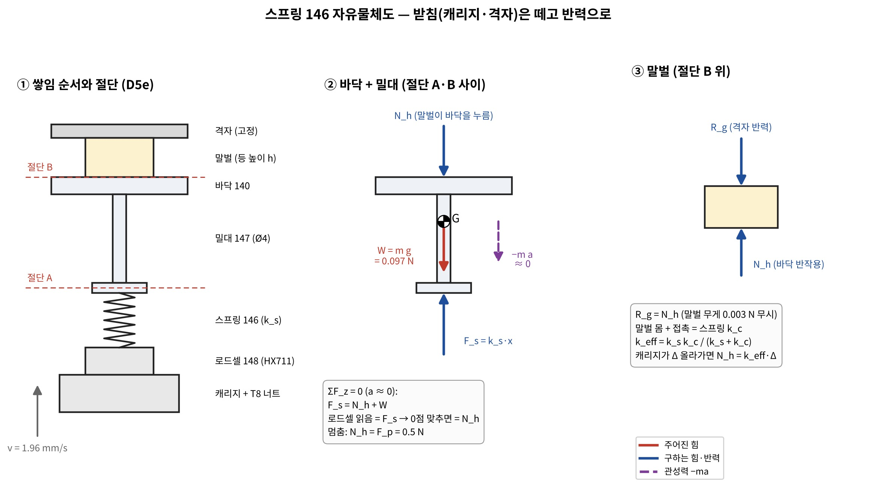
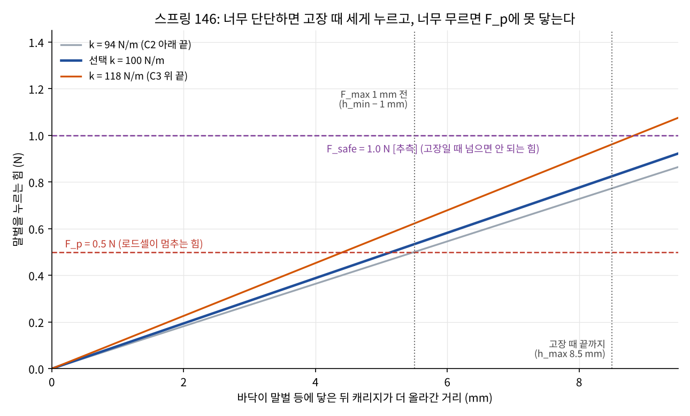

# S4 역학계산 — 스프링 146 (바닥 누르기 스프링) 강성 정하기

정리: 2026-11-06 · 이서현 (Claude, **CAP-AI-24**, 서현 위임 "너가 역학계산해서 정해")
코드: `design/calc/spring146_calc.py` (계산·그래프, 결과 `spring146_results.json`), `design/calc/spring146_fbd.py` (자유물체도)
표기: [확실] 계산·사양 / [가능성 높음] / [추측]. 실물 시험 전이라 결과 값은 모두 `미검증`.

## 0. 결론 먼저
- **k_s = 0.1 N/mm (100 N/m)** — (AI 판단, 서현 위임). 허용 범위는 **94~118 N/m** [확실 — 계산, 단 입력 F_safe·k_c는 추측].
- 사양: **피아노선 d 0.4 mm, 평균 지름 7.5 mm (바깥 7.9, 안 7.1), 유효 감김 6, 자유 길이 16 mm, 양끝 닫고 연마** → k 100.3 N/m (0.57 lbf/in) [확실 — 공식].
- **D5f 모양 바꿀 것**: 지금 CAD 스프링 길이 10 mm → **16 mm** (설치 길이 약 15 mm, 바닥 무게로 1 mm 줄어듦). 밀대 147·칼라 위치를 6 mm 위로 → 다음 CAD 단계.
- 스프링이 왜 꼭 있어야 하나: 스프링 없이 로드셀이 바닥을 바로 밀면, HX711 10 Hz에서 멈추기 전에 더 올라간 0.22 mm 때문에 힘이 **최대 0.68 N 더 생김 (F_p의 135 %)** [확실 — 계산, k_c 3000 N/m일 때].
- 가장 큰 불확실성: 말벌이 다치는 힘(F_harm, R7)을 모름 → 임시로 고장 때 허용 힘 F_safe = 1.0 N [추측]. **F_safe가 0.8 N보다 작으면 이 방식(바닥 스프링 + 위치 한계)으로는 범위가 없음** → R7 결과를 보고 다시 계산 (표 5).

## 4-1. 외력 — 무엇이 무엇을 미나

| 힘 | 크기 | 방향 | 근거 |
|---|---|---|---|
| 바닥+밀대 무게 W | (9.09 + 0.77) g × g = 0.097 N | 아래 | CAD 질량 (승준 `d5e_mass_cad_sj.json`) [가능성 높음] |
| 말벌이 바닥을 미는 힘 N_h | 0 → F_p 0.5 N | 아래 (바닥에) | D6 F_p [확실 — 설계값] |
| 스프링 힘 F_s = k_s·x | 구함 | 위 | |
| 관성력 −m a | 0.00986 kg × (속도 1.96 mm/s, 멈출 때 a ≈ 1.96/0.001 mm/s² 미만) ≈ 2×10⁻⁵ N | — | 무시 [확실 — 계산] |

## 4-2. 절단
- 절단 A (스프링과 칼라 사이), 절단 B (바닥 윗면과 말벌 사이).
- ② 바닥+밀대: ΣF_z = 0 → **F_s = N_h + W**. 로드셀은 스프링 아래라 F_s를 읽음 → 켤 때 0점(W 빼기) 맞추면 **로드셀 읽음 = N_h** [확실].
- ③ 말벌: R_g (격자) = N_h. 말벌 몸과 접촉은 또 하나의 스프링 k_c → 직렬: **k_eff = k_s·k_c / (k_s + k_c)**. 캐리지가 닿은 뒤 Δ 올라가면 N_h = k_eff·Δ.

## ① 조건 다섯 개

| | 조건 | 식 | 결과 |
|---|---|---|---|
| C1 넘침 | 멈추는 데 걸리는 시간 동안 더 생긴 힘 ≤ 0.2·F_p | k_eff · v · t_d ≤ 0.1 N, t_d = 1/f + 0.1/f + 5 ms | 10 Hz: t_d 0.115 s, 0.225 mm → **k_s ≤ 521 N/m** |
| C2 도달 | 가장 낮은 말벌(6.5 mm)·단단한 접촉에서도 캐리지 한계 1 mm 전에 F_p | F_p/k_eff ≤ h_min − 1 mm | **k_s ≥ 94 N/m** |
| C2b 붙잡기 | 가장 낮은·가장 무른 말벌이면 한계에서 멈출 수 있음 → 그때 힘 ≥ 0.8 F_p | k_eff(k_s, 300)·h_min ≥ 0.4 N | k_s ≥ 77 N/m |
| C3 고장 안전 | 로드셀 고장(0으로 읽음) → 캐리지가 한계까지 감. 가장 큰 말벌(8.5 mm)이면 스프링이 8.5 mm 줄어듦 | k_s · h_max ≤ F_safe | F_safe 1.0 N → **k_s ≤ 118 N/m** |
| C4 진동 | 바닥+밀대가 스프링 위에서 흔들리는 주파수 | f_n = √(k/m)/2π | 16.1 Hz → HX711은 **80 Hz (RATE 높음)** 로 (나이퀴스트 40 Hz > 16 Hz). 회로는 이미 80 Hz [확실] |
| C5 강도·좌굴 | τ = K_w·8FD/πd³ ≤ 0.45 S_ut, L₀/D < 2.6 | | τ 304 MPa ≤ 1035 MPa, L₀/D 2.13 → 좌굴 없음, 밀대 Ø4가 안에서 안내 |

→ 범위 **94 ≤ k_s ≤ 118 N/m** → 가운데 아래쪽 **100 N/m** 선택. 위쪽(C3, 말벌 안전)에 여유를 더 둠.

## ② 고른 스프링 확인 (k_s = 100.3 N/m)

| 항목 | 값 | 판정 |
|---|---|---|
| 넘침 (10 Hz / 80 Hz, k_c 3000) | 0.022 N (4.4 %) / 0.004 N (0.7 %) | C1 여유 큼 |
| 닿은 뒤 F_p까지 시간 | 2.6 s (단단한 접촉) | PRESS가 약 2.6 s 길어짐 → trap_sim 다음 판에 반영 |
| 낮은·무른 말벌, 한계에서 힘 | 0.49 N | ≥ 0.4 N OK |
| 고장 때 가장 큰 힘 | 0.95 N | ≤ F_safe 1.0 N |
| 바닥 무게로 줄어든 길이 | 0.96 mm | 설치 길이 ≈ 15 mm |
| 가장 줄었을 때 길이 | 6.5 mm (밀착 길이 3.2 mm의 2배) | 밀착 안 됨 |
| 바깥 / 안 지름 | 7.9 / 7.1 mm | CAD 외경 9 mm 안, 밀대 Ø4 + 틈 |

스프링 허용 오차 ±10 %면 90~110 N/m [가능성 높음 — 상용 압축 스프링 보통 등급]. 90이면 C2가 0.3 mm 늦어짐(낮고 단단한 말벌에서 한계 1 mm 여유 → 0.7 mm) → 받아들임.

## ③ 스프링 없을 때와 비교 (왜 넣었나)

| HX711 | k_c 300 | k_c 3000 |
|---|---|---|
| 10 Hz | +0.068 N (14 %) | **+0.68 N (135 %)** |
| 80 Hz | +0.011 N (2 %) | +0.11 N (22 %) |

스프링 없이 80 Hz여도 단단한 접촉이면 22 % 넘침, 그리고 로드셀 고장 때는 힘이 위치 한계까지 그대로 커짐(제한 없음) → 스프링은 **넘침과 고장 두 가지를 모두 막는다** [확실 — 계산].

## ④ 펌웨어에 줄 것 (승준, Issue #7)
1. HX711 RATE 80 Hz, 바닥 올라가는 동안 매 표본마다 비교 (평균 내지 말 것 — 평균은 t_d를 늘림).
2. 캐리지 위치 한계에 닿았는데 힘이 F_p보다 작으면: **힘 ≥ 0.4 N이면 '눌림 OK'** (작은·무른 말벌), 0.4 N 미만이면 '말벌 없음/작음' → 다시 보기.
3. 켤 때 0점(바닥 무게) 맞추기는 지금처럼.

## ⑤ 적용 안 한 것과 이유
- 말벌 몸의 비선형(처음엔 무르고 점점 단단해짐): k_c를 300~3000 범위의 두 끝으로 대신함. R7 압축 시험에서 힘-변위 곡선을 얻으면 바꾼다.
- 스프링 질량에 의한 서지(surge) 진동: 스프링 0.35 g, 서지 주파수가 수백 Hz라 무시 [가능성 높음].
- 바닥이 기울어 한쪽만 누르는 경우: 바닥 안내가 밀대 하나라 기울 수 있음 → J6에서 확인.

## 쉬운 비유
스프링은 **엄마 손과 아기 사이에 끼운 쿠션**이에요. 손(모터)이 "이제 멈춰!" 소리(로드셀)를 늦게 들어도, 쿠션이 있으면 조금 더 밀린 만큼만 살짝 더 누르게 돼요. 쿠션이 너무 딱딱하면 늦게 멈출 때 아프고, 너무 말랑하면 아무리 밀어도 꽉 잡지 못해요. 계산해 보니 **1 mm 누르면 10 g 무게만큼 미는 쿠션**(0.1 N/mm)이 딱 알맞았어요.
