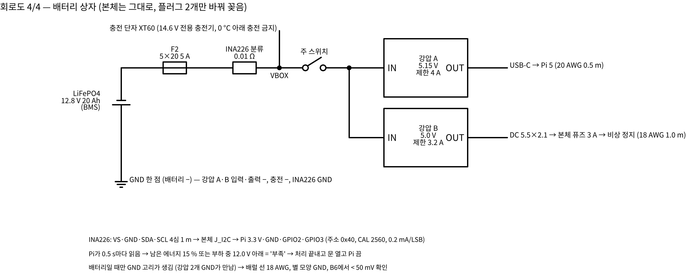

# 배터리 상자 회로 — LiFePO4 12.8 V 20 Ah → 본체 플러그 2개

정리: 2026-11-06 22시 · 이서현 (Claude, **CAP-AI-35**, 제어·회로 서현 위임 → 결정은 **(AI 판단, 서현 위임)**)
코드: `design/circuit/battery_box.py` → 결과 `design/circuit/out/battery_box.json`, 그림 `design/img/circuit/회로도_4_배터리상자.png`
바탕: `design/2026-11-02_전기계통_제어순서_서현.md` 8장 (콘센트 기본 + 같은 플러그 배터리 상자, 20 Ah = 2일)
쉬운 설명: `design/2026-11-06_배터리상자_쉬운설명_서현.md`

## 0. 결론 먼저
1. **[확실 — TI 사양 계산] 흔히 파는 INA226 모듈(분류 저항 R100 = 0.1 Ω)은 0.82 A까지만 잰다.**
   - 우리 배터리 전류는 대기 0.64 A, 규칙 최대 2.01 A, 설계 최악 3.08 A이다.
   - R100 모듈을 쓰면 낮에 전류가 많이 흐를 때 값이 막혀서 남은 에너지 계산이 틀린다.
   - → **R010(0.01 Ω) 모듈을 산다.** R100밖에 없으면 2512 크기 0.01 Ω 1 W 저항으로 바꿔 납땜한다.
   - 0.01 Ω이면 8.19 A까지 잰다. 분해능은 0.25 mA, 최악일 때 저항 열은 0.1 W이다.
2. **[가능성 높음] 배터리일 때만 GND 고리가 생긴다.**
   - 콘센트 어댑터 2개는 서로 절연되어 있어서 고리가 없다.
   - 배터리 상자에서는 강압 2개의 GND가 배터리 −에서 만난다.
   - 그래서 구동 레일로 돌아오는 전류의 **약 30 %(최대 0.54 A)가 UNO USB 케이블과 Pi를 거쳐** 돌아간다. 이때 GND 어긋남은 약 32 mV이다 (배럴 꼬리선 18 AWG 1 m 기준).
   - 고리를 받아들이되 세 가지를 한다:
     - 배럴 꼬리선은 18 AWG
     - GND는 배터리 −에서 별 모양으로 모은다
     - 브링업 B6에서 확인한다
   - 기준을 넘으면 강압 B를 절연형 **Mean Well SD-15A-5**로 바꾼다 (하루 +5.6 Wh 손해).
3. **충전 단자는 분류 저항 뒤(VBOX)에 단다.** 그래야 충전 전류도 같은 저항으로 재서 '가득'을 맞출 수 있다 [확실 — 회로].
4. **INA226은 적산 기능이 없고, Pi가 꺼진 밤에는 INA226도 꺼진다.**
   - Pi가 켜져 있는 동안 전력을 더한다.
   - 밤 몫(0.25 W × 꺼진 시간, 15시간이면 3.8 Wh)은 아침에 Pi가 더한다.
   - 이 처리는 승준 Pi 코드 몫이다 → Issue.
5. 2일 조건은 그대로 지킨다: **2.88일** (하루 80 Wh, 강압 효율 90 %) [가능성 높음 — 부하 값은 사양 기반].

## 1. 회로

| 넷 | 연결 | 선 |
|---|---|---|
| BAT+ | 배터리 + → F2 (배터리 단자에서 **10 cm 안**) | 18 AWG, XT60 |
| VF2 | F2 → INA226 IN+ | 18 AWG |
| VBOX | INA226 IN− · VBUS → 충전 단자 + · 주 스위치 | 18 AWG |
| VSW | 주 스위치 → 강압 A IN+ · 강압 B IN+ | 18 AWG |
| GND_BOX | 배터리 − 한 점 ← 충전 −, 강압 A·B 입력 −·출력 −, Pi 꼬리선 GND, 배럴 −, INA226 GND | 18 AWG |
| 5V1_PI | 강압 A OUT+ (5.15 V, 전류 제한 4 A) → USB-C 수 플러그 (전원 전용) | 20 AWG 0.5 m |
| 5V_DRV | 강압 B OUT+ (5.0 V, 전류 제한 3.2 A) → DC 5.5×2.1 수 플러그 | 18 AWG 1.0 m |
| I2C | INA226 VS·GND·SDA·SCL → 4심 1 m → 본체 J_I2C → Pi 3.3 V·GND·GPIO2·GPIO3 | 28 AWG |

검사 (스크립트) [확실 — 통과]:
- 배터리 +는 퓨즈에만 이어진다.
- 충전 단자는 INA226 IN− 쪽에 있다.
- 강압 입력 2개는 모두 스위치 뒤에 있다.
- 강압 출력끼리 서로 안 이어지고, 12 V 쪽과도 안 이어진다.
- VBUS는 IN− 쪽에 있다.
- 12 V 쪽 선은 모두 18 AWG 이상이다.
- 넷 11개, 끝 32개.

## 2. 계산 (`battery_box.json`)

| 항목 | 값 | 판단 |
|---|---|---|
| Pi 레일 최대 (Pi 8.8 + 카메라 1.87 + HAT 1.5 + UNO 0.5 + HX711 W) | 12.7 W → 2.47 A @5.15 V | 강압 A는 5 A급 (연속 3 A 이상) |
| 배터리 전류 — 대기 / 규칙 최대 / 설계 최악 | 0.64 / 2.01 / 3.08 A | 퓨즈 5 A의 80 % 아래 → 5 A 퓨즈로 충분 (여유 1.62배) [확실 — 계산] |
| Pi 꼬리선 강하 (2.47 A) | 0.16 V → 보드 4.99 V | Pi 5 저전압 경고 약 4.63 V보다 높음 [가능성 높음] |
| 구동 꼬리선 강하 (1.8 A) | 0.11 V → 잭 4.89 V | 콘센트 어댑터와 비슷함 |
| INA226 설정 | 0.01 Ω, Current_LSB 0.2 mA, **CAL = 2560**, Power_LSB 5 mW, 주소 0x40, 설정 0x4527 (평균 16회, 1.1 ms) | [확실 — TI 식] |
| 밤 (Pi·UNO 꺼짐) | 0.25 W ≈ 배터리 19.5 mA | 강압 무부하 0.05 W는 [추측] → B6에서 실측 |
| 버티는 날 | **2.88일** | 2일 조건 충족 |

## 3. 결정 (AI 판단, 서현 위임)

| # | 결정 | 이유 |
|---|---|---|
| BB1 | 퓨즈 **5×20 5 A**, F-520 홀더 (본체 E3와 같은 홀더) | 최악 3.08 A, 같은 부품이라 예비 공유 |
| BB2 | INA226 **R010** | 1번 |
| BB3 | 강압 2개는 **조정형 CV/CC 5 A급** (XL4015 계열 같은 것) [가능성 높음 — 판매처 '5 A'는 방열판 달고 연속 3 A 안팎으로 봄]. 전류 제한 A 4 A, B 3.2 A | 전류 제한이 있어 합선이 나도 퓨즈 전에 먼저 막아 줌. B 3.2 A는 본체 퓨즈 3 A와 맞춤 |
| BB4 | Pi는 USB-C **전원 전용 꼬리선** (PD 협상 없음) | Pi 5는 PD가 아니면 USB 출력을 600 mA로 묶는다 [가능성 높음 — Pi 문서]. UNO 2개는 0.1 A라 괜찮다. **EEPROM `PSU_MAX_CURRENT=5000`은 넣지 않는다** (강압이 연속 5 A가 아님) |
| BB5 | 충전은 **전용 LiFePO4 충전기 14.6 V**, 충전 단자 XT60, **0 °C 아래에서는 충전하지 않는다** | LiFePO4는 영하에서 충전하면 망가진다 [가능성 높음]. 11월 공주 아침은 영하일 수 있다 → 실내에서 충전 |
| BB6 | 자동 전환(UPS)은 안 한다 | 11/02 결정 그대로 |
| BB7 | GND 고리는 받아들이고 B6에서 검사, 기준을 넘으면 SD-15A-5 | 2번 |

## 4. 브링업 B6 (배터리 상자 — 부품 오면, `2026-11-06_브레드보드_단계별_배선_서현.md` 다음 단계)
1. 상자만: 주 스위치를 켜고 강압 A 출력을 **5.15 V**, B를 **5.00 V**로 맞춘다 (테스터). 출력을 테스터 전류 모드로 단락해 전류 제한이 4 A / 3.2 A인지 본다 (짧게).
2. INA226: Pi에서 `i2cdetect -y 1` → **0x40**. 5 Ω 저항을 걸어 1 A 근처일 때 테스터와 2 % 안인지 본다.
3. 본체에 꽂고 전체 운용 1시간:
   - UNO GND ↔ Pi GND 전압 (테스터 mV, 스테핑할 때) **< 50 mV**
   - UNO 시리얼 끊김·재연결 **0회** (Pi 로그)
   - 강압 온도는 손으로 잡을 수 있을 정도 (< 60 °C)
4. 위 3번에서 하나라도 넘으면 → 강압 B를 SD-15A-5로 바꾼다 (AI 판단 BB7).

## 5. 사야 할 것 (현장 시험 날짜가 정해지면 — 승준 구매)

| # | 부품 | 수량 | 메모 |
|---|---|---|---|
| B1 | LiFePO4 12.8 V 20 Ah (BMS, 연속 10 A 이상) | 1 | 13~18만 원 [추측] |
| B2 | LiFePO4 충전기 14.6 V (2~5 A) | 1 | 2~3만 원 [추측] |
| B3 | 퓨즈홀더 F-520 + 5×20 5 A | 1 + 3 | 디바이스마트 (E3와 같은 홀더) |
| B4 | 주 스위치 DC 12 V 10 A 이상 | 1 | |
| B5 | INA226 모듈 **R010 (0.01 Ω)** | 1 (+1) | 상세 사진에서 저항 글씨 'R010' 확인. 없으면 R100 + 2512 0.01 Ω 1 W |
| B6 | 강압 모듈 조정형 CV/CC 5 A급 (입력 8~36 V) | 2 (+1) | 방열판 달린 것 |
| B7 | USB-C 수 플러그 꼬리선 (전원 전용, 20 AWG) | 1 | |
| B8 | DC 5.5×2.1 수 플러그 꼬리선 18 AWG | 1 | |
| B9 | XT60 암·수 | 2쌍 | 배터리, 충전 단자 |
| B10 | 4핀 커넥터 + 4심 선 1 m | 1 | 본체 J_I2C와 짝 |
| B11 | 방수 ABS 상자 | 1 | 배터리 크기를 보고 고름 |
| (대기) | Mean Well SD-15A-5 | 0 | B6에서 실패할 때만 |

## 6. 승준에게 (Issue)
- Pi 코드 할 일:
  - INA226이 없으면(콘센트일 때) 오류 없이 넘어간다.
  - 있으면 CAL 2560으로 설정하고, 0.5 s마다 전력을 더한다.
  - 아침에 '밤 W × 꺼진 시간'을 더한다.
  - 충전 끝(14.4 V 이상, 충전 전류 < 0.5 A)이면 100 %로 다시 맞춘다.
- 본체에는 **J_I2C 4핀 커넥터** 자리가 필요하다 (D5g 하네스, Pi 근처).
