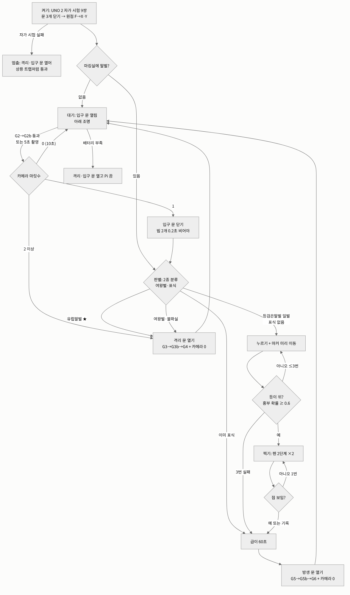
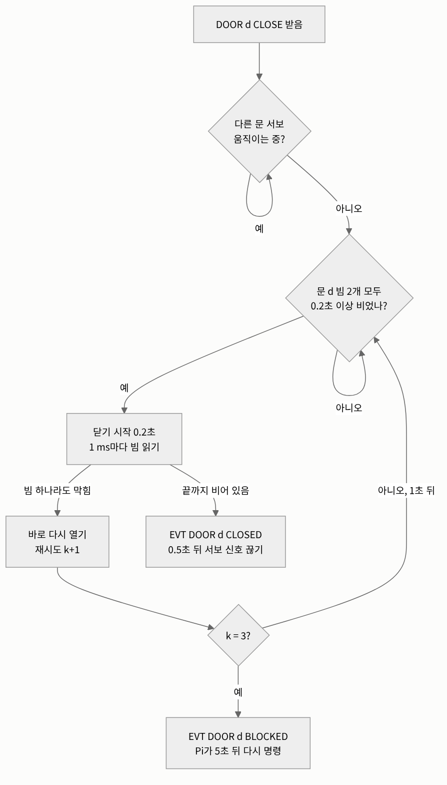
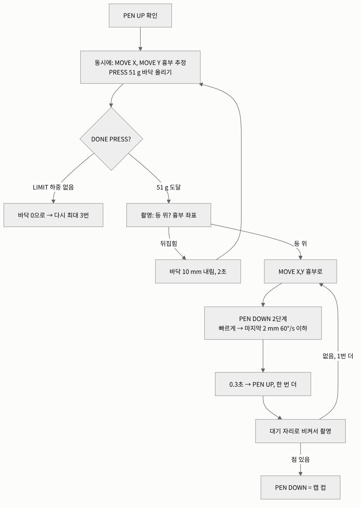

# 제어 알고리즘과 판단 정리 (D5e + 11/02 결정)

정리: 2026-11-06 · 이서현 (Claude, **CAP-AI-23**, 서현 확인 대기)
참고 구현(실행됨): `design/control_sim/trap_sim.py` — 여기 적은 알고리즘이 그대로 들어 있고 시나리오 19개를 통과한다.
흐름도 원본: `design/algo/*.mmd` → 그림 `design/img/algo/`
표기: [확실] / [가능성 높음] / [추측]. **★ = 서현 판단 필요**

## 0. 결론 먼저
- 제어는 **세 층**이다: ① UNO 2가 혼자 지키는 안전(문틈·서보 하나씩) ② UNO 1이 혼자 지키는 안전(펜 든 채로만 X·Y, Pi 침묵 때 멈춤·바닥 내림) ③ Pi가 하는 판단(누구인지, 무엇을 할지). Pi가 죽어도 ①②는 남는다 [확실 — 시나리오 S12b].
- 판단에 쓰는 숫자 12개 중 **실험 없이 정한 것이 9개**다 [확실]. 대부분 J6·행동 시험에서 바뀐다. 그중 서현이 정해야 할 것 4개를 7장에 모았다.

## 1. 전체 흐름



## 2. 알고리즘

### A1. 문 닫기 (UNO 2, 문마다) — 끼임 막기

```
on DOOR d CLOSE:
  wait until 다른 문 서보가 멈춤                # 서보 하나씩 (전류 1.9 A 안)
  repeat k = 1..3:
    wait until 빔 d_a, d_b 모두 0.2 s 이상 비어 있음
    닫기 시작 (0.2 s), 1 ms마다 빔 읽기
    if 빔 하나라도 막힘: 바로 다시 열기, "RETRY k", 1 s 쉬기, continue
    "CLOSED"; 0.5 s 뒤 서보 신호 끊기; return
  "BLOCKED"                                       # Pi가 5 s 뒤 다시 명령
```
근거: 빔 하나면 S8a·S8b 끼임, 빔 2개면 0 [확실 — 시뮬레이션]. MG90S 닫는 힘 22~44 N (S4 M7).

### A2. 빛 게이트 읽기 (UNO 2)
```
1 ms마다 9개 읽기; 같은 값 3번 연속이면 바뀐 것 → "EVT GATE n BLOCK|CLEAR ms"
SELFTEST: 송신 끔 → 9개 모두 LOW? → 송신 켬 → 모두 HIGH?  아니면 그 이름 보고
```
수신부가 죽으면 늘 '안 끊김'으로 읽혀 위험 → 켤 때 자가 시험으로 잡음 (S11b).

### A3. 장부 (Pi) — 누가 어디 있나
```
문마다 빔 2개: 처음 막힌 빔 = first, 마지막에 풀린 빔 = last
  first ≠ last → 지나감 (앞→뒤 = 정방향, 뒤→앞 = 역방향)
  first = last → 문틈에 들어왔다 되돌아감 (안 셈)
G1·G4·G6 하나짜리: 막힘→풀림 = 한 번 지나감
카메라 마릿수와 다르면 카메라를 믿고 장부를 고침, 기록
```
한계: 바짝 붙은 두 마리는 한 번으로 보일 수 있다 → 카메라가 최종 판단 (S3) [확실 — 시뮬레이션].

### A4. 누르기 + 찍기 (UNO 1 + Pi)

```
PEN UP → (동시에) MOVE X tx, MOVE Y ty, PRESS 51 g
  DONE PRESS LIMIT → 바닥 0, 다시 (≤ 3번)
촬영 → 등 위 & 흉부 확률 ≥ 0.6 ?
  아니면 바닥 10 mm 내림, 2 s, 다시 누르기 (≤ 3번) → 실패면 표식 없이 급이
MOVE X/Y 흉부 → PEN DOWN 2단계(빠르게 → 마지막 2 mm 60 °/s 이하) → 0.3 s → PEN UP  ×2
대기 자리로 비켜서 촬영 → 점 있으면 PEN DOWN(캡 컵), 없으면 1번 더 → 그래도 없으면 기록
```
UNO 1 안전: 펜이 내려가 있으면 `MOVE X/Y` 거절 (`ERR PEN_DOWN`).

### A5. 내보내기 — 방생 / 격리 (Pi)
```
방생: 위·아래 조명 끔, 출구 조명 켬, 방생 문 열기
격리: 바닥 0, 조명 끔(포획통 쪽이 밝음), 격리 문 열기
기다림: 장부(문 빔 → 출구 빔) 0 이고 카메라 0 → 문 닫기(A1)
  60 s: 출구 조명 깜빡  /  120 s: 알림  /  300 s(방생): 격리 문도 엶
```

### A6. 고장 (Pi + UNO)
```
Pi: 0.5 s마다 PING, 1.5 s 답 없으면 고장 → 문 그대로 → 그 장치 READY 기다림(120 s)
    → 돌아오면 다시 초기화(UNO 1이면 원점부터) → 마킹실 확인 후 이어서
    → 안 돌아오면 passthrough: 격리·입구 문 열고 멈춤 (상용 트랩처럼)
UNO 1: Pi 2 s 침묵 → 멈춤 → 펜 들기 → 바닥 10 mm 내림
UNO 2: Pi 2 s 침묵 → 닫던 문 다시 열기, 나머지 그대로
켤 때: 문 3개 먼저 닫기(원점 찾는 35 s 동안 못 들어오게) → 원점 → 마킹실 확인
```

### A7. 배터리 (Pi, 배터리 상자일 때)
```
0.5 s마다 INA226 → 남은 에너지 < 15 % 또는 부하 중 < 12.0 V → '부족'
처리 중이면 끝까지 → 조명 끔 → 격리 문 → 입구 문 열기 → Pi 끔 (UNO도 꺼짐)
```

## 3. 판단표 — 판별 결과 → 행동

| 카메라가 본 것 | 행동 | 근거 / 상태 |
|---|---|---|
| 마킹실 0마리 (10 s) | 입구 문 열어 둠, 장부 0 | 되돌아감·카메라 놓침 |
| 2마리 이상 | **둘 다 격리** | 한 번에 하나만 찍을 수 있음 |
| 등검은말벌 일벌, 표식 없음 | 누르기 → 찍기 → 급이 → 방생 | 기본 |
| 등검은말벌, 이미 표식 | 재방문 기록 → 급이 → 방생 | 다시 찍지 않음 |
| 등검은말벌 여왕벌 | 격리 | 놓아주면 새 둥지 위험 [가능성 높음] |
| **유럽말벌** | 지금: 격리 | ★ 11/02에 물은 것, 아직 답 없음 (격리 / 방생) |
| 2종 아님 또는 신뢰도 < 기준 | 격리 | 2종 분류기 (11/02 결정) — 꿀벌이면 갇혀 죽음 ★ |
| 방제 모드 | 모두 격리 | 모드 스위치 |

## 4. 숫자 (판단 기준값)

| 값 | 지금 | 정한 근거 | 바꾸는 시험 |
|---|---|---|---|
| 종 신뢰도 기준 | 0.6 | [추측] | 우리 사진으로 다시 학습한 뒤 (승준) |
| 여왕벌 구분 | 몸길이·흉부 폭 (크기) | [가능성 높음 — 여왕벌이 큼] | 표본 사진 ★ 기준 길이 |
| 흉부 확률 기준 | 0.6 | [추측] | J6 |
| 누르는 힘 | 51 g (0.5 N) | [확실 — D6] | 표본 |
| 자세 다시 시도 | 3번, 10 mm 내림, 2 s | [추측] | 행동 |
| 펜 닿는 시간 | 0.3 s ×2 | [추측] | 마킹 시험 |
| 급이·건조 | 60 s | [추측] | 샤피 건조 시험 |
| 문틈 빈 시간 | 0.2 s | [가능성 높음] | J6 |
| 문 재시도 | 3번, 1 s | [가능성 높음] | J6 |
| 나가기 기다림 | 60 / 120 / 300 s | [추측] | 행동 |
| 하트비트 | 0.5 s 보냄, 1.5 s 끊김 / UNO 감시 2 s | [가능성 높음] | J6 |
| 배터리 부족 | 15 % 또는 12.0 V | [가능성 높음] | 배터리 상자 |

## 5. 승준 AI와 나눈 것
- 서현 쪽(이 문서·회로 설계): `design/` 만 고침. 승준 쪽 제안: `control/` 펌웨어 UNO 1·2 나누기와 Pi 코드 (Issue #6). 인터페이스 정의서는 이번에 안 고침.

## 6. 검증
- 알고리즘은 `trap_sim.py`로 19개 시나리오 통과 + 빔 하나 비교 [확실 — 시뮬레이션]. 실물은 `미검증`.

## 7. ★ 서현 판단 필요
1. **유럽말벌**: 격리(지금) / 방생
2. **꿀벌 같은 다른 곤충**: 격리(지금, 죽음) / 방생(종이 틀리면 등검은말벌을 놓칠 위험) — 입구 크기로 얼마나 걸러지는지 먼저 봐도 됨
3. **여왕벌 기준 길이**: 표본으로 정할지 (승준 보유 7마리)
4. **배터리로 며칠**: 1박 2일(12 Ah) / 3일 이상(20 Ah)
