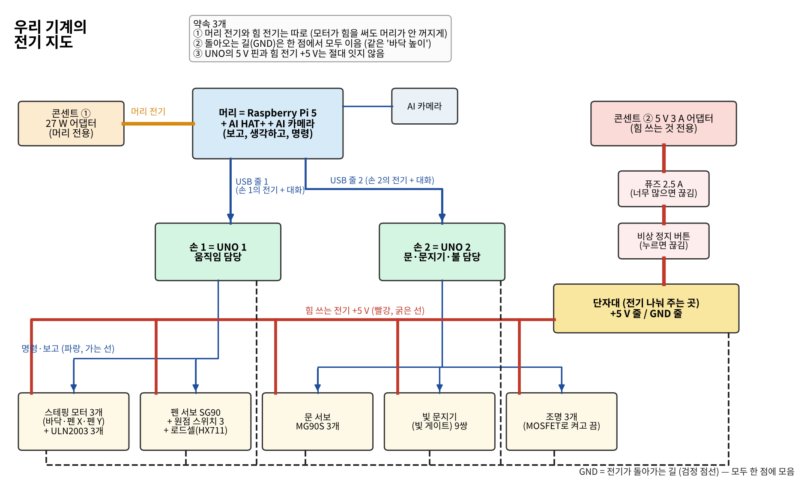
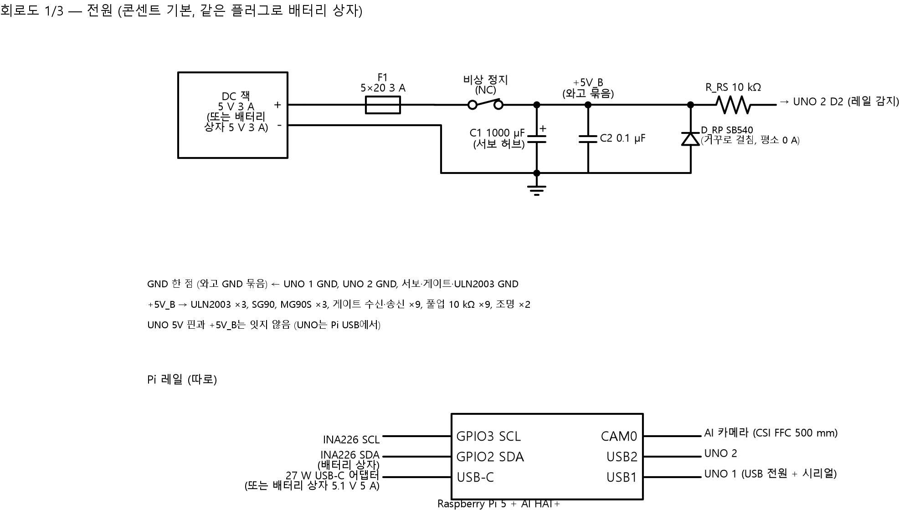
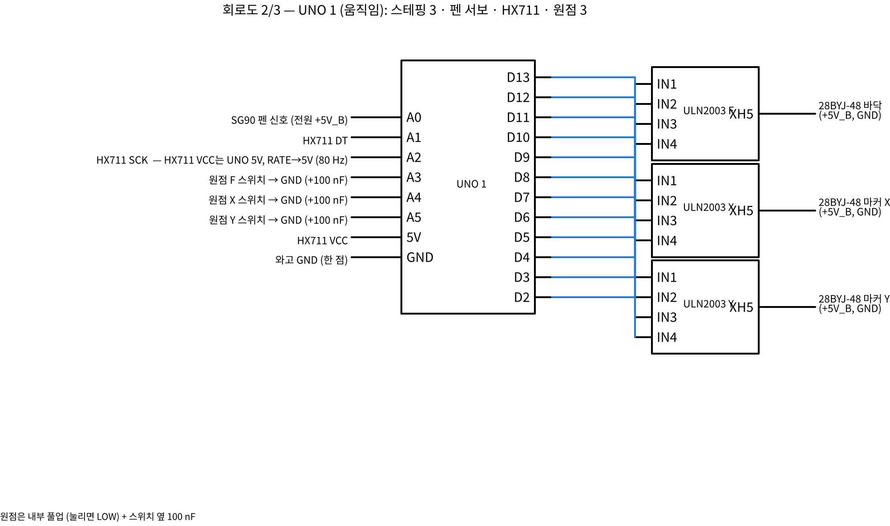
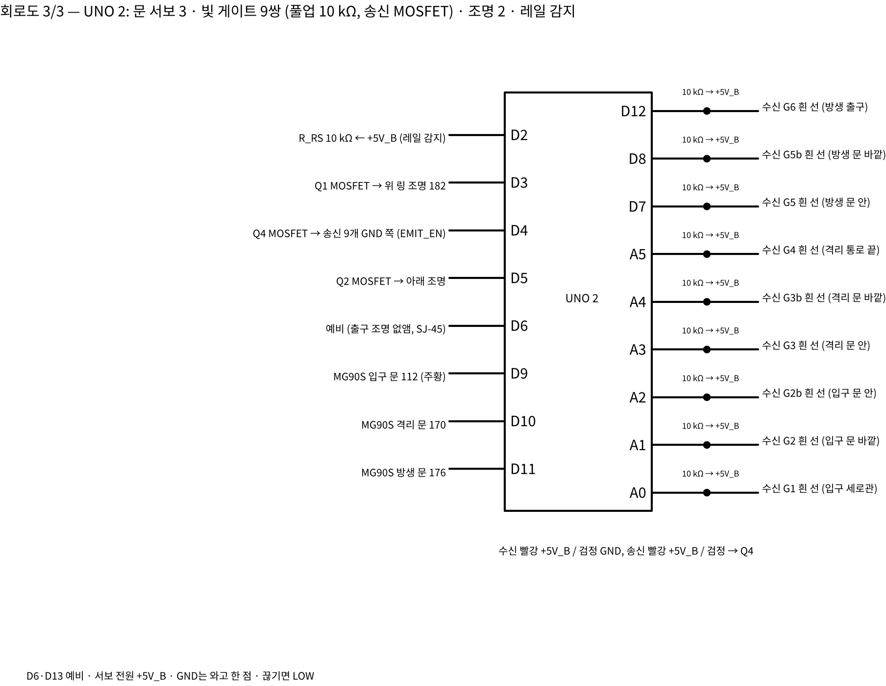

# 회로도 쉬운 설명 — 초등학생도 읽을 수 있게

정리: 2026-11-06 · 이서현 (Claude, **CAP-AI-29**) · 서현이 "회로도 내용을 모르겠어"라고 해서 만듦
자세한 것(전선 굵기, 핀 번호 표 전부): `design/2026-11-06_회로설계_서현.md` · 부품 목록: `design/2026-11-06_제어회로_부품_보유와_구매_서현.md`

---

## 1. 한 장으로 보기

우리 기계는 **머리 1개, 손 2개, 전기 길 2개**로 되어 있어요.
- **머리 = 라즈베리 파이 5** (+ AI 카메라). 보고, 생각하고, 손에게 명령해요.
- **손 1 = 아두이노 UNO 1.** 움직이는 것 담당: 바닥 올리기, 펜 옮기기, 펜 내리기, 누르는 힘 재기.
- **손 2 = 아두이노 UNO 2.** 문 3개, 빛 문지기 9쌍, 조명 3개 담당.
- **전기 길 ① (27 W 어댑터):** 머리 전용. 손 두 개도 머리에 꽂은 USB 줄로 전기를 받아요.
- **전기 길 ② (5 V 3 A 어댑터):** 힘 쓰는 것(모터, 서보, 문지기, 조명) 전용.

> **왜 길을 둘로 나눴나요?** 모터가 갑자기 힘을 쓰면 전기를 확 끌어가요. 머리와 같은 길을 쓰면 머리가 순간 정전돼서 꺼질 수 있어요. 그래서 길을 따로 만들었어요.

## 2. 전기를 '물'로 생각하기

| 전기 말 | 물로 바꾸면 | 우리 기계에서 |
|---|---|---|
| 전압 (V, 볼트) | 물탱크 높이 — 높을수록 세게 밀어요 | 5 V (모두 같은 높이) |
| 전류 (A, 암페어) | 관 속을 흐르는 물의 양 | 모터 하나 약 0.24 A, 전부 합쳐 최대 약 1.9 A |
| GND (그라운드) | 바닥 / 물이 돌아가는 길 | 모든 GND를 **한 점**에서 이어요 |
| 퓨즈 | 물이 너무 많이 흐르면 저절로 막히는 마개 | 2.5 A 넘으면 끊어짐 |
| 스위치 | 수도꼭지 | 비상 정지 버튼 |
| 저항 | 관을 좁게 만든 곳 | 10 kΩ (빛 문지기 신호용) |
| 커패시터 | 작은 물통 — 갑자기 물이 필요할 때 바로 줌 | 1000 µF (서보가 갑자기 움직일 때) |

**전기는 꼭 '한 바퀴'를 돌아야 일을 해요.** +5 V에서 나와서 부품을 지나 GND로 돌아가요. 그래서 GND 선이 빠지면 아무것도 안 움직여요. 그리고 **신호(명령)도 GND를 같이 써야** 서로 말이 통해요. 같은 바닥 높이에서 재야 키를 비교할 수 있는 것처럼요.

## 3. 회로도 기호 읽는 법

| 그림 | 뜻 |
|---|---|
| 선 ─ | 전선 |
| 검은 점 ● | 선끼리 이어진 곳 (점이 없이 지나가면 안 이어진 것) |
| 지그재그 ⩘ | 저항 |
| 두 판 ‖ (+ 표시가 있으면 방향 있음) | 커패시터 (+ 쪽을 +5 V로) |
| 땅에 꽂은 빗 ⏚ | GND |
| 동그라미 두 개와 비스듬한 막대 | 스위치 (NC = 평소에 붙어 있음, 누르면 떨어짐) |
| 네모 안 선 | 퓨즈 |
| 큰 네모 + 이름표 다리 | 부품(아두이노, ULN2003 같은 칩) — 다리 이름이 핀 이름 |

## 4. 회로도 1 — 전원 (전기 길)

**위쪽 (힘 쓰는 전기 길):** 어댑터 → **퓨즈** → **비상 정지 버튼** → **단자대**(전기를 나눠 주는 곳) → 모든 모터·서보·문지기·조명
- 단자대 옆 **큰 물통(1000 µF)과 작은 물통(0.1 µF)**: 서보가 갑자기 움직일 때 전압이 떨어지지 않게 해요.
- **10 kΩ → UNO 2 D2 (레일 감지)**: 손 2가 "힘 전기 들어왔나?"를 확인하는 선이에요. 비상 정지를 누르면 LOW가 돼서 손 2가 알아차려요.

**아래쪽 (머리 전기 길):** 27 W 어댑터 → 파이. 파이의 USB 1·2 → UNO 1·2, CAM0 → AI 카메라.
- INA226은 배터리로 쓸 때만 꽂는 '전기 계량기'예요 (배터리가 얼마나 남았나).

**절대 하면 안 되는 것:** UNO의 5V 핀과 힘 전기 +5 V를 잇기. 두 길이 섞이면 모터가 힘쓸 때 머리 쪽까지 흔들려요.

## 5. 회로도 2 — 손 1 (UNO 1: 움직임)

| UNO 1 다리 | 이어지는 곳 | 쉬운 설명 |
|---|---|---|
| D2~D5 | ULN2003 F → 바닥 모터 | 바닥 올리기·내리기 |
| D6~D9 | ULN2003 X → 펜 X 모터 | 펜 앞뒤 |
| D10~D13 | ULN2003 Y → 펜 Y 모터 | 펜 좌우 |
| A0 | 펜 서보 SG90 (주황 선) | 펜 들기·내리기 |
| A1, A2 | HX711 DT, SCK | 누르는 힘 읽기 |
| A3, A4, A5 | 원점 스위치 F, X, Y | "여기가 처음 자리" 알림 |

- **ULN2003은 '힘센 친구'예요.** 아두이노 다리는 약해서(최대 20 mA) 모터(약 240 mA)를 직접 못 돌려요. 아두이노가 ULN2003에게 "1번 켜!" 하고 작게 말하면, ULN2003이 힘 전기로 모터 코일을 켜요. 코일 4개를 차례로 켜면 모터가 한 칸씩 돌아요.
- **서보 선 3색:** 빨강 = +5 V(힘 전기), 갈색 = GND, 주황 = 신호("몇 도로 가!").
- **HX711은 '아주 작은 소리를 키우는 확성기'예요.** 로드셀(힘 재는 쇠붙이)은 눌리면 아주아주 작은 전기 변화(천분의 일 볼트보다 작음)를 내요. HX711이 그걸 크게 키워서 숫자로 바꿔 줘요. 조용해야 하니까 HX711만 **UNO의 5 V**(머리 쪽 전기)를 써요.
- **원점 스위치와 풀업:** 평소에는 아두이노 안의 저항이 다리를 HIGH(1)로 당겨 놓아요. 스위치가 눌리면 GND와 붙어서 LOW(0)가 돼요. "LOW = 눌림 = 처음 자리에 왔다." 옆의 100 nF는 스위치가 '따다닥' 튀는 걸 막아요.
- UNO 1은 **다리 18개를 모두** 써요. 남는 다리가 없어요.

## 6. 회로도 3 — 손 2 (UNO 2: 문·문지기·조명)

| UNO 2 다리 | 이어지는 곳 | 쉬운 설명 |
|---|---|---|
| A0 | G1 입구 세로관 | 누가 들어왔다 |
| A1 / A2 | G2 / G2b 입구 문 바깥·안 | 입구 문에 무엇이 있나 |
| A3 / A4 | G3 / G3b 격리 문 안·바깥 | 격리 문에 무엇이 있나 |
| A5 | G4 격리 통로 끝 | 격리됐다 |
| D7 / D8 | G5 / G5b 방생 문 안·바깥 | 방생 문에 무엇이 있나 |
| D12 | G6 방생 출구 | 나갔다 |
| D9, D10, D11 | 문 서보 입구·격리·방생 | 문 열기·닫기 |
| D3, D5, D6 | MOSFET → 조명 위·아래·출구 | 불 켜기 (밝기 조절도 가능) |
| D4 | MOSFET → 문지기 송신 9개 | 문지기 빛 켜고 끄기 (자가 시험) |
| D2 | 레일 감지 | 힘 전기 들어왔나 |
| D13 | 비어 있음 | 예비 |

- **빛 문지기(빛 게이트)는 '보이지 않는 줄'이에요.** 한쪽(송신)이 적외선을 쏘고 맞은편(수신)이 받아요. 말벌이 지나가 빛을 가리면 수신 선이 **LOW**가 돼요.
- **10 kΩ 풀업 9개:** 수신기는 "가려졌을 때만 GND로 당기는" 방식(열린 컬렉터)이에요. 그래서 평소에 HIGH로 잡아 줄 저항이 하나씩 필요해요.
- **MOSFET은 '전기 수도꼭지'예요.** 아두이노가 작은 신호를 주면 큰 전기(조명)를 켜고 꺼요.
- **송신 9개를 한꺼번에 끄는 이유 (자가 시험):** 켤 때 송신을 끄면 수신 9개가 모두 LOW가 되어야 정상이에요. 하나라도 HIGH면 그 문지기가 고장이에요. 다시 켜면 모두 HIGH여야 해요. 그래서 고장 난 문지기를 믿고 문을 닫는 일이 없어요.
- **문마다 문지기가 2개인 이유:** 문 앞과 뒤를 모두 지켜야, 말벌이 문틈에 머리만 넣고 있어도 알아차리고 문을 다시 열어요. (시뮬레이션: 1개면 끼임 2번, 2개면 0번)

## 7. 켜질 때 일어나는 순서
1. 27 W 어댑터를 꽂음 → 파이가 켜지고, USB로 UNO 1·2도 켜짐
2. 5 V 3 A 어댑터를 꽂음 → 힘 전기가 들어옴 → UNO 2가 D2로 확인
3. UNO 2: 문 3개를 **하나씩** 닫음 (서보는 한 번에 하나만 움직여요 — 전기를 한꺼번에 많이 쓰지 않으려고)
4. UNO 2: 문지기 자가 시험 (송신 끄고 → 모두 LOW? → 켜고 → 모두 HIGH?)
5. UNO 1: 바닥·X·Y를 원점 스위치까지 보내서 '처음 자리' 맞춤 (HOME)
6. 파이: "준비 완료" → 말벌을 기다림

## 8. 만들 때 순서 (한 번에 다 꽂지 말기)
1. **전기 길 ②만:** 어댑터 → 퓨즈 → 비상 정지 → 단자대. 테스터로 5.0 V 확인 → 비상 정지 누르면 0 V 확인
2. **UNO 2 + 문지기 1쌍:** 손으로 빛을 가려 LOW가 되는지 확인 → 송신 끄고 켜기 확인
3. **문 서보 1개:** 빛을 가린 채 '닫기' → 안 닫히는지, 닫는 중에 가리면 다시 열리는지 확인
4. **UNO 1 + ULN2003 1개 + 원점 스위치:** HOME → 나머지 축
5. **전부 연결:** 켤 때 전류 확인 (서보 하나씩이면 약 1.2 A)

## 9. 자주 하는 실수
- GND를 안 이음 → 신호가 이상하게 튐. **모든 GND는 단자대 한 점으로.**
- 서보 빨간 선을 UNO 5V에 꽂음 → UNO가 재부팅됨. **서보·모터는 꼭 힘 전기로.**
- 1000 µF를 거꾸로 꽂음 → 터질 수 있음. **긴 다리(+)를 +5 V로.**
- 빛 문지기 송신·수신을 바꿔 꽂음 → 항상 LOW. **송신은 선 2개, 수신은 선 3개.**
- 퓨즈 없이 시험 → 합선되면 어댑터·선이 뜨거워짐. **퓨즈를 먼저.**

## 10. 단어장
| 말 | 뜻 |
|---|---|
| 핀 / 다리 | 아두이노에 선을 꽂는 구멍 하나하나 |
| HIGH / LOW | 다리의 전압이 5 V(1) / 0 V(0) |
| 풀업 | 평소에 HIGH로 당겨 두는 저항 |
| 레일 | 같은 전압의 전기가 흐르는 큰 길 (+5V_B = 힘 전기 레일) |
| 넷리스트 | "무엇의 몇 번 다리가 무엇의 몇 번 다리와 이어지는지" 적은 표 (`design/circuit/out/netlist.csv`) |
| AWG | 전선 굵기 번호 — 숫자가 작을수록 굵음 (20 AWG 굵음, 28 AWG 가늚) |
| PWM | 빠르게 켰다 껐다 해서 밝기·각도를 조절하는 방법 |
