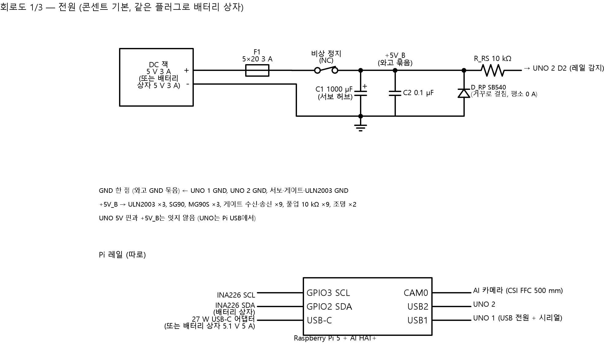
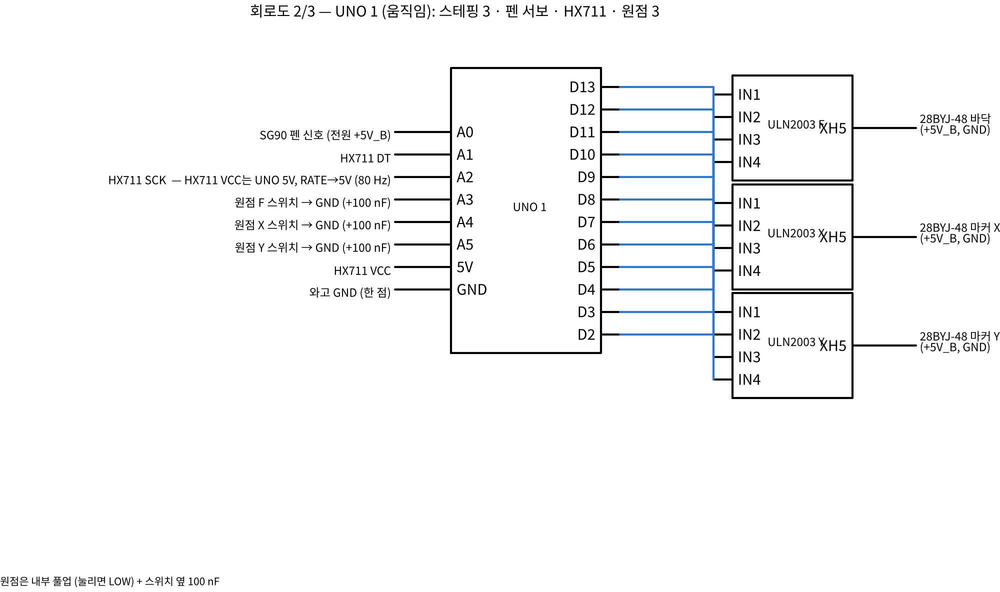
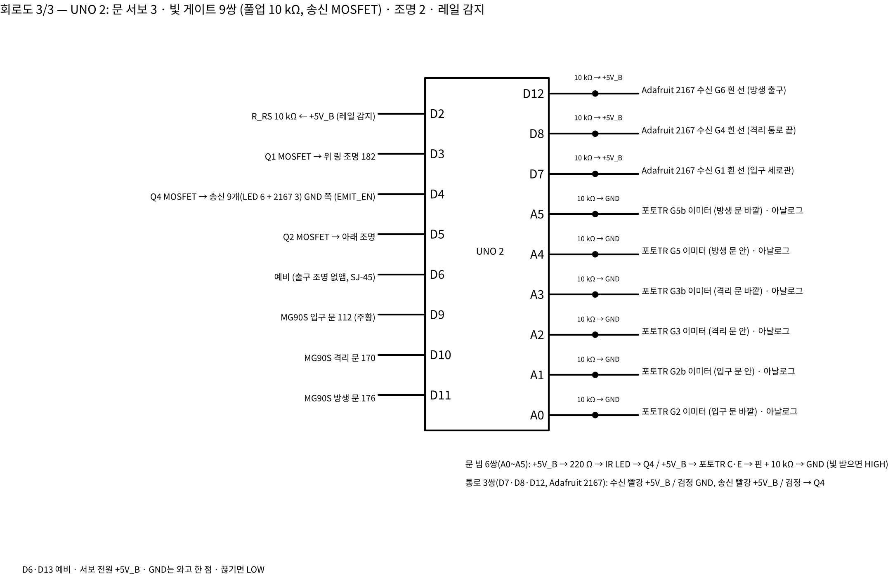

# 회로 설계 (D5e + 11/02 결정) — 회로도 3장, 넷리스트, 구매 목록

정리: 2026-11-06 · 이서현 (Claude, **CAP-AI-23**, 서현 자리 비운 동안 작성 → 서현 확인 대기)
코드: `design/circuit/circuit.py` — 연결을 한 곳(`NETS`)에 적고, 넷리스트·구매 목록·검사·회로도를 모두 여기서 만든다.
바탕: `design/2026-11-02_전기계통_제어순서_서현.md` (핀 4장, 전원 3·8장, 빛 게이트 9쌍 결정)
표기: [확실] 계산·사양 / [가능성 높음] / [추측]

## 0. 결론 먼저
- **11/06 저녁 바뀜 (CAP-AI-30):** 출구 조명·Q3 없앰 → UNO 2 D6 예비 (16/16), 단자대 → 와고 221 + 줄 퓨즈, 서보·게이트 허브 만능기판. 넷 58개. 판단 문서 10장.
- [확실 — 스크립트 검사] 넷 60개, 끝 211개. **UNO 1 핀 18개 모두**, **UNO 2 핀 17개**(D13만 예비)를 쓰고 겹치는 핀이 없다. 서보·게이트·풀업 전원은 모두 구동 레일(+5V_B)이고, UNO 5V 핀은 구동 레일에 안 이어진다.
- UNO 1은 **남는 핀이 없다** [확실]. 나중에 센서를 더 달려면 UNO 2 D13이나 Pi I2C(INA226과 같은 줄)를 써야 한다 → 서현 판단 필요 없음, 기록만.
- 아직 실물로 확인 못 한 것: MOSFET 모듈 실제 제품(핀 이름이 OUT−/TRIG가 아닐 수 있음), 조명 실제 전류, 보유 AI 카메라 케이블 길이 → `미검증`.

## 1. 회로도

- 구동 레일: DC 잭 → **퓨즈 T2.5A** → **비상 정지(NC)** → 단자대 +5V_B (1000 µF + 0.1 µF). GND는 단자대 한 점.
- Pi 레일은 따로 (27 W USB-C). 배터리 상자는 같은 플러그로 두 입력을 대신하고 INA226을 Pi I2C(GPIO2/3)에 꽂는다.

- D2~D13 → ULN2003 F·X·Y (IN1~4), A0 펜 서보 신호, A1/A2 HX711, A3~A5 원점 스위치(내부 풀업, 눌리면 LOW, 100 nF).
- HX711 전원은 UNO 5V(조용함), RATE 다리를 5 V로 → 80 Hz.

- 문 빔 6쌍(낱개 LED·포토TR) → A0~A5 아날로그 (10 kΩ → GND), 통로 3쌍(2167) → D7·D8·D12 (10 kΩ 풀업). 끊기면 LOW. (21시 바뀜)
- 송신 9개의 검정(GND) 선을 MOSFET Q4로 모아 D4가 켜고 끈다 (켤 때 자가 시험).
- 조명 Q1·Q2·Q3 ← D3·D5·D6 (PWM 가능), 문 서보 D9·D10·D11, 레일 감지 D2 (10 kΩ 직렬).

## 2. 넷리스트 (전체는 `design/circuit/out/netlist.csv`, 엑셀로 열림)

| 묶음 | 연결 | 선 |
|---|---|---|
| 구동 전원 | J_B+ → F1 → SW_E → TB +5V_B / J_B− → TB GND | 20 AWG |
| 스테핑 ×3 | U1 D2~D5/D6~D9/D10~D13 → ULN_F/X/Y IN1~4, ULN VCC·GND → 단자대, ULN → 모터 JST-XH 5핀 | 신호 26, 전원 22 AWG |
| 펜 서보 | U1 A0 → SG90 주황, 빨강 → +5V_B, 갈색 → GND | 26 AWG 실리콘 (움직임) |
| HX711 | U1 5V/GND → VCC/GND, A1 → DT, A2 → SCK, E+/E−/A−/A+ → 로드셀 빨강/검정/흰/초록 | 28 AWG 실리콘 (움직임) |
| 원점 ×3 | U1 A3/A4/A5 → 스위치 NO, COM → GND, 100 nF 병렬 | 28 AWG |
| 문 서보 ×3 | U2 D9/D10/D11 → MG90S 주황, 빨강 → +5V_B, 갈색 → GND | 26 AWG |
| 게이트 ×9 | U2 핀 ← 수신 흰 선 + 10 kΩ → +5V_B, 수신 빨강/검정 → +5V_B/GND, 송신 빨강 → +5V_B, 송신 검정 → Q4 OUT− | 28 AWG |
| 송신 켜기 | U2 D4 → Q4 TRIG, Q4 GND → GND | 24 AWG |
| 조명 ×3 | U2 D3/D5/D6 → Q1/Q2/Q3 TRIG, 조명 + → +5V_B, 조명 − → Q OUT− | 24 AWG |
| 레일 감지 | +5V_B → 10 kΩ → U2 D2 | 28 AWG |
| Pi | USB-C ← 27 W(또는 배터리 상자), USB1 → UNO 1, USB2 → UNO 2, CAM0 → AI 카메라 300 mm, GPIO2/3·3V3·GND → INA226(배터리일 때) | — |

빛 게이트 자리 (문판 앞·뒤 각 2 mm):

| 이름 | 자리 | 종류 | UNO 2 핀 |
|---|---|---|---|
| G2 / G2b | 입구 문 바깥 / 안 | 낱개 IR LED + 포토TR | A0 / A1 (아날로그) |
| G3 / G3b | 격리 문 안 / 바깥 | 낱개 | A2 / A3 (아날로그) |
| G5 / G5b | 방생 문 안 / 바깥 | 낱개 | A4 / A5 (아날로그) |
| G1 | 입구 세로관 | Adafruit 2167 | D7 |
| G4 | 격리 통로 끝 | Adafruit 2167 | D8 |
| G6 | 방생 출구 (목 위) | Adafruit 2167 | D12 |

**11/06 21시 바뀜 (CAP-AI-34):**
- 문 하우징 사이 틈이 5 mm라 Adafruit 2167 몸통(20 × 10 × 8)이 안 들어감 (승준 SJ-47) → 문 빔 6쌍은 **3 mm 적외선 LED + 3 mm 포토트랜지스터 낱개**
- 회로:
  - LED 쪽: +5V_B → 220 Ω → LED → Q4 (송신 켜기 공통)
  - 포토TR 쪽: +5V_B → 포토TR C, E → 핀 + 10 kΩ → GND (이미터 팔로어)
  - 빛을 받으면 HIGH, 끊기면 LOW — 2167과 같은 방향
- 포토TR 출력은 0/5 V로 딱 떨어지지 않음 → **아날로그로 읽음**. 문턱값 = (송신 켬 값 + 끔 값) / 2를 켤 때 자가 시험으로 정함. 차이가 200(약 1 V)보다 작으면 고장(햇빛이 들거나 방향이 틀림)
- 그래서 문 빔을 A0~A5로, 통로 2167을 D7·D8·D12로 옮김 → **펌웨어 핀 표 바뀜 (승준)**

## 3. 구매 목록 (`design/circuit/out/bom.csv`) — 보유분은 승준 구매장부와 대조

| 부품 | 수량 | 쓰는 곳 | 상태 |
|---|---|---|---|
| Arduino UNO R3 | 2 | UNO 1·2 | 보유 |
| Raspberry Pi 5 + AI HAT+ + AI 카메라 | 1 | 판단 | 보유 |
| Pi 5 카메라 케이블 22↔15핀 300 mm | 1 | Pi 위판 아래 | 확인 (동봉 길이) |
| 28BYJ-48 + ULN2003 | 3 | F·X·Y | 구매 목록 |
| SG90 / MG90S | 1 / 3 | 펜 / 문 | 보유 / 구매 목록 |
| HX711 + 로드셀 (1 kg 버튼형) | 1 | 누르는 힘 — D5f(11/06)에서 로드셀이 캐리지 아래 컵으로 옮김 | **살 것** (구매목록 D2 — 전에 보유로 잘못 적음, 11/06 고침) |
| 마이크로 스위치 KW11-3Z (레버형, 승준 SJ-38 라이브러리) | 3 | 원점 | **추가** |
| 빛 게이트 Adafruit 2167 | 3 | 통로 G1·G4·G6 | **살 것 3 (+1)** |
| 적외선 LED 3 mm 940 nm / 포토트랜지스터 3 mm 940 nm(검은 몸통) / 220 Ω | 6 / 6 / 6 | 문 빔 6쌍 (21시) | 살 것 (+4 예비씩), 220 Ω는 키트 |
| 로직 레벨 MOSFET 모듈 | **3** | 조명 2 (위·아래) + 송신 1 — 출구 조명 없앰 (SJ-45) | 살 것 |
| 10 kΩ / 100 nF / 1000 µF | 10 / 4 / 1 | 풀업·감지 / 원점·단자대 / 서보 옆 | **추가** |
| 5 V 3 A 어댑터 + DC 잭 | 1 | 구동 레일 | 구매 목록 G2 |
| 줄 퓨즈 홀더 + T2.5A, 비상 정지(NC) | 각 1 | 구동 레일 | 살 것 |
| 와고 221-415 (5구) | 5 | 단자대 대신 (+5 V 2개, GND 3개) — SJ-43 채택 | 살 것 |
| 만능기판 소형 2 + 핀 헤더 | — | 서보 허브·게이트 허브 (풀업 9개) | 살 것 |
| 실리콘 연선·연장 커넥터 | — | 약 44 m | **추가** |
| Pi 5 RTC 배터리 (공식 충전식, J5 BAT) | 1 | 날짜 유지 → 여왕벌 계절 규칙 (11/06) | **추가** |
| (선택) 배터리 상자 — **LiFePO4 12.8 V 20 Ah** (2일, 11/06 결정) | 1 | 배터리 운용 | 현장 시험 날짜 보고 |

## 4. 만들 때 순서 (J6 시험과 맞춤)
1. 구동 레일만 먼저: 퓨즈·비상 정지·단자대 → 전압 5.0 V 확인 → 비상 정지 눌러 0 V 확인.
2. UNO 2 + 게이트 1쌍: 손으로 빔 끊어 LOW 확인 → 송신 MOSFET 끄면 LOW, 켜면 HIGH (자가 시험).
3. 문 서보 1개: 빔 막고 닫기 명령 → 안 닫히는지, 닫는 중 막으면 다시 열리는지.
4. UNO 1 + ULN2003 1개 + 원점 → HOME → 나머지 축.
5. 전부 연결 후 켤 때 전류 확인 (서보 하나씩이면 1.2 A 안팎 [가능성 높음]).

## 5. 서현 판단 필요
- 없음 (11/02 결정 그대로). 실물 MOSFET 모듈이 정해지면 핀 이름만 맞춘다 (승준 구매).
