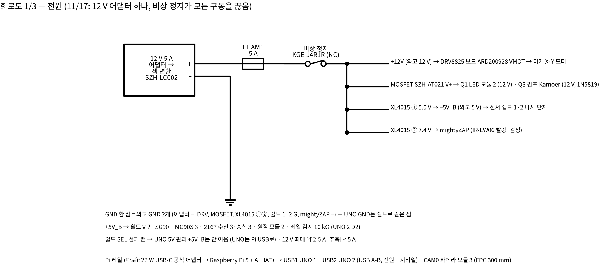
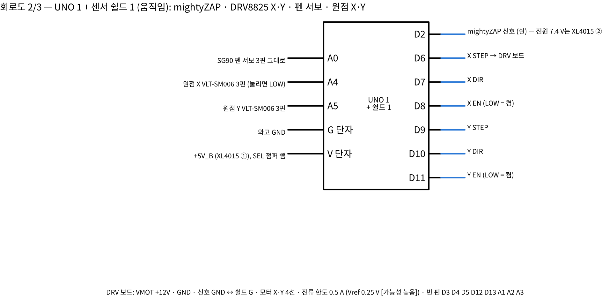
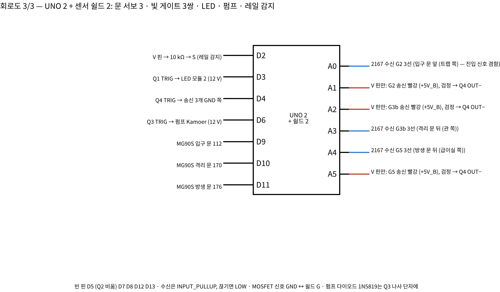

# 회로·배선표 11/17 판 — 12 V 하나 · 센서 쉴드 · DRV8825 · mightyZAP · 빛 게이트 3쌍

정리: 서현 (Claude, CAP-AI-62) · 2026-11-17. 11/06 회로설계·하네스표(`design/2026-11-06_회로설계_서현.md`·`_하네스표_`)를 **이것으로 바꾼다** (그 문서는 그날 기록으로 둠).
코드: `design/circuit/circuit.py` (연결 한 곳 + 검사 + 그림), `design/circuit/harness.py` (선마다 길이). 결과: `design/circuit/out/netlist.csv`·`bom.csv`·`harness.csv`·`harness_table.md`.

## 1. 결론
- [확실 — 검사] 넷 41개, 끝 132개, **검사 통과**: UNO 핀 겹침 없음, 쓴 핀 = 계획 (UNO 1 10개 · UNO 2 10개), 5 V 부하는 모두 +5V_B, 12 V 부하는 모두 비상 정지 뒤, 7.4 V는 mightyZAP만, 5 V 부품이 12 V에 안 붙음, UNO 5V ↔ +5V_B 안 이음, 잭 → 퓨즈 → 비상 정지 순서.
- [확실 — 계산] 배선 31묶음 59가닥. 자를 연선 **22 AWG 5.7 m** + LED·펌프·mightyZAP 연장 약 2.5 m = 빨강·검정 각 약 4.1 m (빨강·검정 10 m 롤로 충분). 기본 선으로 모자라 듀폰·서보 연장이 필요한 묶음 20개 (아래 3장).
- (11/17 15시 서현 '필요한 거 다 사고 엑셀에') **엑셀에 넣음** — 디바이스마트, 값은 상품 페이지 11/17 [확실]:
  1. 전선 UL1007 AWG22 빨강 10M (13003199) · 검정 10M (13003197) 각 4,180원 — 20 AWG는 30 m 롤(26,070원)뿐이라 전원 줄을 모두 22 AWG로 (가장 센 줄 약 3 A, 강하 0.14 V [가능성 높음 — 짧은 줄])
  2. 쇼트키 다이오드 1N5819 (27) 44원 × 40 — 펌프 역기전력. MOSFET Q3 나사 단자에 펌프 선과 같이 조임 (SZH-AT021에 다이오드가 없어 보임 [가능성 높음 — CAD 부품 표]). 수량 칸 기본 40 = 최소 구매 수량으로 보임 [가능성 높음]
  3. 전해 25 V 100 µF (29527) 44원 × 40 — DRV8825 VMOT 옆 (보드 ARD200928에 있으면 안 씀)
- [가능성 높음] 카메라 FPC 300 mm는 **빠듯** (맨해튼 201 mm + 여유) — 곧게 두르면 됨, 꺾어 돌리면 모자랄 수 있음.
- UNO 1 펌웨어 trap_motion **v0.3** (같은 날 15시): 아래 핀으로 STEP·DIR·EN, 400 걸음/mm — 시뮬 sim_motion 92/92, Pi 시험 37/37·55/55.

## 2. 그림과 핀

| UNO | 핀 | 꽂는 것 (센서 쉴드 3핀 G·V·S) |
|---|---|---|
| 1 | D2 | mightyZAP 신호 (IR-EW06 흰) — V·G는 XL4015 ② 7.4 V |
| 1 | D6 · D7 · D8 | X STEP · DIR · EN → ARD200928 (서현 11/17 13시) |
| 1 | D9 · D10 · D11 | Y STEP · DIR · EN |
| 1 | A0 | 펜 서보 SG90 (3핀 그대로) |
| 1 | A4 · A5 | 원점 X · Y (VLT-SM006 3핀, 눌리면 LOW [받고 확인]) |
| 2 | D2 | 레일 감지: 같은 줄 V → 10 kΩ → S (비상 정지 누르면 +5V_B 꺼짐 → LOW) |
| 2 | D3 · D4 · D6 | MOSFET Q1 LED 2 · Q4 송신 3 · Q3 펌프 (Q2·D5 비움) |
| 2 | D9 · D10 · D11 | 문 서보 112 · 170 · 176 |
| 2 | A0 · A3 · A4 | 빛 게이트 수신 G2 · G3b · G5 (내부 풀업) |
| 2 | A1 · A2 · A5 의 **V 핀만** | 송신 빨강 G2 · G3b · G5 (+5V_B). 송신 검정 3개 → Q4 OUT− [AI 판단 — 와고에 가는 선을 안 넣으려고] |

비는 핀: UNO 1 D3 D4 D5 D12 D13 A1 A2 A3 · UNO 2 D5 D7 D8 D12 D13 (A1 A2 A5는 신호 핀만 빔).
와고: 12 V 1개 5구 **꽉 참** (비상 정지·DRV·MOSFET·XL4015 ①②), GND 2개 10구 꽉 참 (다리 포함), 5 V 1개 3/5, 예비 1개.

## 3. 배선표 (harness.py 결과 그대로)
길이: 1.2 × 맨해튼 + 60 (+ 움직이는 끝 1.5 × 움직임 + 40), 자를 때 + 10 %. 좌표는 D5g_full 부품 가운데 [확실 — 모델], LED 모듈 자리·기본 선 길이 일부 [추측].

| 번호 | 어디 → 어디 | 선 (색·굵기) | 시작 핀 → 끝 핀 | 길이 | 양 끝 | 움직임 |
|---|---|---|---|---|---|---|
| P01 | 잭 변환 + → 퓨즈 FHAM1 | 12 V (빨강, 22 AWG) | SZH-LC002 + → FHAM1 1 | 자름 100 mm | 나사 단자 (벗겨 조임) / 나사 단자 (벗겨 조임) (선 달린 꼴이면 그 선) |  |
| P02 | 퓨즈 → 비상 정지 NC | 12 V 퓨즈 뒤 (빨강, 22 AWG) | FHAM1 2 → NC 1 | 자름 490 mm | 나사 단자 (벗겨 조임) / 비상 정지 나사 단자 |  |
| P03 | 비상 정지 → 와고 12 V | +12V (빨강, 22 AWG) | NC 2 → 와고 12 V | 자름 400 mm | 비상 정지 나사 단자 / 와고 221-415 (8 mm 벗김) |  |
| P04 | 잭 변환 − → 와고 GND | GND (검정, 22 AWG) | SZH-LC002 − → 와고 GND | 자름 180 mm | 나사 단자 (벗겨 조임) / 와고 221-415 (8 mm 벗김) |  |
| P05 | 와고 → DRV8825 보드 VMOT (갠트리 위로) | +12V (빨강, 22 AWG) GND (검정, 22 AWG) | 와고 12 V → VMOT 와고 GND → GND | 자름 520 mm | 와고 221-415 (8 mm 벗김) / 나사 단자 (벗겨 조임) |  |
| P06 | 와고 → MOSFET 보드 V+ | +12V (빨강, 22 AWG) GND (검정, 22 AWG) | 와고 12 V → V+ 와고 GND → GND | 자름 350 mm | 와고 221-415 (8 mm 벗김) / 나사 단자 (벗겨 조임) |  |
| P07 | 와고 → XL4015 ① 입력 | +12V (빨강, 22 AWG) GND (검정, 22 AWG) | 와고 12 V → IN+ 와고 GND → IN− | 자름 280 mm | 와고 221-415 (8 mm 벗김) / 나사 단자 (벗겨 조임) |  |
| P08 | 와고 → XL4015 ② 입력 | +12V (빨강, 22 AWG) GND (검정, 22 AWG) | 와고 12 V → IN+ 와고 GND → IN− | 자름 330 mm | 와고 221-415 (8 mm 벗김) / 나사 단자 (벗겨 조임) |  |
| P09 | XL4015 ① 출력 → 와고 5 V | +5V_B (빨강, 22 AWG) GND (검정, 22 AWG) | OUT+ → 와고 5 V OUT− → 와고 GND | 자름 280 mm | 나사 단자 (벗겨 조임) / 와고 221-415 (8 mm 벗김) |  |
| P10 | 와고 5 V → 센서 쉴드 1 나사 단자 | +5V_B (빨강, 22 AWG) GND (검정, 22 AWG) | 와고 5 V → 쉴드 1 V 와고 GND → 쉴드 1 G | 자름 230 mm | 와고 221-415 (8 mm 벗김) / 나사 단자 (벗겨 조임) |  |
| P11 | 와고 5 V → 센서 쉴드 2 나사 단자 | +5V_B (빨강, 22 AWG) GND (검정, 22 AWG) | 와고 5 V → 쉴드 2 V 와고 GND → 쉴드 2 G | 자름 280 mm | 와고 221-415 (8 mm 벗김) / 나사 단자 (벗겨 조임) |  |
| P12 | XL4015 ② 출력 → mightyZAP 전원 (IR-EW06 빨강·검정 + 연장) | +7V4 (빨강, 22 AWG) GND (검정, 22 AWG) | OUT+ → IR-EW06 빨강 OUT− → IR-EW06 검정 | 기본 200 + 연장 90 | 나사 단자 (벗겨 조임) / IR-EW06 (mightyZAP에 꽂음) |  |
| S01 | 쉴드 1 D2 → mightyZAP 신호 (IR-EW06 흰 + 연장) | PWM (흰, 26 AWG) | D2 S → IR-EW06 흰 | 기본 200 + 연장 200 | 듀폰 암 (쉴드 핀) / IR-EW06 |  |
| S02 | 쉴드 1 → DRV 보드 (STEP·DIR·EN ×2 + GND) | X STEP (파랑, 26 AWG) X DIR (초록, 26 AWG) X EN (노랑, 26 AWG) Y STEP (파랑, 26 AWG) Y DIR (초록, 26 AWG) Y EN (노랑, 26 AWG) GND (검정, 26 AWG) | D6 S → X STEP D7 S → X DIR D8 S → X EN D9 S → Y STEP D10 S → Y DIR D11 S → Y EN 아무 G → 보드 GND | 기본 200 + 연장 360 | 듀폰 암 (쉴드 핀) / 듀폰 암 (보드 헤더) [받고 확인] |  |
| M01 | DRV 보드 → X 모터 215 (모터 4선) | 모터 4선 (모터 선 색, 26 AWG) | X A1 A2 B1 B2 → 모터 | 기본 300 + 연장 160 | 나사 단자 (벗겨 조임) / 헤더 [받고 확인] / 모터 (기본) |  |
| M02 | DRV 보드 → Y 모터 209 (X 캐리지와 움직임) | 모터 4선 (모터 선 색, 26 AWG) | Y A1 A2 B1 B2 → 모터 | 기본 300 + 연장 50 | 나사 단자 (벗겨 조임) / 헤더 [받고 확인] / 모터 (기본) | 휨 고리 |
| V01 | 쉴드 1 A0 → 펜 서보 SG90 205 (X·Y로 움직임) | 서보 3선 (갈색 G·빨강 V·주황 S, 26 AWG) | A0 줄 → 서보 | 기본 250 + 연장 510 | 서보 3핀 그대로 / 서보 (기본) | 휨 고리 |
| S03 | 쉴드 1 A4 → 원점 X 모듈 VLT-SM006 | 3선 (검정 G·빨강 V·노랑 S, 26 AWG) | A4 줄 → 모듈 G V S | 기본 200 + 연장 360 | 듀폰 암 (쉴드 핀) / 듀폰 암 (모듈 헤더) |  |
| S04 | 쉴드 1 A5 → 원점 Y 모듈 (X 캐리지와 움직임) | 3선 (검정 G·빨강 V·노랑 S, 26 AWG) | A5 줄 → 모듈 G V S | 기본 200 + 연장 480 | 듀폰 암 (쉴드 핀) / 듀폰 암 (모듈 헤더) | 휨 고리 |
| V02 | 쉴드 2 D9 → 입구 문 서보 112 | 서보 3선 (갈색·빨강·주황, 26 AWG) | D9 줄 → 서보 | 기본 250 + 연장 30 | 서보 3핀 그대로 / 서보 (기본) |  |
| V03 | 쉴드 2 D10 → 격리 문 서보 170 | 서보 3선 (갈색·빨강·주황, 26 AWG) | D10 줄 → 서보 | 기본 250 + 연장 120 | 서보 3핀 그대로 / 서보 (기본) |  |
| V04 | 쉴드 2 D11 → 방생 문 서보 176 | 서보 3선 (갈색·빨강·주황, 26 AWG) | D11 줄 → 서보 | 기본 250 + 연장 160 | 서보 3핀 그대로 / 서보 (기본) |  |
| G01 | 쉴드 2 → 빛 게이트 G2 (수신 3선 → A0 줄, 송신 빨강 → A1 V) | 수신 신호 (흰, 28 AWG) 수신 +5V (빨강, 28 AWG) 수신 GND (검정, 28 AWG) 송신 +5V (빨강, 28 AWG) | A0 S → 수신 흰 A0 V → 수신 빨강 A0 G → 수신 검정 A1 V → 송신 빨강 | 기본 230 + 연장 90 | 듀폰 암 (쉴드 핀) / 2167 선 끝 헤더 + 듀폰 연장 |  |
| G02 | 쉴드 2 → 빛 게이트 G3b (수신 3선 → A3 줄, 송신 빨강 → A2 V) | 수신 신호 (흰, 28 AWG) 수신 +5V (빨강, 28 AWG) 수신 GND (검정, 28 AWG) 송신 +5V (빨강, 28 AWG) | A3 S → 수신 흰 A3 V → 수신 빨강 A3 G → 수신 검정 A2 V → 송신 빨강 | 기본 230 + 연장 130 | 듀폰 암 (쉴드 핀) / 2167 선 끝 헤더 + 듀폰 연장 |  |
| G03 | 쉴드 2 → 빛 게이트 G5 (수신 3선 → A4 줄, 송신 빨강 → A5 V) | 수신 신호 (흰, 28 AWG) 수신 +5V (빨강, 28 AWG) 수신 GND (검정, 28 AWG) 송신 +5V (빨강, 28 AWG) | A4 S → 수신 흰 A4 V → 수신 빨강 A4 G → 수신 검정 A5 V → 송신 빨강 | 기본 230 + 연장 210 | 듀폰 암 (쉴드 핀) / 2167 선 끝 헤더 + 듀폰 연장 |  |
| G04 | 빛 게이트 G2 송신 검정 → MOSFET Q4 OUT− | 송신 GND(켜기) (검정, 28 AWG) | 송신 검정 → Q4 OUT− | 기본 230 + 연장 230 | 2167 선 끝 헤더 + 듀폰 연장 / 나사 단자 (벗겨 조임) (수 핀 3개 함께) [AI 판단] |  |
| G05 | 빛 게이트 G3b 송신 검정 → MOSFET Q4 OUT− | 송신 GND(켜기) (검정, 28 AWG) | 송신 검정 → Q4 OUT− | 기본 230 + 연장 260 | 2167 선 끝 헤더 + 듀폰 연장 / 나사 단자 (벗겨 조임) (수 핀 3개 함께) [AI 판단] |  |
| G06 | 빛 게이트 G5 송신 검정 → MOSFET Q4 OUT− | 송신 GND(켜기) (검정, 28 AWG) | 송신 검정 → Q4 OUT− | 기본 230 + 연장 350 | 2167 선 끝 헤더 + 듀폰 연장 / 나사 단자 (벗겨 조임) (수 핀 3개 함께) [AI 판단] |  |
| S05 | 쉴드 2 D3·D4·D6 → MOSFET TRIG (Q1 LED·Q4 송신·Q3 펌프) + GND | Q1 (노랑, 26 AWG) Q4 (보라, 26 AWG) Q3 (주황, 26 AWG) GND (검정, 26 AWG) | D3 S → Q1 TRIG D4 S → Q4 TRIG D6 S → Q3 TRIG 아무 G → 신호 GND | 기본 200 + 연장 20 | 듀폰 암 (쉴드 핀) / 듀폰 암 (보드 핀) |  |
| L01 | MOSFET Q1 → LED 3구 모듈 2개 (카메라 판 양옆) | +12V (빨강, 24 AWG) Q1 OUT− (검정, 24 AWG) | Q1 OUT+ → 모듈 빨강 ×2 Q1 OUT− → 모듈 검정 ×2 | 기본 150 + 연장 620 | 나사 단자 (벗겨 조임) (모듈 2개 선을 2가닥씩 함께) / 모듈 선 + 연장 — 이음은 모듈 선 끝을 보고 정함 [받고 확인] |  |
| L02 | MOSFET Q3 → 펌프 Kamoer 144p (프레임 +y 밖, 1N5819는 Q3 단자에) | +12V (빨강, 22 AWG) Q3 OUT− (검정, 22 AWG) | Q3 OUT+ → 펌프 + Q3 OUT− → 펌프 − | 기본 100 + 연장 540 | 나사 단자 (벗겨 조임) / 펌프 단자 [받고 확인] |  |

**사서 쓰는 케이블 길이 확인** (경로 1.2 × 맨해튼 + 60, + 10 %)

| 케이블 | 필요 | 있음(산 것) | 판단 |
|---|---|---|---|
| Pi USB → UNO 1 (USB A–B) | 630 mm | 1000 mm | 충분 |
| Pi USB → UNO 2 (USB A–B) | 670 mm | 1000 mm | 충분 |
| Pi CAM0 → 카메라 모듈 3 (FPC 22P↔15P) | 340 mm | 300 mm | 빠듯 (곧게 두르면 됨) |

## 4. 받고 확인할 것 (값이 바뀌면 circuit.py·harness.py만 고치고 다시 돌림)
- 센서 쉴드: SEL 점퍼를 빼면 V 핀이 나사 단자 전원으로만 가는지, 나사 단자 G = UNO GND인지
- MOSFET SZH-AT021: OUT+ 단자 = V+인지, 다이오드 있는지, 신호 GND 핀
- ARD200928: 헤더 이름 (EN·STEP·DIR·GND), 마이크로스텝 점퍼, VMOT 콘덴서 유무
- VLT-SM006: 눌렀을 때 S가 LOW인지 (HIGH면 펌웨어에서 뒤집음)
- 2167 선 끝 모양 (헤더 수 핀이면 듀폰 암으로 연장), LED 모듈·펌프 선 끝, FHAM1 선 달린 꼴인지
